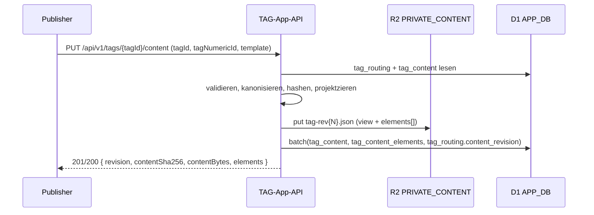

# Refinement: TAG-App-API – Upload eines TAG-Content-Templates

**Status:** unverbindliches Refinement (Rev. 6: App-Nachzug und Element-Schema)
**Revision:** 6
**Stand:** 2026-11-20
**Geltungsbereich:** `apps/tag-app` (Worker `app-api`, D1 `database/0002_tag_content.sql`, R2 `PRIVATE_CONTENT`), Consumer TAG Control Center/TCP und TAG-Content-Designer
**Verbindlichkeit:** gemäß [`../README.md`](../README.md) ausdrücklich **keine** Anforderung, kein Contract und keine Umsetzungsgrundlage

**Historie:** Revision 1 beschreibt erstmals einen **schreibenden** Content-Pfad: ein TAG-Content-Template (JSON, `myqr24-tag-content-template-v1`) wird zu einer TAG-ID hochgeladen, serverseitig validiert und projektziert, und strukturiert in D1 (`tag_content`, `tag_content_elements`) plus R2 (Tag-/Element-JSON) abgelegt.

**Revision 2 (Element-Docs entfallen, Vollprojektion):** Zwei Korrekturen aus der Diskussion. Erstens: Die Projektion wird **nicht** mehr an den heute bekannten App-Blöcken ausgerichtet – jedes Element wird abgebildet (`D-11`). Zweitens: Die **Element-Dokumente in R2 entfallen**; ihre Nutzlast wandert in das Tag-Dokument. Pro Publish entsteht damit genau **ein** R2-Objekt, während `tag_content_elements` als revisionsgekoppelte Strukturprojektion und FK-Ziel der Item-Zuordnung erhalten bleibt (`D-14`).

**Revision 3 (lokal umgesetzt):** Der Endpunkt ist implementiert (`workers/tag-content/*`, Route in `app-api.ts`, 31 neue Tests). Beim Bauen zeigte sich eine notwendige Präzisierung: Die Revision steht **im** Dokument, deshalb kann der Dokument-Hash bei identischem Inhalt nie gleich bleiben. Die Idempotenz vergleicht daher einen **Inhalts-Hash mit der gespeicherten Revision** (§5.1, §8.4, `D-05`). Der Lese-Pfad bevorzugte zunächst `elements[]` und hatte bis Revision 5/6 einen Elementdatei-Fallback; dieser ist jetzt entfernt.

**Revision 4 (Löschschutz und Definition lesen):** Ein Element mit Inhalten darf **nicht** verschwinden (`D-13`): Der Publish lehnt das Update mit `409 elements_in_use` ab, bevor irgendetwas geschrieben wird; die DELETE-Anweisung trägt zusätzlich `NOT EXISTS`, damit ein `ON DELETE CASCADE` keine Items mehr mitreißen kann. Elemente ohne Inhalte dürfen entfallen, neue dürfen hinzukommen, ein geänderter Anzeigename ist ein Upsert. Dazu ein Lese-Endpunkt `GET /api/v1/tags/{tagId}/content/document`, der das veröffentlichte Dokument **byte-identisch** zurückgibt (`ETag`, `X-Content-Revision`), und die ausdrückliche Invariante „Revision im JSON = `tag_content.content_revision` = `tag_routing.content_revision`" (`D-15`, `D-16`).

**Revision 5/6 (Schemafreigabe und App-Projektion):** Migration `0003` entfernt die vier obsoleten Datei-Spalten aus `tag_content_elements`; beide Tabellen der zusammengesetzten FK-Beziehung werden gemeinsam neu erstellt, kopiert und mit aktiven Fremdschlüsseln geprüft. Die Content-Route verlangt `elements[]` im Tag-Dokument, Seed und Publish schreiben keine Elementdateien. Die App rendert strukturierte RichText-/Tabellen, die neuen Blocktypen, Theme, responsive Placement/Spans und Slot-Platzhalter fail-soft. `placement` wird validiert und in `view.vault.blocks[]` weitergereicht. Der frühere Staging-Upload-Sonderweg wurde entfernt; eine spätere Upload-UI ist an `gallery.actions.upload` zu binden und bedarf einer serverseitigen Upload-API.

**Revision 7 (Dev-/Staging-Reset):** Die `_v3`-Tabellen in Migration `0003` waren ausschließlich temporäre Tabellen und wurden bereits dort in die kanonischen Namen zurückbenannt. Weil lokale und Staging-Daten entbehrlich sind, ergänzt Migration `0004_tag_app_development_reset.sql` einen absichtlich destruktiven Reset aller Access-, Routing-, TAG-Content-, Range- und Global-Zeilen; das Schema selbst bleibt unverändert. R2 wird nicht von einer D1-Migration gelöscht. Staging wurde anhand der Cloudflare-Ressourcenliste auf `myqr24-stg-db` und `myqr24-stg-blob` abgeglichen; alle vier D1-Migrationen sind dort angewendet. R2-Objekte sind absichtlich unberührt geblieben, weil D1-Migrationen sie nicht löschen und die Wrangler-CLI in diesem Setup kein sicheres Objektlisting nach App-Präfix bereitstellt.


---

## 1. Ausgangslage und Abgrenzung

### 1.1 Was heute existiert

| Baustein | Stand | Bedeutung für den Upload |
| --- | --- | --- |
| `database/0002_tag_content.sql` | vollständig | Zielstruktur steht bereits: `tag_content`, `tag_content_elements`, `tag_content_items`, `tag_content_element_items`, `tag_content_media_variants` |
| `workers/app-api.ts` | nur lesend | `POST …/access/public`, `POST /api/verify-pin`, `GET /api/v1/tags/:tagId/content`, `POST /api/get-image-url` |
| Content-Route | erzwungene Invarianten | `tag_content.content_revision` **muss** `tag_routing.content_revision` entsprechen; R2-Größe **muss** `content_bytes` entsprechen; Schema `myqr24-tag-content-v2` / `myqr24-tag-element-v1`; keine Storage-Keys im JSON |
| `workers/content-paths.ts` | R2-Key-Ableitung | `content/v1/tags/{numeric}/tag-rev{N}.json` – **nur numeric**, Base36 ist nie Teil eines Keys; `…/elements/{cel_id}/element-rev{N}.json` existiert noch als **Altbestand** und wird nicht mehr geschrieben |
| `workers/content-id.ts` | Item-IDs | 32 Bit Sekunden + 20 Bit Zufall (≤ 2^52−1), als Dezimalstring im JSON |
| `docs/…/40-TAG-APP-DATA-MODEL.md` §9 | offene Gates | „TCP-Publisher und Outbox-Anbindung für `0002`", „Owner-/Gastverwaltung und Upload-Endpunkte" |
| Designer (`tools/tag-content-designer`) | erzeugt Templates | `myqr24-tag-content-template-v1`, `schemaVersion 3`, Grenzen: 128 kB, 24 Elemente, 16 Slots, 64 Items/Slot |

**Kernbefund:** Der fehlende Baustein ist kein „JSON-Ablageendpunkt", sondern ein **Publish**: Der Upload muss genau die Invarianten erfüllen, die die Content-Route beim Lesen erzwingt. Andernfalls entstehen TAGs, die zwar Zeilen besitzen, aber dauerhaft `404` liefern.

### 1.2 Was dieses Refinement **nicht** löst

- keinen Item-Upload (Bilder, PDFs), keine Variantenpipeline, keine Quarantäne;
- keine Owner-/Gast-Session und keine Owner-UI (der Aufrufer ist ein Dienst, kein Browser);
- keinen TCP-Outbox-Anschluss, keine redaktionellen Revisionen, kein Rollback;
- keine Schemaänderung an `0002` (die Struktur reicht aus);
- keine Anpassung der App-View: Die Projektion richtet sich am Content-Design aus; was die App heute nicht kennt, wird **dokumentiert** und später nachgezogen (`D-11`).

---

## 2. Begriffe

| Begriff | Bedeutung hier |
| --- | --- |
| **Template** | vollständiges Designer-Dokument `myqr24-tag-content-template-v1` (Shell, Theme, Layout, Elemente) |
| **Projektion** | serverseitig abgeleitete Laufzeitform: **ein** Tag-Dokument `myqr24-tag-content-v2` mit `view` (App-Sicht) und `elements[]` (Element-Nutzlasten) |
| **Publish** | Schreiben der Projektion nach R2 **und** der strukturierten Zeilen nach D1 in einem Vorgang |
| **Revision** | ganzzahlige, monoton steigende Fassung eines TAG-Contents (`tag_content.content_revision`), gleichzeitig Bootstrap-Pointer in `tag_routing.content_revision` |
| **Publisher** | authentifizierter Dienst (TCC/TCP/CLI), der Templates veröffentlicht – **kein** Browser und keine Scanner-Session |
| **Element-Nutzlast** | Payload eines Elements (Style, RichText, Slots, Rechte) im Tag-Dokument; ersetzt seit `D-14` das frühere Element-Dokument |
| **Slot** | deklarierter Inhaltsplatz eines Elements (`accepts`, `min`, `max`) – die spätere Andockstelle für Items |

---

## 3. Zielbild und Nicht-Ziele

### 3.1 Zielbild

Ein **einziger** schreibender Endpunkt veröffentlicht den vollständigen Content-Stand eines TAGs:

```text
Publisher ──PUT template ──► TAG-App-API
                              ├─ validiert (Struktur, Limits, Policy)
                              ├─ projektziert → **ein** Tag-Dokument (`view` + `elements[]`)
                              ├─ schreibt R2 (immutabel, revisionsiert)
                              └─ schreibt D1 im Batch (tag_content, elements, tag_routing.content_revision)
```

Nach Erfolg gilt:

1. `GET /api/v1/tags/{tagId}/content` liefert den neuen Stand (Revision stimmt mit `tag_routing` überein).
2. `tag_content_elements` enthält **genau** die sichtbaren Elemente des Templates mit Typ, Reihenfolge und Sichtbarkeit – damit können Galerie- und Dokument-Elemente später Items aufnehmen, ohne dass das Template erneut geschrieben werden muss.
3. Ein erneuter Upload desselben Inhalts ändert nichts (Idempotenz über kanonischen Hash).

### 3.2 Consumer

| Consumer | Nutzung |
| --- | --- |
| TAG Control Center / TCP | veröffentlicht nach redaktioneller Freigabe |
| TAG-Content-Designer (CLI/Export) | testweise Veröffentlichung aus dem Tool |
| Lokale Testumgebung | Seed-/Fixture-Erzeugung ohne handgeschriebene SQL-Inserts |

### 3.3 Nicht-Ziele (bewusst außen vor)

- **Kein** Teil-Update einzelner Elemente (immer vollständiger Stand).
- **Kein** Löschen von TAGs oder Elementen (das ist TCP-Lifecycle).
- **Kein** Setzen von `protection_mode`, PIN, Owner, Features – das bleibt Routing-/Access-Verantwortung.
- **Keine** HTML-/CSS-/JavaScript-Übernahme: Der Content bleibt JSON, es wird nichts gerendert oder ausgeführt.
- **Keine** Item-Mitgliedschaften (`tag_content_element_items`) – dieser Upload legt nur die Elemente an.
- **Keine** Rücksicht auf heutige App-Grenzen: Elemente, die die App noch nicht rendert, werden trotzdem vollständig projektziert und in der Abweichungstabelle (§9.5) geführt.

### 3.4 Erfolgskriterien (für eine spätere Umsetzung)

- Ein valides Template führt zu einer lesbaren Content-Route ohne manuelle Nacharbeit.
- Ein manipuliertes oder fehlerhaftes Template führt zu **keinem** Schreibvorgang (fail-closed, keine halben Stände).
- Zwei identische Uploads erzeugen genau eine Revision.
- Die Zuordnung Base36 ↔ BigInt ist nach dem Upload nachweisbar und bei Abweichung blockiert.

---

## 4. Identität: Base36-ID **und** Big-Int-ID

### 4.1 Warum beide IDs verlangt werden

- `tag_content` verwendet `tag_numeric_id` als Primärschlüssel; die Base36-ID ist dort nur eine eindeutige, suchbare Projektion.
- Die Base36-ID entsteht über einen **Feistel-Codec** mit Secret (`tag-codec-internal-v1`, Implementierung im Edge-Router). Sie ist **keine** Basis-36-Darstellung des numerischen Werts und von der TAG-App-API **nicht berechenbar**.
- Deshalb bleibt die API codierungsunabhängig: Sie verlangt beide Werte, prüft ihre Zusammengehörigkeit über die Datenbank und überlässt die Kodierung dem Codec-Besitzer.

### 4.2 Formatregeln

| Feld | Typ | Regel |
| --- | --- | --- |
| `tagId` | String | lowercase Base36, exakt 6, 8 oder 10 Zeichen (`[0-9a-z]`), wie `TAG_ID` in `app-api.ts`/`tag_routing.tag_id` |
| `tagNumericId` | Dezimalstring | `1 … 3656158440062975` (kleiner `36^10`, kleiner `2^53`), keine führenden Nullen |

Beide Werte müssen zusätzlich die DB-Constraints erfüllen: `tag_content` prüft Länge **und** kanonischen Zahlenraum (6 Stellen → `≥ 36^5`, 8 → `≥ 36^7`, 10 → `≥ 36^9`).

### 4.3 Cross-Check-Matrix

| Fall | Prüfung | Ergebnis |
| --- | --- | --- |
| `tag_routing` fehlt oder `status ≠ active` | Lookup per Base36 | `404 tag_not_found` |
| `tag_content` existiert bereits | `tag_content.tag_numeric_id` **muss** `tagNumericId` entsprechen | sonst `409 tag_identity_mismatch` |
| `tag_content` existiert nicht (Erstveröffentlichung) | `tag_base36_id`/`tag_numeric_id` werden aus dem Request übernommen, Constraint prüft den Zahlenraum | `201 created` |
| Base36-Format ungültig | Regex vor jedem DB-Zugriff | `400 invalid_request` |
| Numeric außerhalb des Bereichs | Bereichsprüfung vor jedem DB-Zugriff | `400 invalid_request` |

**Bewusste Grenze:** Beim Erstupload ist die Codec-Zuordnung nicht kryptografisch bewiesen, sondern nur bereichs- und konsistenzgeprüft. Deshalb ist der Endpunkt ausschließlich mit dem Publisher-Secret erreichbar (siehe `D-01`, `D-12`).

### 4.4 Weg zur Einzel-ID (später)

1. **Codec-Verify per Service-Binding** (`CODEC` → `POST /internal/v1/codec/decode`): Numeric aus der Base36 ableiten und mit dem Request vergleichen. Dann könnte der Client nur noch `tagId` senden.
2. Alternativ eine **Identitätsprojektion** in D1 (`tag_identity(tag_base36_id, tag_numeric_id)`), die TCP beim Reservieren mitschreibt; die API prüft dann nur noch gegen diese Tabelle.

Bis dahin gilt `D-03`: beide IDs verpflichtend, Abweichung = `409`.

---

## 5. Ablauf des Uploads

### 5.1 Schritte

1. **Authentisieren** – `Authorization: Bearer <APP_CONTENT_PUBLISH_KEY_S01>`; konstantzeitiger Vergleich (die Funktion `timingSafeEqual` existiert bereits in `app-api.ts`). Kein Cookie, kein Query-Parameter.
2. **Rahmen prüfen** – Methode/Content-Type/Pfad-ID (`TAG_ID`-Regex), Body-Größe (Header und tatsächliche Bytes).
3. **JSON parsen** – ein Objekt, nicht `null`, kein Array; unbekannte Top-Level-Felder werden ignoriert (vorwärtskompatibel), doppelte JSON-Schlüssel sind ein Fehler.
4. **Template validieren** – vollständig, fail-closed (Regeln siehe Anhang B).
5. **TAG adressieren** – `tag_routing` per Base36 (`status = active`), `tag_content` per `tag_numeric_id` (Identitätsvergleich, §4.3).
6. **Kanonisch serialisieren** – Determinismus: sortierte Schlüssel, keine `undefined`, UTF-8. Ergebnis: `content_sha256` (hex, 64) und `content_bytes`.
7. **Idempotenz entscheiden** – der Vergleichs-Hash wird über den Inhalt **mit der gespeicherten Revision** gebildet (die Revision steht im Dokument). Stimmt er mit `tag_content.content_sha256` überein und ist die Revision gleich `tag_routing.content_revision` → `200 {status:"unchanged"}`, kein Schreibzugriff.
8. **Inhalte prüfen** – bestehende Element-IDs und Item-Zahlen lesen. Entfallene Elemente **mit** Inhalten führen zu `409 elements_in_use`, bevor irgendetwas geschrieben wird (§7.4).
9. **Projektion bauen** – **ein** Tag-Dokument mit `view` und `elements[]` (§9), Revision `alt + 1`.
10. **R2 schreiben** – genau ein Objekt `tag-rev{N}.json` (immutable, §8).
11. **D1 im Batch schreiben** – `tag_content` (Upsert), `tag_content_elements` (Upsert je Element, Löschen nur ohne Inhalte), `tag_routing.content_revision` + `updated_at` (§7).
12. **Antworten** – `201 created`, `200 updated` oder `200 unchanged`, ohne Storage-Keys.

### 5.2 Reihenfolge und Atomarität



**Warum R2 zuerst:** Die Content-Route liest den Pointer aus D1 und danach das R2-Objekt. Zeigt D1 auf ein noch nicht existierendes R2-Objekt, liefert die Route `404`. Ein R2-Waise dagegen ist harmlos (niemand referenziert ihn) und kann später aufgeräumt werden.

**Warum nur ein R2-Objekt:** Mit `D-14` liegen Tag-View und Element-Nutzlasten in **einem** Dokument. Ein Publish braucht damit genau einen `put`, es gibt keine Element-Waisen und keine Teil-Sichtbarkeit („Tag-Doc da, Element-Doc fehlt"). Die Route lädt ohnehin alle Elemente eines TAGs, der frühere Vorteil einzelner Objekte (Lazy Loading) wurde nicht genutzt.

**Warum `tag_routing` im selben Batch:** `content()` vergleicht `tag_content.content_revision` mit `tag_routing.content_revision` und bricht sonst ab. Ein Update nur einer Tabelle würde den TAG unsichtbar machen.

**Grenze der Atomarität:** D1-`batch()` ist atomar, R2 ist es nicht. Deshalb ist die Reihenfolge festgelegt und ein fehlgeschlagenes D1-Schreiben hinterlässt ausschließlich unreferenzierte R2-Objekte (Gate: Cleanup, §12.4).

### 5.3 Wiederholbarkeit

| Situation | Verhalten |
| --- | --- |
| Retry nach Netzwerkfehler, gleicher Inhalt | `200 unchanged` (Hash gleich) – keine neue Revision |
| Retry nach D1-Fehler, gleicher Inhalt | neuer Versuch schreibt denselben R2-Key (idempotent) und den Batch erneut |
| gewollte Änderung | neuer Hash → neue Revision, neuer R2-Key |
| zwei Publisher gleichzeitig | beide berechnen `N+1`; der D1-Upsert mit `expectedRevision`-Prüfung lässt genau einen gewinnen (§12.3) |

---

## 6. API-Vertrag

### 6.1 Endpunkt

```text
PUT /api/v1/tags/{tagId}/content
Authorization: Bearer <APP_CONTENT_PUBLISH_KEY_S01>
Content-Type: application/json
```

`PUT` dokumentiert den vollständigen Ersatz des Stands (kein Merge). `tagId` im Pfad und im Body müssen identisch sein; abweichende Werte sind `400 invalid_request`.

### 6.2 Request-Body

| Feld | Typ | Pflicht | Bedeutung |
| --- | --- | --- | --- |
| `tagId` | String | ja | Base36-ID, identisch zum Pfad |
| `tagNumericId` | String | ja | Big-Int-ID als Dezimalstring |
| `template` | Objekt | ja | vollständiges `myqr24-tag-content-template-v1` |
| `tagName` | String | nein | Anzeigename für `view.tag.displayName`; Fallback `template.name` |
| `expectedRevision` | Integer | nein | optimistisches Lock (siehe §12.3) |
| `publishedAt` | String (ISO) | nein | nur für Test-/Replay-Zwecke; sonst Serverzeit |

### 6.3 Antworten

`201 created` (erste Veröffentlichung), `200 updated` (neue Revision), `200 unchanged` (identischer Inhalt):

```json
{
  "status": "updated",
  "tagId": "ab12cd",
  "tagNumericId": "623187229",
  "revision": 9,
  "contentSha256": "0f1c…64 hex…",
  "contentBytes": 7231,
  "elementCount": 9,
  "elementIds": ["cel_hero", "cel_welcome", "cel_gallery", "cel_docs"],
  "unchanged": false
}
```

**Keine** Storage-Keys, keine Bucket-Namen, keine Tokens, keine Hashes von Secrets in der Antwort (Datenmodell §8). `Cache-Control: no-store` gilt auch für den Schreibpfad.

### 6.4 Fehlerformat und Codes

```json
{
  "error": {
    "code": "template_invalid",
    "message": "Das Template entspricht nicht dem Schema.",
    "issues": [
      { "code": "ELEMENT_TYPE_UNKNOWN", "path": "elements[3].elementType", "message": "Unbekannter Elementtyp: schedule" }
    ]
  }
}
```

| HTTP | `code` | Ursache |
| --- | --- | --- |
| `400` | `invalid_request` | Pfad-/Body-`tagId` ungleich, `tagNumericId` nicht kanonisch, JSON defekt, doppelte Schlüssel, unbekannte Pflichtfeldtypen |
| `401` | `unauthorized` | Bearer fehlt/falsch (keine Unterscheidung nach außen) |
| `404` | `tag_not_found` | `tag_routing` fehlt, `status ≠ active`, oder `target_type ≠ internal` |
| `409` | `tag_identity_mismatch` | `tagNumericId` passt nicht zum bestehenden `tag_content` |
| `409` | `revision_conflict` | `expectedRevision` stimmt nicht mit der aktuellen Revision überein |
| `409` | `elements_in_use` | Ein entfallenes Element hat noch Inhalte; `elements[]` nennt `elementId` und `itemCount` |
| `413` | `payload_too_large` | Tag-Dokument oder Element-Nutzlast über Limit |
| `415` | `unsupported_media_type` | `Content-Type` nicht `application/json` |
| `422` | `template_invalid` | Validierungsfehler; `issues[]` mit `code`, `path`, `message` (max. 20 Einträge, gekürzt) |
| `500` | `internal` | unerwarteter Fehler (kein Stacktrace, keine Inhalte in der Antwort) |

Strukturierte Fehler sind hier bewusst zulässig, weil der Aufrufer ein authentifizierter Publisher ist. Die **öffentlichen** Scanner-Pfade bleiben neutral (`Not Found`), unverändert.

### 6.5 Limits

| Grenze | Wert | Herkunft |
| --- | --- | --- |
| Request-Body | 128 kB + Hüllfelder (≈ 132 kB) | Designer-`MAX_DOCUMENT_BYTES` |
| Elemente | 24 | `MAX_ELEMENTS` |
| Slots je Element | 16 | `MAX_SLOTS_PER_ELEMENT` |
| `max` je Slot | 64 | `MAX_ITEMS_PER_SLOT` |
| Absätze je Textfeld | 16, Zeichen je Absatz 2048, Überschrift 120 | `MAX_PARAGRAPHS`, `MAX_TEXT_LENGTH`, `MAX_HEADING_LENGTH` |
| Tabellen | 2 je Feld, 6 Spalten, 20 Zeilen, 200 Zeichen/Zelle | `MAX_TABLES`, `MAX_TABLE_*` |
| Tag-Dokument (`view` + `elements[]`) | 128 kB | `MAX_DOCUMENT_BYTES`; deckt seit `D-14` auch alle Element-Nutzlasten |
| `elementIds` | ≤ 24 Einträge in der Antwort | `MAX_ELEMENTS` |

### 6.6 Definition abrufen

```text
GET /api/v1/tags/{tagId}/content/document
Authorization: Bearer <APP_CONTENT_PUBLISH_KEY_S01>
```

| Aspekt | Festlegung |
| --- | --- |
| Zweck | veröffentlichtes Tag-Dokument (`myqr24-tag-content-v2` inkl. `elements[]`) erneut abrufen, z. B. für Roundtrip-Prüfung oder Bearbeitung |
| Antwort | **byte-identisch** der gespeicherte R2-Inhalt, `Content-Type: application/json; charset=utf-8` |
| Header | `ETag: "<content_sha256>"`, `X-Content-Revision: <N>`, `X-Content-Bytes: <n>`, `Cache-Control: no-store` |
| Bedingt | `If-None-Match` mit passendem ETag → `304 Not Modified` |
| Auth | Publisher-Bearer; das Dokument enthält vollständige Nutzlasten, Theme und Layout und ist **kein** öffentlicher Content |
| Fehler | `400 invalid_request` (Tag-ID), `401 unauthorized`, `404 content_not_found` (kein Stand oder kein Objekt), `500 internal` (Byte-/Objektinkonsistenz) |

Es wird **nicht** das ursprüngliche Designer-Template zurückgegeben – die Projektion ist nicht verlustfrei umkehrbar. Der Endpunkt liefert genau das, was die Content-Route als Laufzeitstand liest.

---

## 7. Strukturierte Ablage in D1

### 7.0 Rolle der Tabelle `tag_content_elements`

Drei Konzepte bleiben getrennt: **Struktur** (Elemente), **Inhalt** (Items) und **Zuordnung** (Mitgliedschaft). `tag_content_elements` ist dabei **keine zweite Definition** des Templates, sondern die materialisierte Projektion des logischen Namens (`cel_gallery`) für die Laufzeit:

| Rolle | Warum sie in D1 liegen muss |
| --- | --- |
| Existenz | Eine Galerie ohne Bilder muss existieren können – als Zeile, nicht nur im JSON |
| Typ und Position | Route sortiert und filtert ohne R2-Read |
| Sichtbarkeit | Filter **vor** dem Blob-Load (Kosten und Datensparsamkeit); per `UPDATE` änderbar, ohne neu zu publizieren |
| FK-Ziel | `tag_content_element_items` referenziert `(tag_numeric_id, content_element_id)`; Tippfehler sind unmöglich |
| Aufräumen | `ON DELETE CASCADE` entfernt Zuordnungen, wenn ein Element entfällt (`D-13`) |

Die Nutzlast des Elements (Style, RichText, Slots, Rechte) liegt seit `D-14` **nicht** mehr in einem eigenen R2-Objekt, sondern im Tag-Dokument (§8.2).

### 7.1 `tag_content` (eine Zeile je TAG)

| Spalte | Wert |
| --- | --- |
| `tag_numeric_id` | `tagNumericId` (PK, unverändert bei Re-Publish) |
| `tag_base36_id` | `tagId` (muss zum PK passen) |
| `content_revision` | `alt + 1`, bei Erstveröffentlichung `1` |
| `schema_version` | `template.schemaVersion` (aktuell `3`) |
| `content_file` | `tag-rev{N}.json` |
| `content_sha256` | SHA-256 **hex** (64 Zeichen) über das kanonische Tag-Dokument |
| `content_bytes` | UTF-8-Bytezahl des kanonischen Tag-Dokuments |
| `content_type` | `application/json` |
| `published_at` | Erstveröffentlichung (bleibt stehen) |
| `updated_at` | Zeitpunkt dieses Uploads |

### 7.2 `tag_content_elements` (eine Zeile je sichtbarem Element)

| Spalte | Wert | Zielzustand |
| --- | --- | --- |
| `tag_numeric_id` | wie oben | bleibt |
| `content_element_id` | `element.elementId` (`cel_…`) | bleibt |
| `content_element_type` | `element.elementType` | bleibt |
| `display_order` | `element.displayOrder` | bleibt |
| `content_file` | Kopie: `tag-rev{N}.json` | **entfällt später** |
| `content_sha256` | Kopie: Hash des Tag-Dokuments | **entfällt später** |
| `content_bytes` | Kopie: Größe des Tag-Dokuments | **entfällt später** |
| `content_type` | `application/json` | **entfällt später** |
| `visibility` | `element.visibility` | bleibt |

Begründung: Mit `D-14` gibt es kein eigenes Element-Dokument mehr. Die vier zuvor redundanten Datei-Spalten sind in Migration `0003` entfernt.

**Wichtig für die Umsetzung:** `NOT NULL` ohne `DEFAULT` erzwingt das Befüllen. Der Upload schreibt deshalb in **jede** Elementzeile dieselben Werte (`content_file = tag-rev{N}.json`, `content_sha256`/`content_bytes` des Tag-Dokuments, `content_type = application/json`). Elementindividuelle Werte wären falsch und würden die Existenz eigener Element-Dateien vortäuschen.

**Regeln:**

1. `hidden: true` (Theme-Assets/`theme-assets`) erzeugt **keine** Elementzeile – es ist Gestaltung, kein View-Element.
2. Slot-IDs werden **1:1** aus dem Template übernommen und nie umbenannt – Items werden später über `(elementId, slotId)` adressiert; eine Umbenennung würde Zuordnungen unsichtbar machen.
3. **Jedes** sichtbare Element erhält eine Zeile – auch Typen, die die App heute nicht rendert (`image`, `document`, `divider`, Finder, Wartung). Gespeichert wird die Struktur, gerendert wird später (`D-11`).

### 7.3 `tag_routing` (im selben Batch)

| Spalte | Wert |
| --- | --- |
| `content_revision` | neue Revision (identisch zu `tag_content`) |
| `updated_at` | Zeitpunkt dieses Uploads |

Ohne dieses Update liefert `GET /api/v1/tags/{tagId}/content` dauerhaft `404`, weil `content()` den Gleichstand erzwingt. `access_version`, `protection_mode`, `status` werden **nicht** angefasst.

### 7.4 Schreiboperationen im Batch

```text
1) upsert tag_content (PK tag_numeric_id)
2) für jedes Element: upsert tag_content_elements (PK tag_numeric_id, content_element_id)
3) delete tag_content_elements WHERE tag_numeric_id = ? AND content_element_id IN (…entfallene IDs…)
     AND NOT EXISTS (SELECT 1 FROM tag_content_element_items AS assignment
                      WHERE assignment.tag_numeric_id = tag_content_elements.tag_numeric_id
                        AND assignment.content_element_id = tag_content_elements.content_element_id)
4) update tag_routing SET content_revision = ?, updated_at = ? WHERE tag_id = ?
```

**Inhaltsschutz statt Kaskade:** `tag_content_element_items` hängt per `ON DELETE CASCADE` an `tag_content_elements`. Würde ein Element mit Inhalten gelöscht, verschwänden die Zuordnungen stillschweigend. Deshalb gilt:

| Fall | Verhalten |
| --- | --- |
| Element bleibt (gleiche `elementId`), Payload/Text/Anzeigename ändert sich | **Upsert** – Zeile wird überschrieben, Items bleiben |
| Element neu | **INSERT** |
| Element entfällt, **hat Items** | **`409 elements_in_use`** vor jedem Schreibzugriff; Antwort nennt `elementId` und `itemCount` |
| Element entfällt, **hat keine Items** | **DELETE** (mit `NOT EXISTS` als zweiter Sicherung) |

**Race-Schutz:** Kommt zwischen Vorab-Prüfung und Batch eine Zuordnung hinzu, löscht die `NOT EXISTS`-Bedingung nichts; die Antwort ist erneut `409`, weil `meta.changes` kleiner als die Zahl der entfallenen Elemente ist. Der Batch ist atomar – D1 bleibt unverändert.

**Zählweise:** Es zählen **alle** Zuordnungen in `tag_content_element_items`, unabhängig vom Item-Status (auch widerrufene). Aufräumen ist Sache des Item-/Cleanup-Flows, nicht des Template-Uploads.

**Grenze:** Eine echte **Umbenennung der `elementId`** wird nicht unterstützt (`D-16`). Der stabile Schlüssel ist die `elementId`; ein geänderter Anzeigename ist ein Upsert. Ein späteres `renames`-Mapping müsste die Item-Zuordnungen aktiv umziehen.

### 7.5 Was der Upload ausdrücklich **nicht** schreibt

- `tag_content_items`, `tag_content_element_items`, `tag_content_media_variants` – Items sind ein eigener Vorgang;
- `tag_pin_credentials`, `tag_access_sessions`, `tag_pin_throttles` – Access bleibt getrennt;
- R2-Item-/Variantenobjekte – nur das Tag-Dokument.

### 7.6 Die vier Datei-Spalten: entfernt mit Migration `0003`

Mit `D-14` sind `content_file`, `content_sha256`, `content_bytes` und `content_type` in `tag_content_elements` **fachlich obsolet**. Ein sofortiger Umbau ist aber nicht risikofrei:

- `tag_content_element_items` verweist per FK auf `tag_content_elements`;
- SQLite/D1 verträgt `DROP TABLE` + `RENAME` auf ein FK-Ziel nur mit deaktivierten Fremdschlüsseln und aktualisiert abhängige FK-Definitionen nicht zuverlässig;
- eine kaputte Migration würde die Item-Zuordnungen treffen – genau die Daten, die `D-13` bewahren soll.

Migration `apps/tag-app/database/0003_tag_content_element_structure.sql` baut beide Tabellen mit den notwendigen FK-, `CHECK`-, `UNIQUE`- und Trigger-Guards um. Die temporären `_v3`-Namen werden in derselben Migration auf die kanonischen Tabellennamen umbenannt. `PRAGMA foreign_keys` bleibt aktiv; Migrationstests prüfen den damaligen Datenkopierpfad, `PRAGMA foreign_key_check` und CASCADE.

Für die entbehrlichen Entwicklungs-/Staging-Daten entfernt die nachfolgende Migration `0004_tag_app_development_reset.sql` alle Access-, Routing-, Content-, Range- und Global-Daten. Sie ist ausschließlich auf Disposable-Umgebungen anzuwenden und ändert kein Tabellenschema. R2-Objekte bleiben bestehen und müssen separat sowie nach eindeutig verifiziertem Bucket bereinigt werden. Bereits angewendete Migrationen werden nicht editiert.

Die D1-Zeile `tag_content_elements` enthält danach nur `tag_numeric_id`, `content_element_id`, `content_element_type`, `display_order`, `visibility`. Inhalte stehen ausschließlich in `elements[]` des einen Tag-Dokuments. Bereits erzeugte Elementdateien sind unreferenzierter Altbestand und können betrieblich bereinigt werden; vorhandene TAGs müssen vor weiterer App-Nutzung neu publiziert oder neu geseedet werden.

---

## 8. R2-Ablage

### 8.1 Keys

Ausschließlich über die bestehenden Funktionen aus `workers/content-paths.ts` ableiten – **nie** aus Client-Eingaben:

| Objekt | Key |
| --- | --- |
| **Tag-Dokument (einziger Put)** | `content/v1/tags/{tagNumericId}/tag-rev{N}.json` (`tagContentFileKey`) |
| Altbestand Element-Dokumente | `…/elements/{cel_id}/element-rev{N}.json` (`tagElementFileKey`) – wird **nicht mehr geschrieben**, alte Dateien bleiben lesbar/aufräumbar |

Die Base36-ID ist **nicht** Teil eines Keys: Eine Codec-Rotation darf den Storage-Key nicht verändern. `N` ist die neue Revision; ältere Tag-Revisionen bleiben liegen (Grundlage für Rollback durch TCP).

### 8.2 Tag-Dokument (`myqr24-tag-content-v2`)

```json
{
  "schema": "myqr24-tag-content-v2",
  "tagNumericId": "623187229",
  "tagId": "ab12cd",
  "revision": 9,
  "view": {
    "tag": { "id": "ab12cd", "displayName": "Hochzeit Anna & Ben", "presentation": "wedding" },
    "vault": {
      "blocks": [
        { "type": "hero", "title": "Hochzeit Anna & Ben", "subtitle": "Wir feiern im Garten – mit euch." },
        { "type": "text", "title": "Willkommen", "paragraphs": ["Schön, dass ihr dabei seid."] },
        { "type": "gallery", "title": "Gästefotos", "images": [] },
        { "type": "documents", "title": "Dokumente", "documents": [] }
      ]
    },
    "enabledFeatures": ["vault"],
    "theme": { "colorMode": "light", "colors": { "background": "#fbf7f0" } },
    "layout": { "mode": "grid-flow", "columns": 12 }
  },
  "elements": [
    {
      "elementId": "cel_gallery",
      "elementType": "gallery",
      "payload": {
        "options": { "name": "Gästefotos", "maxImages": 48 },
        "style": { "padding": "md" },
        "content": { "paragraphs": [{ "heading": 3, "runs": [{ "text": "Gästefotos" }] }] },
        "slots": [{ "slotId": "images", "accepts": ["image"], "min": 0, "max": 48 }],
        "actions": { "upload": { "enabled": true, "principals": ["guest", "owner"], "afterUpload": "quarantine" } },
        "bindings": { "title": { "from": "tag.displayName" } }
      }
    }
  ]
}
```

- `schema`, `tagNumericId`, `tagId`, `revision` werden von `isContentDocument()` **exakt** gegen die D1-Zeile geprüft.
- `view` ist die App-Sicht (`PublicTagView`), `elements` ist die vollständige Struktur je Element (`D-14`). Beide werden aus **einem** Template erzeugt und in **einem** Dokument gespeichert.
- `view.theme`/`view.layout` sind Zusatzfelder: Die App ignoriert sie heute, sie halten die Gestaltung aber verlustfrei.
- `elements[]` enthält **jedes** sichtbare Element (auch die, die die App heute nicht rendert) in `displayOrder`-Reihenfolge; `hidden`/`theme-assets` fehlen.
- **Keine Zeitstempel** im Dokument. `published_at`/`updated_at` stehen nur in D1 – sonst würde jeder Retry einen neuen Hash und damit eine neue Revision erzeugen.

### 8.3 Element-Nutzlast (im Tag-Dokument)

Aufbau des `payload`-Objekts aus §8.2:

| Feld | Inhalt | Pflicht |
| --- | --- | --- |
| `options` | Element-`payload` des Templates (z. B. `variant: "cover"`, `name`, `maxImages`, `tone`, `method`, `groupBy`) | ja (Objekt) |
| `style` | `ElementStyle` des Templates | nein |
| `content` | `RichTextContent` **vollständig** (Absätze, Runs, Marks, Tabellen) | nein |
| `slots` | deklarierte Slots (`slotId`, `accepts`, `min`, `max`, `presentation`) | nein |
| `actions` | `upload`/`download`/`delete` inkl. `afterUpload`, `guestScope` | nein |
| `bindings` | `title`, `subtitle`, … | nein |
| `editability` | Grenzen für spätere Gast-/Owner-Bearbeitung | nein |

Regeln:

- `displayOrder`, `visibility` und `hidden` stehen **nicht** im Payload – sie sind D1-Spalten bzw. Ausschlusskriterium.
- Keine `elementId`/`elementType` im Payload – sie stehen im umgebenden Objekt und in D1.
- Keine Storage-Keys, keine Verweise auf R2-Pfade, keine Zeitstempel.
- Das frühere Schema `myqr24-tag-element-v1` wird **nicht mehr erzeugt**. Die Content-Route kann es für Altbestand weiterhin lesen; ab dem nächsten Publish entstehen keine neuen Dateien, der Altbestand wird über `G-05` aufgeräumt.

### 8.4 Kanonisierung, Hash, Größe

1. Projektion bauen (nur definierte Felder, keine `undefined`, keine Zeitstempel).
2. Kanonisch serialisieren: Schlüssel rekursiv sortiert, UTF-8, keine Leerzeichen außerhalb von Strings.
3. `content_sha256` = SHA-256 **hex** (D1-CHECK verlangt `[0-9a-f]{64}`) über das **finale** Dokument (inkl. `revision`); `content_bytes` = Bytezahl **dieser** Serialisierung.
4. Genau diese Bytes werden nach R2 geschrieben – die Content-Route vergleicht `object.size` mit `content_bytes` und würde sonst `404` liefern.
5. **Idempotenz** nutzt denselben Aufbau, aber mit der **gespeicherten** Revision: Ist dieser Vergleichs-Hash identisch mit `content_sha256`, hat sich der Inhalt nicht geändert. Ohne diesen Kniff wäre jeder Upload ein neuer Hash, weil die Revision Teil des Dokuments ist.

### 8.5 Invarianten (prüfbar)

- Kein `objectKey`, `object_key`, `r2_key`, `r2Key` irgendwo im Dokument (`containsStorageKey()` in der Route).
- Jede `contentId` in Items ist ein Dezimalstring ≤ 2^52−1 (Items selbst sind nicht Teil dieses Uploads).
- `revision` im Dokument = `content_revision` in D1 = `tag_routing.content_revision`.
- **Mengengleichheit:** `elements[].elementId` = `tag_content_elements.content_element_id` (beide Richtungen, keine Waisen in D1 oder im JSON).
- **1:1 zu den Blöcken:** `view.vault.blocks.length === elements.length` – jedes sichtbare Element wird als Block abgebildet (`D-11`), `hidden`/`theme-assets` in keinem von beiden.

---

## 9. Projektion Template → `PublicTagView`

### 9.1 Grundsatz

Die Projektion richtet sich **am Content-Design aus, nicht an der heutigen App**. Jedes sichtbare Element wird als Block abgebildet, und jeder Block trägt seine Nutzlast **strukturiert** (Runs, Tabellen, Slots, Rechte) – zusätzlich zu den Feldern, die die App heute schon liest. Damit gilt:

- Kein Element geht verloren, nur weil die App es noch nicht rendert.
- Die App kann weiterhin ihre heutigen Felder nutzen (`text.paragraphs`, `gallery.images`, …) und später auf die strukturierten Felder umstellen.
- Ein App-Umbau braucht **kein** Re-Publish: Die Daten liegen bereits vollständig vor.

### 9.2 Mapping-Tabelle (vollständig)

| Template-Element | Blocktyp | Pflichtfelder | Struktur-Feld |
| --- | --- | --- | --- |
| `hero` | `hero` (heute) | `title` | `content` (RichText), `bindings` |
| `text` | `text` (heute) | `paragraphs` | `content` |
| `callout` | `callout` (heute) | `tone`, `title`, `text` | `content` |
| `gallery` | `gallery` (heute) | `title`, `images` | `content`, `slots`, `actions` |
| `documents` | `documents` (heute) | `title`, `documents` | `content`, `slots`, `actions` |
| `external-link` | `external-link` (heute) | `label`, `url` | `content`, `options` |
| `image` | `image` (neu) | `title?`, `options.fit/zoom` | `content`, `slots`, `style` |
| `document` | `document` (neu) | `options.display` | `content`, `slots`, `actions` |
| `divider` | `divider` (neu) | `options.style` | `style` |
| `finder-notice` | `notice` (neu) | `urgency` | `content` |
| `finder-form` | `finder-form` (neu) | `channel` | `content`, `slots` |
| `contact-channel` | `contact` (neu) | `method` | `content` |
| `maintenance-history` | `maintenance` (neu) | `groupBy`, `dateFormat` | `content`, `slots`, `actions` |
| `theme-assets` (`hidden`) | – | – | keine Zeile, kein Block |

Reihenfolge im View: `displayOrder`, danach `elementId`. Die Blocktypen der Spalte „neu" sind **Vorschläge** an den künftigen App-Vertrag; sie sind heute noch nicht in `PublicTagView` definiert (`D-11`).

### 9.3 Strukturierte Nutzlast und Plaintext-Brücke

Jeder Block trägt `content` (vollständiges `RichTextContent`). Zusätzlich werden Kompatibilitätsfelder gefüllt, damit die **heutige** App unverändert funktioniert:

| Block | Struktur (neu) | Kompatibilität (heute) | Ableitung |
| --- | --- | --- | --- |
| `text` | `content` | `title`, `paragraphs` | erste Überschrift → `title`; Runs → Strings (`hardBreak` = `\n`) |
| `callout` | `content` | `tone`, `title`, `text` | `title` = Überschrift; `text` = restliche Absätze |
| `hero` | `content`, `bindings` | `title`, `subtitle` | `title` = `tagName`/Bindung; `subtitle` = erste Absätze |
| `gallery` | `content`, `slots`, `actions` | `title`, `images` | `images: []`, bis Items zugeordnet sind |
| `documents` | `content`, `slots`, `actions` | `title`, `documents` | `documents: []`, bis Items zugeordnet sind |
| `external-link` | `content`, `options` | `label`, `url` | `copy.label` / `copy.url` (`https:`) |
| `image`, `document`, `divider`, `notice`, `finder-form`, `contact`, `maintenance` | `content`, `options`, `slots`, `actions`, `style` | – (App ignoriert sie heute) | vollständig strukturiert |

Regeln:

- Tabellen bleiben als `content.paragraphs[] = { type: "table", … }` erhalten; im Kompatibilitätsfeld werden sie zeilenweise mit ` · ` abgeflacht.
- Marks, Farben und Zellhintergründe bleiben ausschließlich in `content` – die Plaintext-Felder dienen nur der heutigen Darstellung.
- Leere Absätze entfallen; ein Block ohne jeden Text bleibt trotzdem im View (App entscheidet über Ausblenden).

### 9.4 Shell, Theme, Layout, Features

| Template | View |
| --- | --- |
| `template.name` / `tagName` | `view.tag.displayName` |
| `tagId` | `view.tag.id` |
| `shell.presentation` | `view.tag.presentation` |
| `shell.features` | `view.enabledFeatures` |
| `shell.theme` | `view.theme` (Zusatzfeld, App nutzt es heute nicht) |
| `layout` | `view.layout` (Zusatzfeld) |
| `shell.navigation`, `statusBar` | **nicht** projiziert (App hat keine Navigation) |
| `palette.custom` | **nicht** projiziert (Editor-Komfort) |

### 9.5 Abweichungen zur heutigen App-View

Die App rendert die Projektion inzwischen; diese Tabelle dokumentiert den erledigten Nachzug und verbleibende Backend-Arbeit:

| Thema | Vor App-Nachzug | Projektion / App Revision 6 | Restpunkt |
| --- | --- | --- | --- |
| RichText (Marks, Absätze, Tabellen) | Plaintext | RichText- und Tabellen-Renderer | keine |
| Placement/Responsive Layout | keine Layout-Metadaten | `placement`, 12-Spaltenraster, Breakpoints, Span/Order | Item-Upload bleibt offen |
| Theme | Standard-CSS | Themefarben, Dark-Mode und Typografie-CSS-Variablen | Feinschliff |
| Elementtypen | Teilmenge | alle 13 sichtbaren Typen, unbekannte Typen ignoriert | Daten/Interaktionen bleiben bei späteren APIs |
| Bilder/Dokumente | leere Arrays | Slot-Platzhalter, Empty States und vorhandene Items | Item-Upload |
| Upload-Demo | `guestContributionDemo`-Sonderfeld | entfernt; Upload-Konfiguration liegt in `gallery.actions.upload` | spätere serverseitige Upload-API und autorisierte UI |

Unbekannte Blocktypen werden **ignoriert statt fatal gerendert** (fail-soft), damit ein neues Template die PWA nicht lahmlegt.

### 9.6 Leere Blöcke sind zulässig

`gallery.images: []` und `documents.documents: []` sind **gültig** und gewollt: Der TAG ist veröffentlicht, aber noch ohne Inhalte. Die App zeigt Slot-Platzhalter mit Kapazität. Ein späterer Item-Upload füllt sie, ohne die Revision des Templates zu ändern.

---

## 10. Galerie- und Dokument-Elemente (Vorbereitung für Items)

### 10.1 Was der Upload liefert

| Voraussetzung für Items | entsteht hier |
| --- | --- |
| Element existiert | `tag_content_elements`-Zeile mit `cel_…`-ID |
| Elementtyp bekannt | `content_element_type` (`gallery`, `documents`, `document`, …) |
| Slot bekannt | `slots[]` im Tag-Dokument (`elements[].payload.slots`) |
| Rechte bekannt | `actions` im Tag-Dokument (`elements[].payload.actions`) |
| Sichtbarkeit bekannt | `visibility` in D1 (getrennt von der Item-Sichtbarkeit) |
| Reihenfolge bekannt | `display_order` in D1 |

### 10.2 Was hier **nicht** entsteht

- keine `tag_content_items` (keine `contentId`, kein `filename_key`, kein `status`);
- keine `tag_content_element_items` (keine Zuordnung Element ↔ Item);
- keine `tag_content_media_variants` (keine Variantenmetadaten);
- keine R2-Item-Objekte oder -Varianten.

### 10.3 Andocken späterer Items (Vorschau auf den Folge-Upload)

Der Item-Upload wird dieselbe Adressierung verwenden (`tagId` + `tagNumericId`) und zusätzlich `elementId` + `slotId`:

1. `tag_content_items` anlegen (`scope='tag'`, Owner-TAG, `status` `pending`/`ready`).
2. `tag_content_element_items` mit `visibility` aus dem Item, `item_scope` und `display_order` innerhalb des Slots.
3. **Grenze beachten:** `UNIQUE (tag_numeric_id, content_element_id, filename_key)` verhindert doppelte Dateinamen je Element.
4. Der Slot-`max` aus dem Tag-Dokument (`elements[].payload.slots`) begrenzt die Anzahl; die API prüft es beim Item-Upload erneut (nicht nur im UI).

### 10.4 Akzeptanzkriterien (für die spätere Umsetzung)

- Nach dem Template-Upload existiert für jede Galerie/jedes Dokumenten-Element genau eine Zeile in `tag_content_elements`.
- `GET …/content` liefert den Block mit leerem `images`/`documents`-Array.
- Ein Re-Publish desselben Templates erhält bestehende Item-Zuordnungen (§7.4).
- Ein Re-Publish mit entfallenem Element **ohne** Inhalte entfernt dessen Zeile.
- Ein Re-Publish mit entfallenem Element **mit** Inhalten wird mit `409 elements_in_use` abgelehnt; Template und D1 bleiben unverändert.
- Ein geänderter Anzeigename überschreibt die Zeile (Upsert), ohne Items zu verlieren.

### 10.5 Invariante für Originale und optionale Varianten

- Eine `contentId` identifiziert genau ein logisches Item mit genau einem Originalbild oder -dokument. Mehrere eigenständige Bilder einer Galerie beziehungsweise mehrere eigenständige Dokumente einer Liste werden als separate Items mit jeweils eigener `contentId` gespeichert.
- `small`, `medium` und weitere abgeleitete Größen sind optionale Varianten desselben Originals, keine weiteren Items. Ein vertrauenswürdiger Uploader kann sie als separate Multipart-Datei-Parts mitsenden; die API transformiert sie nicht selbst.
- Der R2-Key einer Variante wird aus numerischer TAG-ID, `contentId` und Variantennamen abgeleitet: `content/v1/tags/{tagNumericId}/items/{contentId}/variants/{variant}`. Der Variantennamen-Segmentwert wird serverseitig gegen die definierte Allowlist validiert.
- `tag_content_media_variants` bleibt als optionale Metadaten-/Verfügbarkeitsprojektion bestehen. Ein direkter Leseweg für eine bekannte Variante kann den Key ohne JOIN ableiten; er muss trotzdem Itemstatus, Zuordnung, TAG und effektive Sichtbarkeit autorisieren. Der bestehende Legacy-Signer-Pfad darf die Tabelle weiter verwenden.
- Eine Content-ID gruppiert keine mehreren benannten Originaldateien. Ersetzen eines Originals durch eine neue Datei ist kein In-place-Overwrite: Das neue Original erhält eine neue Content-ID und eine neue Zuordnung.
- Der API-Key-geschützte Bild-Upload akzeptiert zusätzlich `multipart/form-data`: genau eine Datei unter `original` und bis zu 16 optionale Datei-Parts mit variant keys wie `small`, `medium` oder `thumbnail-v2`. Variantenschlüssel müssen `[a-z0-9][a-z0-9-]{0,63}` erfüllen; sie sind nicht auf eine feste Liste beschränkt. Alle Multipart-Dateien müssen gültige, signaturgeprüfte JPEG-/PNG-/GIF-/WebP-Bilder sein; die Gesamtgröße der Datei-Parts beträgt höchstens 25 MiB. Die Variante wird unter `variants/{variant}` geschrieben und in `tag_content_media_variants` mit Typ, Größe und SHA-256 registriert.
- Der Raw-Upload bleibt für bestehende Clients und Dokumente erhalten. Bei Multipart bleiben Item und Assignment `pending`/unveröffentlicht, bis Original, alle Varianten und deren D1-Metadaten erfolgreich geschrieben sind. Fehler lösen kompensierende R2-/D1-Bereinigung aus; ein verbleibendes `pending`-Item signalisiert erforderliche Wiederholung/Cleanup.

---

## 11. Sicherheit

### 11.1 Authentisierung

| Aspekt | Festlegung |
| --- | --- |
| Verfahren | `Authorization: Bearer <APP_CONTENT_PUBLISH_KEY_S01>`, konstantzeitiger Vergleich |
| Secret-Ablage | Wrangler-Secret (`wrangler secret put … --config wrangler.app-api.toml --env staging`), nie Git/Browser/Pages/Logs |
| Fehlerfall | `401 unauthorized` ohne Hinweis, ob der Header fehlte oder falsch war |
| Rotation | Namensschema `_S01` → neues Secret `_S02`, beide kurz parallel akzeptieren, dann `_S01` entfernen |
| Abgrenzung | Scanner-/PIN-Sessions (`myqr24_tag_access`) haben **keinen** Schreibzugriff; der Upload ignoriert Cookies vollständig |

### 11.2 Netzwerk und Browser

- **Kein CORS**: keine `Access-Control-Allow-*`-Header; ein Browser-Preflight scheitert, der Endpunkt ist kein Browser-Ziel.
- `Cache-Control: no-store`, `X-Content-Type-Options: nosniff` (wie alle API-Antworten).
- `HEAD` bleibt `404` (bestehende Middleware).
- Keine Query-Parameter für Identität oder Secrets.

### 11.3 Eingaben

- Größenlimit **vor** dem Parsen (Header und tatsächliche Bytes), danach Strukturprüfung.
- Keine Reflexion von Eingabewerten in Fehlermeldungen: nur `code`, `path` und ein kurzer, generischer Text; Element-**Typen** dürfen genannt werden (geschlossener Katalog), keine Texte oder URLs aus dem Template.
- Policy-Prüfung wie im Designer: `POLICY_HTML_MARKUP`, `POLICY_EVENT_HANDLER`, `POLICY_SCRIPT_URL`, `POLICY_CSS_URL`, `POLICY_DATA_URL`, `POLICY_STORAGE_KEY` – HTML/JS bleibt unzulässig.
- URLs nur `https:`/`mailto:` (`normalizeHref`-Regel), keine relativen Ziele, keine Credentials in der URL.
- Kein Datei-/Pfadzugriff aus Eingaben: R2-Keys entstehen ausschließlich aus validierten Zahlen/IDs (`content-paths.ts` wirft bei ungültigen Segmenten).

### 11.4 Datenminimierung

- Antwort enthält keinen R2-Key, keinen Bucket, keine Sessioninformation.
- Logs enthalten keine Template-Inhalte (siehe §13).
- `tag_content` speichert nur Pointer, Hash, Größe – nie den JSON-Inhalt selbst.

### 11.5 Missbrauchsgrenzen

| Risiko | Maßnahme |
| --- | --- |
| Massen-Publishes | Publisher-Secret + optional Cloudflare Rate Limiting (Gate) |
| Große Bodies | 413 vor dem Parsen |
| Replay eines alten Stands | Revision steigt monoton; ein alter Stand erzeugt eine **neue** Revision (kein stiller Rollback) |
| Verwirrung Base36/Numeric | Cross-Check gegen `tag_content`, `409` bei Abweichung (§4.3) |

### 11.6 Audit (Vorschlag)

Ein Audit-Eintrag pro erfolgreichem Publish, ohne Inhalte: `tagId`, `tagNumericId`, `revision`, `contentSha256`, `contentBytes`, `elementCount`, `status` (created/updated/unchanged), Zeitpunkt, `keyHint` (z. B. letzte 4 Zeichen des Secret-Identifiers). Ziel: TCP-/Betriebsnachweis, keine personenbezogenen Daten.

---

## 12. Fehler, Idempotenz und Recovery

### 12.1 Fail-closed

Jeder Fehler **vor** Schritt 9 (R2) führt zu keinem Schreibvorgang. Fehler in Schritt 10 (D1) hinterlassen ausschließlich unreferenzierte R2-Objekte. Es gibt niemals einen D1-Zustand, der auf ein fehlendes R2-Objekt zeigt.

### 12.2 R2-Waisen

| Ursache | Folge | Aufräumen |
| --- | --- | --- |
| D1-Batch schlägt fehl | ein `tag-rev{N}.json` ohne Referenz | Gate: Cleanup-Job listet Tag-Revisionen ohne D1-Referenz und löscht sie nach Frist |
| Retry mit gleichem Hash | derselbe Key wird erneut geschrieben (idempotent) | – |
| Neue Revision | alte Tag-Revisionen bleiben (Rollback durch TCP) | Gate: Aufbewahrungsfrist je Revision |
| Altbestand Element-Docs | `elements/{cel}/element-rev{N}.json` aus früheren Publishes | Gate `G-05`: einmalig aufräumen |

### 12.3 Optimistisches Lock

- `expectedRevision` (optional): Der D1-Upsert wird bedingt ausgeführt – `INSERT … ON CONFLICT(tag_numeric_id) DO UPDATE … WHERE tag_content.content_revision = ?expected`. Betroffene Zeilen `0` → `409 revision_conflict`.
- Ohne `expectedRevision` gewinnt der letzte Schreiber; die Revision bleibt monoton, es entsteht kein Datenverlust in D1, aber ein verlorener Zwischenstand (dokumentiert).
- Empfehlung für Publisher: `expectedRevision` immer senden.

### 12.4 Recovery-Szenarien

| Szenario | Erwartung |
| --- | --- |
| Timeout nach R2, vor D1 | Content-Route liefert weiter die **alte** Revision; Retry veröffentlicht neu |
| D1-Batch teilweise (theoretisch) | D1-`batch()` ist atomar → entweder alter oder neuer Stand |
| Zwei Publisher parallel | einer `201/200`, der andere `409 revision_conflict` (mit `expectedRevision`) |
| Falsche Numeric | `409 tag_identity_mismatch`, kein Schreiben |
| Element mit Inhalten soll entfallen | `409 elements_in_use` **vor** dem R2-Put → kein Schreiben, keine Waise |
| Zuordnung kommt zwischen Prüfung und Batch | `NOT EXISTS` verhindert das Löschen; `409` nach dem Batch, D1 unverändert |
| Secret rotiert, alter Client | `401`, kein Schreiben |

### 12.5 Cleanup-Gate (nicht Teil dieses Refinements)

- verwaiste R2-Objekte (Tag-Revisionen ohne D1-Referenz, plus Altbestand Element-Dokumente),
- alte Revisionen jenseits der Aufbewahrung,
- `pending`-Items und deren Varianten (gehört zum Item-Upload).

---

## 13. Beobachtbarkeit

### 13.1 Strukturierte Logs (Vorschlag)

```json
{
  "event": "tag_content.publish",
  "tagId": "ab12cd",
  "tagNumericId": "623187229",
  "revision": 9,
  "status": "updated",
  "contentSha256": "0f1c…",
  "contentBytes": 7231,
  "elementCount": 9,
  "durationMs": 84
}
```

Nicht geloggt: Template-Inhalte, Texte, URLs, Secret, R2-Keys, Session-Tokens.

### 13.2 Metriken und Alarme

| Metrik | Zweck |
| --- | --- |
| `publish_total{status}` | Verteilung created/updated/unchanged/error |
| `publish_failures{code}` | 401/404/409/413/422/500 |
| `publish_duration_ms` | Performance (R2-Puts + D1-Batch) |
| Alarm: 5xx-Rate | Betriebsstörung |
| Alarm: `identity_mismatch` > 0 | Client-/Codec-Problem |

### 13.3 Nachweisbarkeit gegenüber der Content-Route

Nach jedem Publish ist ein Smoke-Test möglich: `GET /api/v1/tags/{tagId}/content` mit gültiger Session muss `200` liefern und dieselbe `revision` zeigen. Das ist der stärkste Einzelnachweis, dass Revision, R2 und D1 konsistent sind.

---

## 14. Teststrategie

### 14.1 Aufbau

- Neue Datei `apps/tag-app/test/app-api-content-publish.test.ts`.
- **Fake-D1** wie in `test/app-api.test.ts`: `prepare(sql)` liefert Objekte mit `bind/first/all/run`; zusätzlich `batch(statements)` mit Capture der SQL-Texte und Bind-Werte.
- **Fake-R2**: `put(key, body, options)` sammelt `{key, bytes, contentType}`; `get` liest aus demselben Store (für einen Content-Route-Smoke-Test).
- **Kein** Netzwerk, keine echten Secrets, keine echte D1/R2-Ressource.

### 14.2 Testfälle

| ID | Fall | Erwartung |
| --- | --- | --- |
| `TC-PUB-001` | gültiges Template, TAG ohne `tag_content` | `201 created`, `revision 1`, **ein** R2-Put `content/v1/tags/{numeric}/tag-rev1.json` |
| `TC-PUB-002` | zweites, geändertes Template | `200 updated`, `revision 2`, neue Keys |
| `TC-PUB-003` | identischer Upload erneut | `200 unchanged`, **keine** R2-Puts, **kein** D1-Batch |
| `TC-PUB-004` | ohne/mit falschem Bearer | `401 unauthorized`, keine Schreibvorgänge |
| `TC-PUB-005` | unbekannter oder inaktiver TAG | `404 tag_not_found` |
| `TC-PUB-006` | `tagId` in Pfad ≠ Body | `400 invalid_request` |
| `TC-PUB-007` | `tagNumericId` mit führender Null/Buchstaben | `400 invalid_request` |
| `TC-PUB-008` | bestehendes `tag_content` mit anderer Numeric | `409 tag_identity_mismatch` |
| `TC-PUB-009` | `expectedRevision` veraltet | `409 revision_conflict` |
| `TC-PUB-010` | Template > 128 kB | `413 payload_too_large` |
| `TC-PUB-011` | `Content-Type: text/plain` | `415 unsupported_media_type` |
| `TC-PUB-012` | doppelte `elementId` | `422 template_invalid` + `ELEMENT_ID_DUPLICATE` |
| `TC-PUB-013` | unbekannter `elementType` | `422` + `ELEMENT_TYPE_UNKNOWN` |
| `TC-PUB-014` | Tabelle mit 7 Spalten | `422` + `TABLE_COLUMNS_INVALID` |
| `TC-PUB-015` | HTML/Markup im Text, `javascript:`-Link | `422` + `POLICY_HTML_MARKUP` / `POLICY_SCRIPT_URL` |
| `TC-PUB-016` | `objectKey` im Template | `422` + `POLICY_STORAGE_KEY` |
| `TC-PUB-017` | `theme-assets` + `hidden: true` | keine Elementzeile, im D1-Batch nicht enthalten |
| `TC-PUB-018` | Galerie + Dokumente | Elementzeilen mit Typ, `display_order`, `visibility`; Slot-`max` im Tag-Dokument |
| `TC-PUB-019` | R2-Keys | genau ein Key `content/v1/tags/{numeric}/tag-rev{N}.json`, nie Base36, **kein** `element-rev*.json` |
| `TC-PUB-019b` | `elements[]` im Dokument | je D1-Zeile ein Eintrag mit `elementId`, `elementType`, `payload.options/style/content/slots/actions`; Mengengleichheit mit `tag_content_elements` |
| `TC-PUB-020` | Hash/Größe | `content_sha256` 64 hex, `content_bytes` = tatsächliche Bytezahl inkl. Umlauten |
| `TC-PUB-020b` | Element-Schema | Element-Upsert bindet nur die fünf Strukturwerte, keine Datei-/Hash-/Größenfelder |
| `TC-PUB-021` | `tag_routing` | `content_revision` steht im selben Batch wie `tag_content` |
| `TC-PUB-022` | leere Galerie/Dokumente | View enthält `images: []` / `documents: []` |
| `TC-PUB-023` | Projektion | `hero`/`text`/`callout`/`external-link` mit Pflichtfeldern **und** strukturiertem `content` (Plus: Plaintext-Kompatibilitätsfelder) |
| `TC-PUB-024` | Antwort/Logs | kein R2-Key, kein Secret, keine Template-Inhalte |
| `TC-PUB-025` | Re-Publish mit bestehenden Items | SQL enthält **kein** pauschales `DELETE FROM tag_content_elements` (nur gezieltes Delete entfallener IDs) |
| `TC-PUB-026` | D1-Batch wirft | `500 internal`, D1 unverändert, genau ein R2-Waise (`tag-rev{N}.json`) |
| `TC-PUB-027` | Determinismus | zweimal projektziert ⇒ identischer Hash (keine Zeitstempel im Dokument) |
| `TC-PUB-028` | Smoke | nach Publish liefert `GET …/content` mit Session `200` und dieselbe Revision (Fake-R2/-D1) |
| `TC-PUB-029` | Element mit Inhalten entfällt | `409 elements_in_use` mit `itemCount`, **keine** R2-Puts, kein Batch |
| `TC-PUB-030` | Element ohne Inhalte entfällt | `200`, DELETE mit `IN (…entfallene IDs…)` und `NOT EXISTS` |
| `TC-PUB-031` | nur Anzeigename/Payload geändert | `200`, **kein** DELETE, vier Upserts |
| `TC-PUB-032` | neues Element | `200`, INSERT für die neue ID, kein DELETE |
| `TC-PUB-033` | DELETE trifft 0 Zeilen (Race) | `409 elements_in_use` |
| `TC-PUB-034` | Revisions-Invariante | `document.revision` = `tag_content.content_revision` = `tag_routing.content_revision` |
| `TC-PUB-035` | Definition lesen | `200`, Bytes identisch, `ETag`/`X-Content-Revision`/`X-Content-Bytes` |
| `TC-PUB-036` | Definition bedingt lesen | `If-None-Match` mit passendem ETag → `304` |
| `TC-PUB-037` | Definition ohne Secret | `401` |
| `TC-PUB-038` | Definition ohne Stand/Objekt | `404 content_not_found` |
| `TC-PUB-039` | Definition inkonsistent | `500 internal`, wenn Bytes ≠ `content_bytes` |

### 14.3 Nicht in diesem Refinement

- echte D1-/R2-Integration (Miniflare/Docker),
- Last-/Missbrauchstests,
- Codec-Roundtrip (Gate `D-12`),
- App-Darstellung leerer Blöcke (App-Tests, separater Auftrag).

---

## 15. Offene Gates

| Gate | Beschreibung | blockiert |
| --- | --- | --- |
| `G-01` | **Codec-Verify** per Service-Binding (`CODEC`) → Numeric aus Base36 prüfen | Einzel-ID-Upload (Vereinfachung von `D-03`) |
| `G-02` | **Owner-Session** (login-Scope) und Owner-UI | Owner-Upload aus dem Browser |
| `G-03` | **Item-Upload** (Medien, Dokumente, Varianten, Quarantäne) | echte Galerie-/Dokumentinhalte |
| `G-04` | **App-View nachziehen** (neue Blocktypen, formatierte Nutzlast, Theme/Layout) | volle Darstellung in der PWA – die **Projektion liegt bereits vollständig vor** (`D-11`, §9.5) |
| `G-05` | **R2-Cleanup** (R2-Waisen, alte Revisionen und Altbestand Element-Dokumente) | Betriebshygiene; Element-Datei-Spalten sind mit Migration `0003` entfernt |
| `G-06` | **Rate Limiting / Audit-Senke** | Missbrauchsschutz im Dauerbetrieb |
| `G-07` | **Deployment** (echte D1/R2, Secrets, W3D) | Produktivbetrieb |

---

## 16. Entscheidungen

| ID | Thema | Entscheidung | Status |
| --- | --- | --- | --- |
| `D-01` | Authentisierung | Publisher-Bearer (`APP_CONTENT_PUBLISH_KEY_S01`), konstantzeitiger Vergleich, kein Cookie/CORS | **entschieden** |
| `D-02` | Projektion | Server kompiliert `template-v1` → `content-v2` + `element-v1`; Client liefert nur das Template | **entschieden** |
| `D-03` | Identität | `tagId` (Base36) **und** `tagNumericId` (Dezimalstring) verpflichtend; Cross-Check über D1 | **entschieden** |
| `D-04` | Endpunkt | `PUT /api/v1/tags/{tagId}/content` (Voll-Ersatz) | Empfehlung |
| `D-05` | Revision | `alt + 1`; **Vergleichs-Hash mit gespeicherter Revision** ⇒ `unchanged` ohne Schreiben | **entschieden** |
| `D-06` | Atomarität | R2 zuerst, dann **ein** D1-Batch inkl. `tag_routing.content_revision` | Empfehlung |
| `D-07` | Elementablage | `hidden`/`theme-assets` ohne Zeile; `display_order`/`visibility` in D1; Nutzlast ins Tag-Dokument (`elements[]`) | **entschieden** |
| `D-08` | Items | Template-Upload legt **keine** Items/Zuordnungen an | Empfehlung |
| `D-09` | Fehlerformat | strukturierte Fehler für den Publisher, Scanner bleibt neutral | Empfehlung |
| `D-10` | Limits | 128 kB Tag-Dokument (deckt alle Element-Nutzlasten), 24 Elemente, 16 Slots, 64 max/Slot | **entschieden** |
| `D-11` | Vollprojektion | **Jedes** sichtbare Element wird als Block abgebildet (auch `image`, `document`, `divider`, Finder, Wartung), Nutzlast strukturiert **plus** Plaintext-Kompatibilitätsfelder; Renderer-Nachzug in §9.5 umgesetzt | **umgesetzt** |
| `D-12` | Spätere Gates | Codec-Verify, Owner-Session, Cleanup, Rate Limit | offen |
| `D-13` | Element-Upsert & Löschschutz | Elementzeilen werden geupsertet; entfallende Elemente **mit** Inhalten → `409 elements_in_use`, **ohne** Inhalte → DELETE mit `NOT EXISTS`; geänderter Anzeigename = Upsert | **entschieden** |
| `D-15` | Definition abrufen | `GET /api/v1/tags/{tagId}/content/document` (Publisher), byte-identische Antwort mit `ETag`/`X-Content-Revision`, `304` bei `If-None-Match` | **entschieden** |
| `D-16` | Stabile `elementId` | `elementId` ist der Schlüssel; „Name ändern" = Upsert. Echtes `renames` (ID-Umzug inklusive Items) ist nur dokumentiert, nicht umgesetzt | **entschieden (renames offen)** |
| `D-14` | Element-Dokumente | **entfallen**; Element-Nutzlast liegt im Tag-Dokument (`elements[]`). Ein R2-Put pro Publish, ein Hash, eine Größe. Datei-Spalten aus `tag_content_elements` mit Migration `0003` entfernt | **umgesetzt** |
| `D-17` | Layoutprojektion | `placement` wird validiert und in jeden View-Block übernommen; App portiert 12-Spalten-Spans/Breakpoints | **umgesetzt** |
| `D-18` | App-Empty-States | leere Slots werden mit Kapazität und Item-Platzhaltern gerendert; keine Upload-API in diesem Schritt | **umgesetzt** |

---

## 17. Auswirkungen nach Übernahme

| Dokument | Änderung |
| --- | --- |
| neuer Contract `docs/10-Architecture/35-Contracts/tag-app-content-publish-v1.md` | Request/Response, Fehlercodes, Limits, `D-01`/`D-03`/`D-09`/`D-14` (Tag-Dokument mit `elements[]`) |
| `40-TAG-APP-DATA-MODEL.md` | §2/§5 Schreibpfad, §9 Gate „Upload-Endpunkte" teilweise geschlossen, `tag_content_elements` ohne Datei-Spalten, `schema_version`-Semantik |
| `apps/tag-app/database/0003_tag_content_element_structure.sql` | Element-Datei-Spalten entfernt; beide FK-Tabellen im kanonischen Schema belassen |
| `apps/tag-app/database/0004_tag_app_development_reset.sql` | destruktiver Reset für entbehrliche Entwicklungs-/Staging-Daten; produktiv nicht anwenden |
| `apps/tag-app/workers/app-api.ts` | `content()` verlangt `elements[]`; Element-Datei-Fallback und `isElementDocument()` entfernt |
| `apps/tag-app/workers/tag-content/limits.ts` | Grenzen/Kataloge (Kopie der Designer-Werte) |
| `apps/tag-app/workers/tag-content/canonical.ts` | kanonische Serialisierung, Bytes, SHA-256 hex |
| `apps/tag-app/workers/tag-content/validate.ts` | serverseitige Template-Validierung (Struktur, Limits, Policy) |
| `apps/tag-app/workers/tag-content/project.ts` | Projektion `view` + `elements[]` (alle Elementtypen, Plaintext-Brücke) |
| `apps/tag-app/workers/tag-content/publish.ts` | Endpunkt-Logik (Auth, Adressierung, Idempotenz, Item-Schutz, R2, D1-Batch) |
| `apps/tag-app/workers/tag-content/read.ts` | `GET …/content/document` (byte-identisch, ETag/Revision, 304) |
| `apps/tag-app/workers/tag-content/http.ts` | gemeinsame Helfer (Antworten, Fehler, Bearer, Publisher-Prüfung) |
| `apps/tag-app/workers/content-paths.ts` | `tagElementFileKey` bleibt als Pfadhelper für etwaige Altbestandsbereinigung; der Content-Leser ruft ihn nicht mehr auf |
| `apps/tag-app/workers/local-seed.ts` | Seed schreibt Elemente ins Tag-Dokument, keine Element-Dateien |
| `apps/tag-app/test/database-schema.test.mjs` | Migration, Spaltenliste, FK-Datenkopie und CASCADE geprüft |
| `apps/tag-app/test/app-api.test.ts` | Fake-R2 liefert Tag-Doc mit `elements[]` |
| `apps/tag-app/src/features/vault/BlockRenderer.tsx`, `RichText.tsx`, `layout.ts` | App-Renderer, RichText/Tabellen, Theme und Layout inkl. Slot-Platzhalter |
| `docs/40-Implementation/tag-app/10-USER-STORIES.md` | neue Story „Template veröffentlichen" inkl. AC aus §3.4/§10.4 und §9.5 (App-Abweichungen) |
| `docs/40-Implementation/tag-app/21-TEST-CASES.md` | `TC-PUB-001…028` (inkl. `019b`) |
| `30-TRACEABILITY.md`, `STATUS.md` | Nachweis „Publish lokal implementiert" erst **nach** Umsetzung |
| `wrangler.app-api.toml` | Secret-Hinweis `APP_CONTENT_PUBLISH_KEY_S01` ergänzen |
| `.dev.vars.example` | Platzhalter für das neue Secret (lokal, ohne echten Wert) |

---

## 18. Anhang A – Beispiel-Request

```http
PUT /api/v1/tags/ab12cd/content HTTP/1.1
Authorization: Bearer <APP_CONTENT_PUBLISH_KEY_S01>
Content-Type: application/json

{
  "tagId": "ab12cd",
  "tagNumericId": "623187229",
  "tagName": "Hochzeit Anna & Ben",
  "expectedRevision": 8,
  "template": {
    "schema": "myqr24-tag-content-template-v1",
    "schemaVersion": 3,
    "template": { "templateId": "tct_wedding_1", "templateVersion": 1, "tagType": "event", "name": "Hochzeit", "locale": "de-DE", "status": "draft" },
    "shell": { "presentation": "wedding", "features": ["vault"], "theme": { "colorMode": "light", "colors": { "background": "#fbf7f0" } } },
    "layout": { "mode": "grid-flow", "columns": 12 },
    "elements": [
      { "elementId": "cel_hero", "elementType": "hero", "displayOrder": 10, "visibility": "public", "payload": { "variant": "cover" }, "bindings": { "title": { "from": "tag.displayName" } }, "slots": [] },
      { "elementId": "cel_gallery", "elementType": "gallery", "displayOrder": 60, "visibility": "public", "payload": { "name": "Gästefotos" }, "slots": [{ "slotId": "images", "accepts": ["image"], "min": 0, "max": 48 }] }
    ]
  }
}
```

Antwort:

```json
{
  "status": "updated",
  "tagId": "ab12cd",
  "tagNumericId": "623187229",
  "revision": 9,
  "contentSha256": "…64 hex…",
  "contentBytes": 1180,
  "elementCount": 2,
  "elementIds": ["cel_hero", "cel_gallery"],
  "unchanged": false
}
```

## 19. Anhang B – Serverseitige Validierungsregeln

Quelle der Wahrheit ist der Designer-Validator (`tools/tag-content-designer/src/domain/validate.ts`) mit den Grenzen aus `types.ts`. Der Server prüft mindestens:

| Bereich | Prüfung | Beispielcode |
| --- | --- | --- |
| Dokument | Objekt, `schema`, `schemaVersion = 3`, `template`, `shell`, `layout`, `elements` | `DOCUMENT_NOT_AN_OBJECT`, `TEMPLATE_MISSING`, `SHELL_MISSING`, `LAYOUT_MISSING`, `ELEMENTS_MISSING` |
| Meta | `templateId`-Format, Version ≥ 1, Status, Locale, TAG-Typ | `TEMPLATE_ID_INVALID`, `TEMPLATE_VERSION_INVALID`, `TAG_TYPE_INVALID` |
| Elemente | eindeutige IDs/Orders, bekannter Typ, Typ für TAG-Typ zulässig, `visibility`, `hidden` | `ELEMENT_ID_DUPLICATE`, `ELEMENT_ORDER_DUPLICATE`, `ELEMENT_TYPE_UNKNOWN`, `ELEMENT_TYPE_NOT_ALLOWED` |
| Slots | IDs eindeutig, `accepts` bekannt, `min ≤ max`, Bereich | `SLOT_ID_DUPLICATE`, `SLOT_ACCEPT_UNKNOWN`, `SLOT_RANGE_INVALID` |
| Text | Absatzanzahl, Zeichenlängen, Marks, Ausrichtung, Tabellenform/Limits | `CONTENT_PARAGRAPHS_LIMIT`, `CONTENT_TEXT_LIMIT`, `TABLE_COLUMNS_INVALID` |
| Style/Theme | Hex-Farben, Skalen, Theme-Pflichtfelder | `STYLE_COLOR_INVALID`, `THEME_COLORS_MISSING` |
| Rechte | `actions`-Form, Principals, `guestScope` | `ACTIONS_INVALID`, `ACTION_PRINCIPAL_UNKNOWN` |
| Bindings | nur erlaubte Quellen | `BINDING_INVALID` |
| Policy | HTML, Event-Handler, `javascript:`, `url(...)`, `data:` in Medien, Storage-Keys | `POLICY_HTML_MARKUP`, `POLICY_EVENT_HANDLER`, `POLICY_SCRIPT_URL`, `POLICY_CSS_URL`, `POLICY_DATA_URL`, `POLICY_STORAGE_KEY` |
| Größen | 128 kB Dokument, 24 Elemente | `LIMIT_ELEMENTS` + Worker-Limit |

**Empfehlung zur Wiederverwendung:** Der Validator ist framework-frei (nur TS-Typen, keine React-/DOM-Abhängigkeit) und kann als gemeinsames Modul in den Worker wandern, sobald ein Workspace-Paket existiert (`packages/*`; heute umfasst `workspaces` nur `apps/*`). Bis dahin ist eine bewusste Kopie mit Verweis auf die Quelle ehrlicher als eine ungeprüfte Neuimplementierung. Die Frage gehört zu `D-62` im Designer-Refinement und ist hier **nicht** entschieden.

---

## 20. Umsetzungsstand (Revision 6, lokal)

| Artefakt | Stand |
| --- | --- |
| `PUT /api/v1/tags/{tagId}/content` | implementiert in `workers/tag-content/publish.ts`, registriert in `app-api.ts`; Auth über `APP_CONTENT_PUBLISH_KEY_S01` (503, wenn nicht gesetzt) |
| `GET /api/v1/tags/{tagId}/content/document` | implementiert in `workers/tag-content/read.ts`; byte-identische Antwort, `ETag`, `X-Content-Revision`, `304` |
| Validierung | `workers/tag-content/validate.ts`: Schema, Meta, Shell/Theme, Layout, Elemente, Slots, Actions, Bindings, RichText/Tabellen, Policy (HTML/JS/`data:`/`url()`/Storage-Keys), 128 kB |
| Projektion | `workers/tag-content/project.ts`: `view` + `elements[]`, alle 13 sichtbaren Typen, Plaintext-Brücke, Theme/Layout und validierte `placement`-Metadaten |
| Ablage | ein R2-Objekt `tag-rev{N}.json`; D1-Batch mit Struktur-only `tag_content_elements`; Migration `0003` erhält FK-Items und Guards |
| Löschschutz | Vorab-Prüfung (Item-Zahlen) → `409 elements_in_use`; DELETE zusätzlich mit `NOT EXISTS`; `meta.changes`-Kontrolle |
| Lese-Pfad | `content()` verlangt `elements[]`; Element-Datei-Fallback entfernt; lokaler Seed schreibt Inline-Elemente |
| App | fail-soft Block-Renderer, RichText/Tabellen, responsive Layout/Placement, Theme/Typos, Slot-/Item-Platzhalter; Upload-Demo aus `gallery.actions` |
| Tests | Schema-Migration, Dev-Reset, FK/CASCADE, API/Publish, Renderer und Layout |
| Konfiguration | `APP_CONTENT_PUBLISH_KEY_S01` in `wrangler.app-api.toml` dokumentiert und in `.dev.vars.example` als lokaler Platzhalter |

**Bewusst noch offen:** CLI/Designer-Anbindung, Owner-Session, Item-Upload und echte Galerie-Uploads, `renames`-Mapping (`D-16`), R2-Waisen-/Altversions-Cleanup. Alte TAG-Dokumente ohne `elements[]` müssen vor Nutzung neu publiziert oder geseedet werden.


