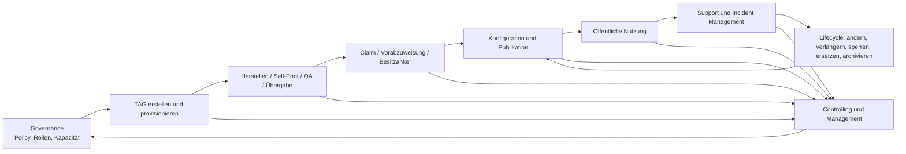
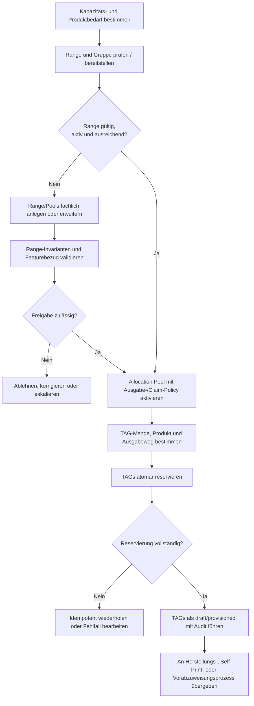
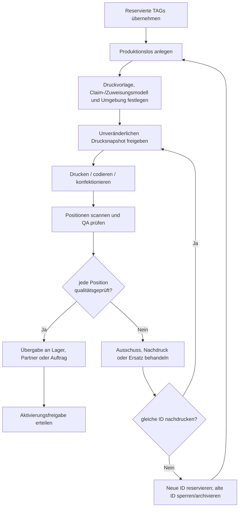
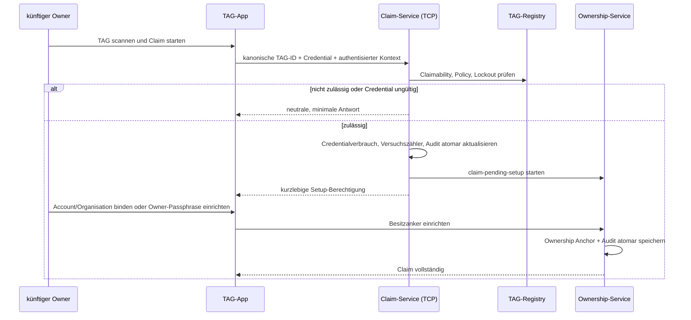
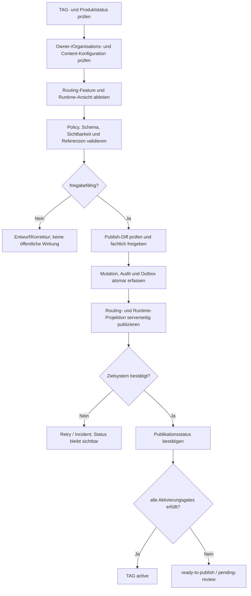
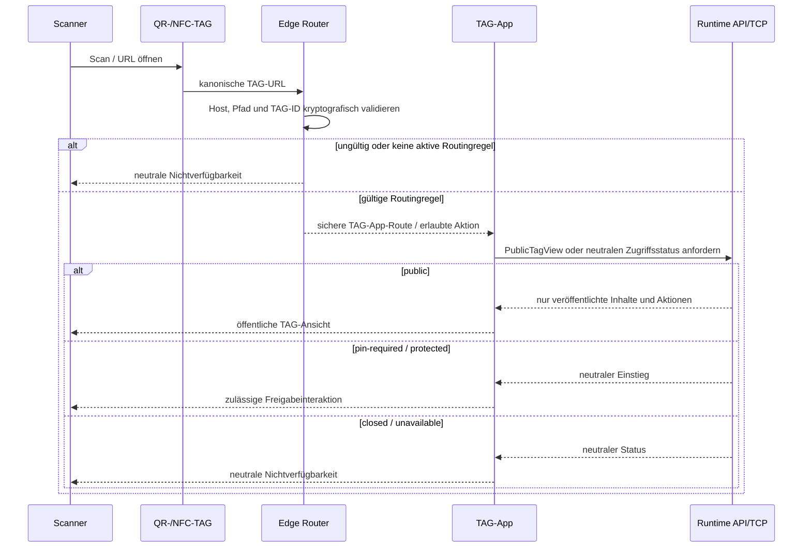
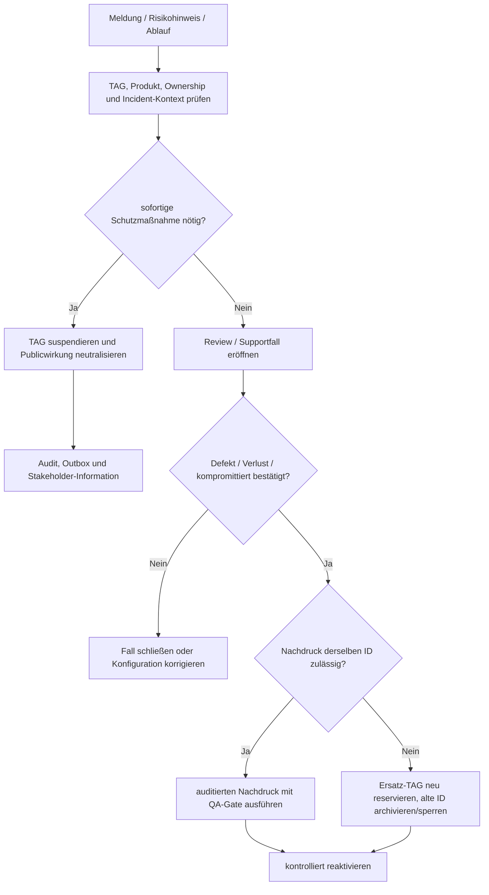
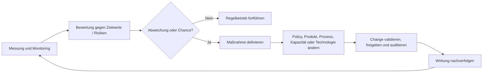
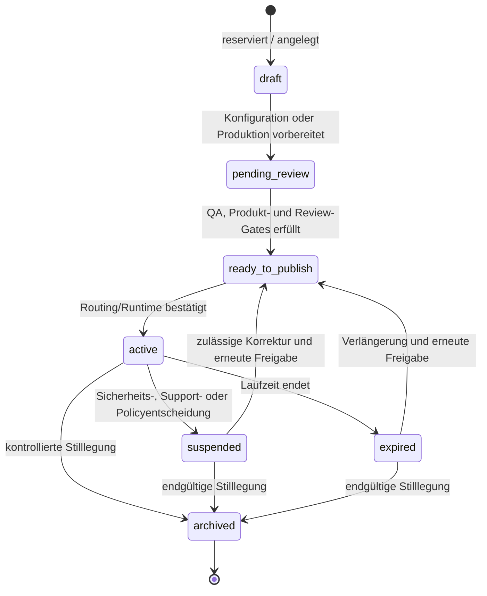

# Prozessarchitektur der TAG-Plattform

**Status:** Zielarchitektur  
**Stand:** 2026-10-06  
**Ebene:** fachlich; End-to-End-Prozesse, Rollen und Steuerung  
**Grundlage:** [Übersicht der funktionalen Architektur](README.md)

## 1. Zielbild und Prozessgrenzen

Die TAG-Plattform stellt eindeutige physische oder selbstgedruckte TAGs bereit, verbindet sie kontrolliert mit einem Produkt-, Owner- oder Organisationskontext und macht sie nach fachlicher Freigabe über eine öffentliche Scan-Interaktion nutzbar.

Der fachliche End-to-End-Lebenszyklus lautet:

```text
Kapazität planen
  → TAG reservieren
  → ausgeben / produzieren / selbst drucken
  → Qualität und Übergabe prüfen
  → claimen oder vorab zuweisen
  → Routing und Runtime veröffentlichen
  → aktiv nutzen und verwalten
  → verlängern, sperren, ersetzen oder archivieren
```

Jeder Prozess ist einer klaren fachlichen Verantwortung zugeordnet. Die zentrale Regel lautet:

> **Nur die TAG Control Plane entscheidet fachlich über Identität, Besitz, Produkt, Status, Freigabe und Veröffentlichung.**

Die TAG-App, der Edge Router, das TAG Control Center und externe Produktions- oder Partnerprozesse führen ausschließlich die für sie vorgesehenen Teile dieses Prozesses aus.

## 2. Rollen und Verantwortlichkeiten

| Rolle | Fachliche Verantwortung | Darf insbesondere | Darf nicht |
| --- | --- | --- | --- |
| Plattformadministrator | Plattformgovernance, Sicherheits- und Ausnahmeentscheidungen | Rollen, Policies, kritische Sperren, Produktionsfreigabe, Eskalationen | Credentials oder Secrets auslesen |
| TAG-Manager | TAG-Registry, Pools, Produkte, Provisioning, Publish-Freigabe | Ranges/Pools im zulässigen Scope verwalten, Chargen vorbereiten, TAGs aktivieren | Control-Plane-Regeln oder Secrets umgehen |
| Produktionsverantwortliche / Partner | physische Herstellung und Rückmeldung | freigegebene Drucksnapshots verwenden, Druck-/QA-Status melden | neue TAGs erfinden, Snapshots verändern |
| Qualitätsprüfung (QA) | Scan-/Lesbarkeits- und Mengenkontrolle | Positionen prüfen, Ausschuss melden, QA freigeben | ungeprüfte TAGs aktivieren |
| Fulfillment / Partner | Übergabe und Auslieferung | geprüfte Einheiten übergeben, Übergabestatus führen | Besitz ohne autorisierten Prozess übertragen |
| Owner | TAG dauerhaft verwalten | claimen, Besitzanker einrichten, erlaubte Inhalte/Features ändern | Produkt-, Routing- oder Plattformpolicy umgehen |
| Organisationsadministrator | Serien-, Partner- und POI-Kontext verantworten | Mitglieder und zugeordnete TAGs im Scope verwalten | globale Platform-/Fremdorganisationen verwalten |
| Content Editor | veröffentlichungsfähige Inhalte vorbereiten | Vault-/Content-Entwürfe pflegen | private/unsichere Inhalte veröffentlichen |
| Scanner / Besucher | öffentliches TAG verwenden | scannen, öffentliche Inhalte ansehen, zulässige Interaktion ausführen | Ownership oder geschützte Sichtbarkeit ableiten |
| Support Agent | datensparsame Hilfe und Triage | Status prüfen, Claim begleiten, zulässige Fälle eskalieren | Claim-/Owner-/Sperrregeln umgehen oder Geheimnisse speichern |
| Reviewer / Compliance | Schutzgates und Nachweise prüfen | POI-/Policy-/Sicherheitsentscheidungen freigeben | öffentliche Daten ohne fachliche Freigabe verändern |
| Management / Product Owner | Steuerung und Priorisierung | Kennzahlen bewerten, Zielwerte und Maßnahmen festlegen | personenbezogene Rohdaten ohne Zweck verarbeiten |
| Automatisierter Publisher | bestätigte Projektionen veröffentlichen | idempotent KV-/Runtime-Projektionen aktualisieren | fachliche Regeln selbst ändern |

## 3. Prozesslandkarte und Wertströme



| Wertstrom | Auslöser | Ende / Ergebnis | Primäre Fachsysteme |
| --- | --- | --- | --- |
| TAG-Kapazität und Registry | neue Produkt-/Partner-/Kampagnenkapazität | aktive, prüfbare Range und Allocation Pool | TCP, TCC |
| TAG-Provisioning | Bestellung, Charge, Self-Print-Auftrag oder Einzelbedarf | reservierte Ausgabe-/Druckpositionen | TCP, TCC |
| Physische Ausgabe | freigegebener Auftrag | QA-geprüfte, übergebene oder sauber ausgesonderte Einheiten | TCP, Produktions-/QA-Prozess |
| Claim / Vorabzuweisung | Scan eines offenen TAGs oder B2B-/Serienauftrag | dauerhafter Ownership Anchor oder dokumentierte Vorabzuweisung | TAG-App, TCP, TCC-Support |
| Routing-/Runtime-Publishing | Aktivierung oder zulässige Inhaltsänderung | bestätigte öffentliche, minimale Projektion | TCP, Publisher, Cloudflare Data Plane |
| Öffentliche TAG-Nutzung | Scan oder Aufruf der TAG-URL | öffentliche Ansicht, sichere Weiterleitung oder neutrale Nichtverfügbarkeit | Edge Router, TAG-App, Runtime API |
| Support / Incident | Nutzer-/Partner-/Systemmeldung | gelöster, eskalierter oder auditiert geschlossener Fall | TCC, TCP |
| Controlling / Management | periodisch oder schwellenbasiert | Maßnahmen, Forecast, Policy-/Produktentscheidung | TCP-Auswertung, TCC/Reporting |

## 4. Kernprozess A – TAG-Erstellung und Registry-Provisioning

### 4.1 Zweck und Auslöser

Dieser Prozess sorgt dafür, dass jede ausgegebene TAG-ID eindeutig, kryptografisch kompatibel, einem zulässigen Bereich zugeordnet und für ihr Ausgabeziel vorbereitet ist.

**Typische Auslöser:**

- Einführung oder Erweiterung einer Produktklasse;
- Kapazitätsbedarf eines Partners, einer Organisation oder Kampagne;
- Bestellung physischer TAGs;
- Freigabe einer Selbstprint-Serie;
- Einzelreservierung für Test, Demo oder Ersatz;
- nachgewiesene Erschöpfung eines Allocation Pools.

### 4.2 Prozessablauf



### 4.3 Fachliche Schritte, Ergebnisse und Kontrollpunkte

| Nr. | Aktivität | Verantwortlich | Ergebnis | Verbindlicher Kontrollpunkt |
| --- | --- | --- | --- | --- |
| A1 | Produkt-, Zielgruppen- und Kapazitätsbedarf erfassen | TAG-Manager / Produkt | Bedarf mit Produktklasse und Ausgabeweg | keine direkte TAG-Vergabe ohne zugelassene Produktpolicy |
| A2 | Range und Gruppe definieren oder auswählen | TAG-Manager | gültiger numerischer TAG-Raum | sechs-/achtstelliger Raum, Nichtüberlappung, 8-stellige 16er-Slotgrenze |
| A3 | Feature-/Routing-Grundkontext prüfen | TAG-Manager | veröffentlichungsfähiger Gruppen-/Range-Kontext | fehlende oder ungültige Feature-Referenz blockiert Publikation |
| A4 | Allocation Pool bereitstellen | TAG-Manager / Organisation | Pool mit Zielgruppe, Produkt-, Claim- und Kapazitätspolicy | Pool ist aktiv, organisationsgebunden falls erforderlich, nicht erschöpft |
| A5 | konkrete Menge und Ausgabemodell festlegen | TAG-Manager / Auftraggeber | Reservierungsauftrag | Modell: offene Charge, Vorabzuweisung, Self-Print, Ersatz oder Demo |
| A6 | TAGs atomar reservieren | TCP-Service | eindeutige TAGs mit vollständigem kanonischem Wert | Unique Constraints, Idempotenz, keine Client-Secrets |
| A7 | Registry-/Auditstatus dokumentieren | TCP-Service | rückverfolgbarer Reservierungsnachweis | Akteur, Anlass, Pool, Menge, Korrelation; keine Geheimnisse im Audit |
| A8 | Provisionierungsweg starten | TCP / TCC | Produktionslos, Self-Print-Auftrag oder Vorabzuweisung | reservierte TAGs werden nicht parallel in anderen offenen Positionen verwendet |

### 4.4 Ausgabemodelle

| Modell | Zielgruppe / Beispiel | Ownership bei Ausgabe | Claim-Credential | Folgeprozess |
| --- | --- | --- | --- | --- |
| Offene Einzel- oder Charge-Ausgabe | Privatkunde, Händler, Messe | noch offen | pro TAG oder kontrolliert pro Charge | Kunde claimt nach Scan und richtet Besitzanker ein |
| Vorabzugewiesene Bestellung | Großkunde, Organisation, Partner | Owner/Organisation vorab gebunden | in der Regel nicht als Endkundenclaim | Übergabe und Aktivierung nach QA/Policy |
| Self-Print-Serie | Organisation, Event-/Kampagnenbetreiber | vorab zugewiesen oder policygesteuert offen | je nach Produktpolicy | vertraulicher, zeitlich begrenzter Druckexport |
| Demo-/Test-TAG | interner Test, Staging | Plattform-/Testkontext | nicht für öffentliche Kundenvergabe | getrennte Umgebung und Ablauf |
| Ersatz-TAG | Verlust, Defekt, Diebstahl | autorisierte Übertragung / neuer Anker | policyabhängig | alte TAG-ID kontrolliert sperren/archivieren |

### 4.5 Pflichtinvarianten

1. Die öffentliche `tagId` und der vollständige kanonische `decodedValue` sind global eindeutig.
2. Ein Pool wird über kanonische Werte verwaltet; sichtbar fortlaufende Feistel-IDs sind keine fachliche Poolgrenze.
3. Eine Reservierung kann wiederholt werden, ohne unbeabsichtigt weitere TAGs zu erzeugen.
4. Ein reservierter TAG besitzt genau einen kontrollierten Provisionierungsweg, bis dieser abgeschlossen, storniert oder ersetzt wurde.
5. Feistel- und HMAC-Secrets verbleiben vollständig serverseitig.
6. Ein Reservierungsstatus allein führt niemals zu öffentlicher Scan-Auflösung oder Aktivität.

## 5. Kernprozess B – Herstellung, QA, Fulfillment und Self-Print

### 5.1 Zweck

Der Prozess überführt reservierte digitale TAG-Identitäten in kontrolliert verfügbare physische oder selbstgedruckte Träger. Er stellt sicher, dass ausschließlich freigegebene, lesbare und nachvollziehbar übergebene Einheiten aktiviert werden.

### 5.2 Prozessablauf für physische Produktion



### 5.3 Prozessablauf für Self-Print

```text
Reservierungsauftrag
  → zulässige Self-Print-Policy prüfen
  → konkrete TAGs atomar reservieren
  → zeitlich begrenzten, vertraulichen Drucksnapshot freigeben
  → Organisation/Partner druckt innerhalb des erlaubten Rahmens
  → Selbsttest bzw. QA-Rückmeldung erfassen
  → Übergabe-/Nutzungsfreigabe bestätigen
  → Aktivierung und Publikation gemäß Produktpolicy
```

Self-Print ersetzt keine Registry-, Audit-, Owner-, Publish- oder QA-Regeln. Der Export enthält nur die für die kontrollierte Ausgabe notwendigen Druckdaten; er enthält niemals Cloudflare-Zugänge, kryptografische Plattformsecrets oder unnötige Owner-/Vaultdaten.

### 5.4 Status- und Gate-Modell

| Ebene | Typische Status | Übergangsregel |
| --- | --- | --- |
| Produktionslos | `approved`, `exported`, `in-production`, `quality-check`, `completed`, `partially-completed`, `cancelled` | Freigabe, Export, QA und Abschluss sind getrennte auditable Schritte |
| Druckposition | `reserved`, `printed`, `quality-checked`, `rejected`, `destroyed`, `reprint-required` | nur `quality-checked` kann in Übergabe/Aktivierung übergehen |
| TAG-Lifecycle | `draft`, `pending-review`, `ready-to-publish`, `active`, `suspended`, `expired`, `archived` | physische und fachliche Gates müssen erfüllt sein |
| Publikation | `pending`, `processing`, `succeeded`, `retryable-failed`, `terminal-failed` | `active` erst nach bestätigter erforderlicher Projektion |

### 5.5 Qualitätsprüfung

| Prüfbereich | Fachliche Prüffrage | Mögliche Folge |
| --- | --- | --- |
| Identität | verweist QR-/NFC-Ausgabe auf die reservierte kanonische URL? | bei Abweichung Position ablehnen |
| Lesbarkeit | ist der Code unter definierten Bedingungen scanbar? | Nachdruck oder Ausschuss |
| Umgebung | entspricht Host/URL der Staging- bzw. Produktionsvorgabe? | falsche Umgebung sperren und neu ausgeben |
| Drucksnapshot | stimmen Vorlage, Charge und Prüfsumme mit Freigabe überein? | Auftrag stoppen und neu freigeben |
| Claim-/Zuweisung | wurde das zulässige Modell verwendet? | Übergabe blockieren oder Support-/Security-Fall |
| Menge / Übergabe | sind Positionen vollständig und eindeutig übergeben? | Teilabschluss, Nachproduktion oder Klärfall |

**Ausschussregel:** Abgelehnte oder zerstörte TAGs werden nicht stillschweigend wieder frei. Ein Nachdruck derselben ID verlangt eine berechtigte, audierte Entscheidung. Ein Ersatz mit neuer ID neutralisiert die alte Identität kontrolliert.

## 6. Kernprozess C – Claiming, Vorabzuweisung und Ownership

### 6.1 Zielzustand

Ein TAG besitzt nach diesem Prozess entweder:

- einen kontrollierten **Ownership Anchor** (Account, Organisation und/oder zulässige Owner-Passphrase),
- eine autorisierte **Vorabzuweisung** zu einer Organisation bzw. Bestellung,
- oder bleibt bewusst unclaimed, aber produktspezifisch ausgabefähig.

Ein lokaler Browserzustand, eine URL-Kenntnis oder ein Collection-Eintrag begründet niemals Besitz- oder Verwaltungsrechte.

### 6.2 Offener Claim-Prozess



### 6.3 Claim-Schritte und Kontrollpunkte

| Schritt | Verantwortlich | Ergebnis | Kontrollpunkt |
| --- | --- | --- | --- |
| C1 | künftiger Owner | Scan und Claim-Start | primär über TAG-App, nicht über frei gestaltete Drittformulare |
| C2 | TCP Claim-Service | neutrale Vorprüfung | TAG-ID kanonisch, Policy, Status und zulässiger Claimweg |
| C3 | TCP Claim-Service | Credential-Prüfung | nur Hashvergleich; Rate Limit, Fehlversuchszähler und Lockout serverseitig |
| C4 | TCP Claim-Service | `claim-pending-setup` | erfolgreicher Claim ist noch keine dauerhafte Ownership |
| C5 | Owner | Account-/Organisationsbindung oder Owner-Passphrase | mindestens ein erlaubter dauerhafter Besitzanker |
| C6 | Ownership-Service | aktiver Ownership Anchor | atomar, TAG-gebunden, auditiert |
| C7 | TCP / Publisher | bei Bedarf Aktualisierung zulässiger Runtime-/Lifecyclewirkung | Berechtigungsdaten selbst werden nicht öffentlich publiziert |

### 6.4 Support-begleiteter Claim

Support darf einen Claim begleiten, jedoch nicht die Sicherheitslogik ersetzen:

1. Support scannt bzw. erfasst die TAG-ID und nimmt das Claim-Secret nur für den unmittelbaren Request entgegen.
2. Derselbe serverseitige Claim-Service prüft Credential, Lockout, Rate Limits und Ownership atomar.
3. Das Secret wird weder gespeichert, geloggt, exportiert noch in Auditdaten übernommen.
4. Die Antwort ist rollenabhängig und datensparsam.
5. Reset, Ersatz, Widerruf oder Lockout-Aufhebung verlangen Berechtigung, Begründung, gegebenenfalls starke Re-Authentisierung und Audit.
6. Ein Supportprozess darf weder eine bestehende Vorabzuweisung überschreiben noch einen zweiten Owner erzeugen.

### 6.5 Vorabzuweisung

Bei Organisationen, Großkunden und Serien kann die Ownership vor physischer Übergabe vorbereitet werden.

```text
autorisierte Bestellung / Organisation
  → konkrete Menge aus aktivem Pool reservieren
  → Owner-/Organisationsbezug atomar binden
  → Produktion / Self-Print / QA / Übergabe
  → Aktivierung nach Produkt- und Übergabepolicy
  → Organisation verwaltet berechtigte Personen und Inhalte
```

Ein Besitzerwechsel, Widerruf oder Ersatz muss die bisherige Beziehung nachvollziehbar beenden bzw. sperren. Es darf keine unklare Doppelzuweisung geben.

## 7. Kernprozess D – TAG-Konfiguration, Publishing und Aktivierung

### 7.1 Zweck

Dieser Prozess überführt die fachlich freigegebene Konfiguration eines TAGs in zwei getrennte, abgeleitete öffentliche Wirkungen:

1. **Routing-Projektion:** entscheidet nach gültigem Scan, zu welcher erlaubten Aktion bzw. TAG-App-Route geleitet wird.
2. **Runtime-Projektion:** bestimmt, welche freigegebenen öffentlichen Inhalte oder neutralen Zugriffsmodi die TAG-App anzeigt.

### 7.2 Prozessablauf



### 7.3 Aktivierungsgates

| Gate | Prüffrage | Typische Verantwortlichkeit |
| --- | --- | --- |
| Identitätsgate | TAG eindeutig reserviert, Range/Pool gültig? | TCP |
| Produktgate | Produktklasse, Laufzeit, Quoten und Module zulässig? | TCP / TAG-Manager |
| Herstellungs-/QA-Gate | physischer TAG oder Self-Print-Nachweis geprüft? | QA / Fulfillment |
| Ownership-/Betreibergate | erforderliche Owner-/Organisationsbindung vorhanden? | Owner / Organisation / TCP |
| Inhaltsgate | nur erlaubte, veröffentlichungsfähige Inhalte/Features? | Owner / Content Editor / TCP |
| POI-Review-Gate | bei POI: Betreiber, Standort, Zustimmung und Meldeweg bestätigt? | Reviewer |
| Projektionsgate | Routing-/Runtime-Diff valide, minimal und bestätigt? | Publisher / TAG-Manager |
| Betriebs-/Security-Gate | keine Sperre, kein kritischer Incident, Umgebung korrekt? | Plattformbetrieb |

### 7.4 Publikationswirkungen

| Fachliche Änderung | Routingwirkung | Runtimewirkung | Beispiel |
| --- | --- | --- | --- |
| Aktivierung | erlaubte Regel wird bereitgestellt | aktuelle freigegebene Revision wird bereitgestellt | TAG zeigt Basis-Vault |
| Content-Änderung | meist unverändert | neue Runtime-Revision | neuer Titel/Galerie |
| Feature-Wechsel | Feature-/Regelprojektionsdiff | gegebenenfalls neuer Action-/View-Hinweis | Vault → Lost & Found |
| Sichtbarkeit `public → pin-required` | Route kann bestehen bleiben | nur neutraler PIN-Einstieg | private Inhalte verborgen |
| Sperrung / Ablauf | Route entfernen oder neutralisieren | Pointer entfernen / neutral antworten | keine alte öffentliche Ansicht |
| Ersatz | alte ID neutralisieren | alte Runtime zurückziehen | neue ID wird separat aktiviert |

Eine fachliche Änderung ist nicht allein durch einen erfolgreichen Browser-Request veröffentlicht. Erst die bestätigte Auslieferung der benötigten Projektion vervollständigt den Publish-Schritt. Fehler verbleiben sichtbar, auditierbar und retrybar.

## 8. Kernprozess E – Öffentliche Nutzung eines TAGs

### 8.1 Prozessvarianten

Ein TAG kann je Produkt, Status und Feature zu unterschiedlichen erlaubten Nutzungswegen führen:

| Nutzungsweg | Typischer Anlass | Fachliches Ergebnis |
| --- | --- | --- |
| Öffentlicher Vault / Public Page | Nutzer scannt Produkt-/Privat-TAG | veröffentlichte Inhalte und erlaubte Links |
| Redirect | TAG dient als sichere Weiterleitung | serverseitig validiertes Ziel |
| Claim | offener, neu ausgegebener TAG wird erstmals genutzt | Claim-Setup und späterer Ownership Anchor |
| Owner-Verwaltung | Owner will Inhalte/Status verändern | TAG-gebundene, serverseitig geprüfte Owner-Session |
| PIN-/Freigabe-Einstieg | veröffentlichter aber geschützter Content | neutrale Eingabe und serverseitige Prüfung |
| POI / Community | Standort-, Event- oder Museums-TAG | öffentliche Ansicht, ggf. erlaubte Meldung/Check-in |
| Neutraler Fehlerpfad | unbekannt, gesperrt, abgelaufen, nicht veröffentlicht | keine internen Statusdetails |

### 8.2 Scan- und Nutzungsablauf



### 8.3 Fachliche Regeln der Nutzung

1. Der Scan validiert zunächst die TAG-ID und löst eine minimale Routingregel auf; er lädt keine Owner-, Claim-, Produkt- oder Vaultdaten im Edge Router.
2. Die öffentliche TAG-App zeigt ausschließlich explizit veröffentlichte, zur aktuellen Sichtbarkeit passende Daten.
3. Nicht veröffentlichte, gesperrte, abgelaufene oder unbekannte TAGs unterscheiden sich extern nicht durch interne Erklärungen.
4. Ein Scan erzeugt nicht automatisch Besitz, Claim, Collection, Check-in oder Tracking.
5. Eine Collection ist ein bewusster lokaler oder kontogebundener Merker und schafft keine Rechte.
6. Jede geschützte Freigabe wird bei Nutzung serverseitig erneut geprüft; kurzlebige Zugriffe werden nicht zur dauerhaften Berechtigung.
7. Erweiterte Interaktionen wie Guestbook, Chat, Lost & Found, Check-in oder Kampagnen folgen separaten Fachmodulen und dürfen die Kernregeln nicht umgehen.

### 8.4 Owner-Verwaltung während der Nutzung

```text
Owner öffnet TAG-App
  → authentisiert sich über zulässigen Account-/Owner-Passphrase-Weg
  → TCP prüft Session, TAG-Scope, CSRF, Lifecycle und Produktpolicy
  → Owner bearbeitet zulässige Konfiguration / Inhalte
  → Änderungen bleiben Entwurf oder durchlaufen den Publikationsprozess
  → veröffentlichte Wirkung erst nach bestätigter Routing-/Runtime-Projektion
```

Die Owner-Passphrase, ein Account und eine Besucher-PIN sind drei getrennte Credential-Domänen. Sie werden getrennt geprüft, gesperrt, auditiert und nie im Klartext gespeichert.

## 9. Kernprozess F – Verwaltung, Änderung und Lebenszyklus

### 9.1 Standardprozess für Änderungen

| Änderungstyp | Fachlicher Ablauf | Öffentliche Wirkung |
| --- | --- | --- |
| Content-Änderung | Entwurf → Validierung → Freigabe/Publish | neue Runtime-Revision |
| Feature-/Routingänderung | Feature-/Assignment-Prüfung → Diff → Publish | neue Routingregel und ggf. Runtime |
| Produkt-/Laufzeitänderung | Policy prüfen → freigeben → Audit | Capabilities/Status aktualisieren |
| Owner-/Organisationswechsel | Berechtigung, Zustimmung, Widerruf prüfen → atomar wechseln | private Änderung; Runtime nur falls erforderlich |
| Verlängerung | Produkt-/Laufzeitpolicy prüfen → Status fortführen | bestehende oder erneuerte Publikation |
| Sperrung | Grund, Rolle, Scope prüfen → Outbox erzeugen | kontrolliertes Neutralisieren/Unpublish |
| Ersatz / Nachdruck | alte ID bewerten → Nachdruck gleicher ID oder neue ID | alte ID bleibt kontrolliert, neue separat aktivieren |
| Archivierung | Retention, offene Grants, Inhalte prüfen → archivieren | keine öffentliche aktive Route/View |

### 9.2 Sperrung, Verlust, Diebstahl und Ersatz



Bei Sicherheit, Verlust oder Diebstahl hat Schutz vor Verfügbarkeit Vorrang. Eine alte öffentliche Wirkung darf nicht unbegründet fortbestehen.

## 10. Support- und Betriebsprozesse

### 10.1 Supportprozess und Triage

```text
Anfrage oder Ereignis
  → Identität und Rolle des Anfragenden im notwendigen Umfang prüfen
  → TAG-ID / Korrelationsreferenz erfassen
  → zulässige datensparsame Statussicht abrufen
  → Fall klassifizieren
  → direkte zulässige Lösung oder Eskalation
  → Ergebnis, Folgeaktion und Auditreferenz kommunizieren
  → Fall schließen oder überwachen
```

| Fallklasse | Typische Beispiele | Zulässige Supportaktion | Eskalation |
| --- | --- | --- | --- |
| Nutzung | Scan führt zu neutraler Ansicht, Browser-/Kameraproblem | öffentliche Nutzung anleiten, Status im erlaubten Umfang prüfen | Betrieb bei bestätigter Plattformstörung |
| Claim | Credential wird abgewiesen, Lockout, Setup nicht abgeschlossen | Claim über gemeinsamen Service begleiten | Security / TAG-Manager für Reset, Ersatz, Widerruf |
| Produktion / QA | Code unlesbar, falsche Umgebung, fehlende Position | Produktionsstatus prüfen, Nachdruckfall einleiten | Produktion/QA |
| Publishing | Änderung nicht sichtbar, Retry fehlgeschlagen | Outbox-/Publishstatus prüfen, Retry anstoßen falls Rolle | Plattformbetrieb |
| Verlust / Diebstahl | physischer TAG nicht mehr vertrauenswürdig | Sperr-/Reviewprozess eröffnen | TAG-Manager / Plattformadmin |
| Inhalt / POI | unzulässiger Inhalt, Standortproblem, Meldung | Meldung erfassen, temporäre Schutzwirkung nach Policy | Reviewer / Moderator / Compliance |
| Datenschutz / Account | personenbezogene Anfrage, Zugriffsproblem | an vorgesehenen Datenschutz-/IAM-Prozess übergeben | Datenschutz / IAM |

### 10.2 Betriebsprozesse

| Betriebsprozess | Auslöser | Ziel | Fachliche Mindestkontrolle |
| --- | --- | --- | --- |
| Outbox überwachen und wiederholen | pending/failed Job, Cloudflare-Fehler | bestätigte Projektion oder sichtbarer Incident | Retry idempotent, keine Browser-Schreibrechte |
| Cache-/Widerrufskontrolle | Sperrung, Ablauf, Visibility-Wechsel | alte öffentliche Wirkung rechtzeitig neutralisieren | dokumentierte TTL-/Invalidierungsgrenzen |
| Range-/Pool-Monitoring | Warnschwelle, Erschöpfung, Konflikt | Ausgabe ohne Kapazitätsbruch | keine neue Vergabe aus inaktivem/erschöpftem Pool |
| Produktions- und QA-Monitoring | Teilabschluss, Ausschuss, Fehlerrate | sichere physische Qualität | Ausschuss nicht still zurückführen |
| Secrets-/Zugriffsreview | rotierender Termin oder Sicherheitsereignis | minimale Berechtigungen und sichere Umgebungsgrenzen | keine Secrets in KV, Browser, Logs, Exports |
| Backup-/Restore-Übung | periodisch | Control Plane und Projektionen wiederherstellbar | Rebuild nur kontrolliert aus autoritativer Quelle |
| Incident Management | Schweregrad-/Alarmkriterium | Risiko begrenzen, Ursache beheben, lernen | Audit, Kommunikation, Post-Incident-Maßnahme |

## 11. Controlling, Auswertung und Plattformmanagement

### 11.1 Zielsetzung

Controlling bewertet, ob die Plattform sicher, wirtschaftlich, skalierbar und produktwirksam betrieben wird. Es dient nicht dazu, einzelne Scanner ohne fachlichen Zweck zu überwachen.

Auswertungen werden rollen-, zweck- und datensparsam bereitgestellt. Personenbeziehbare oder sensible Details bleiben auf berechtigte Betriebs-, Support- oder Compliance-Fälle begrenzt.

### 11.2 Steuerungsdimensionen und Kennzahlen

| Steuerungsdimension | Beispielkennzahlen | Primäre Maßnahmen bei Abweichung |
| --- | --- | --- |
| Kapazität | freie/reservierte/erschöpfte TAGs je Pool, Pool-Runway, Reservierungsrate | Range/Pools planen, Ausgabe drosseln, Kapazität erweitern |
| Provisioning | Reservierung → Produktion → QA → Übergabe-Durchlaufzeit, offene Positionen | Engpass in Produktion/QA/Fulfillment beheben |
| Qualitätsmanagement | QA-Passrate, Ausschuss-, Nachdruck- und Umgebungsfehlerquote | Vorlage, Material, Partnerprozess oder QA-Gate verbessern |
| Claiming | Claim-Erfolgsrate, Setup-Abbruchrate, Lockout-Rate, Supportquote | Claim-UX, Credential-Policy, Kommunikation oder Abuse-Schutz anpassen |
| Aktivierung / Publishing | Zeit bis Publikation, Retry-Rate, fehlgeschlagene Outbox-Jobs, Unpublish-Zeit | Publisher-/Cloudflare-Betrieb verbessern, Incident auslösen |
| Produktnutzung | aktive TAGs nach Produktklasse, öffentliche View-/Feature-Nutzung aggregiert, Verlängerungsquote | Produkt-/Content-/Pricing-Entscheidung, keine unzulässige Profilbildung |
| Support | Fallvolumen, Lösungszeit, Wiedereröffnungen, Eskalationsrate | Wissensbasis, Automation, Rollen oder Produktprozess verbessern |
| Sicherheit und Compliance | Sperrungen, Missbrauchsmeldungen, Berechtigungswiderrufe, offene Reviews | Policy verschärfen, Review-Kapazität erhöhen, technische Controls verbessern |
| POI / Community | ausstehende Reviews, Meldungsbearbeitungszeit, Moderationsrückstand | Reviewer-/Moderator-Kapazität und Schutzmaßnahmen steuern |
| Wirtschaftlichkeit | Kosten je ausgegebenem/aktivem TAG, Ausschusskosten, Partner-/Produktmix | Produktportfolio, Produktionsweg, Vertrags- und Preisentscheidung |

### 11.3 Controlling-Zyklen

| Zyklus | Ziel | Typische Empfänger | Ergebnisse |
| --- | --- | --- | --- |
| Echtzeit / täglich | Betriebsstörungen, Sicherheits- und Publish-Risiken erkennen | Plattformbetrieb, TAG-Management | Incident, Retry, Sperre, Eskalation |
| Wöchentlich | Produktion, Support, Poolkapazität und Backlogs steuern | Betrieb, Support-Leitung, Produkt | Kapazitäts-/Priorisierungsmaßnahmen |
| Monatlich | Produktleistung, Qualität, Verlängerung und Partnerentwicklung bewerten | Management, Product Owner, Finance | Produkt- und Forecast-Entscheidungen |
| Quartalsweise | Policies, Rollen, Sicherheit, Retention und Architektur-Gates prüfen | Plattformleitung, Compliance, Architektur | Governance-/Roadmap-Entscheidungen |
| ereignisbezogen | kritischer Incident, Partnerwechsel, neue Produktklasse | zuständige Rollen | kontrollierter Change oder Post-Incident-Review |

### 11.4 Management-Dashboard: empfohlene Sichten

| Dashboard | Inhalt | Zielgruppe | Datenschutz-/Sicherheitsgrenze |
| --- | --- | --- | --- |
| Platform Health | aktive/suspendierte TAGs, Publish-Jobs, Fehlerklassen, Cache-/Runtime-Lage | Betrieb, Plattformadmin | keine Credentials oder Ownerdaten |
| Capacity & Fulfillment | Pools, Runway, Chargen, QA, Ausschuss, Übergabestatus | TAG-Management, Produktion | organisationsbezogene Details nur im Scope |
| Product Performance | Aktivierungen, Verlängerungen, Produkt-/Featuremix, aggregierte Nutzung | Management, Product Owner | aggregiert/pseudonymisiert; keine Einzelscanprofile |
| Support & Safety | Fallklassen, SLA, Lockouts, Meldungen, offene Reviews | Support-/Security-Leitung | Fall-/Personendetails nur bei berechtigtem Drill-down |
| Partner & POI Governance | Betreiberstatus, Review-Backlog, Meldeweg, Modulstatus | Organisation, Reviewer | Nachweise und personenbezogene Kontakte geschützt |
| Audit & Compliance | Änderungsarten, Rollenereignisse, sensible Commands, Retentionstatus | Compliance, Plattformadmin | ausschließlich redigierte, immutable Auditdaten |

### 11.5 Rückkopplung in die Plattformsteuerung



Mögliche Steuerungsmaßnahmen sind:

- Range- und Poolkapazität anpassen;
- Druck- oder QA-Vorlage verbessern;
- Claim-Policy, UX oder Supportleitfaden ändern;
- Produktlimits, Laufzeiten oder zulässige Module versionieren;
- Partner-/Organisationsrollen prüfen oder entziehen;
- Publishing-/Betriebsresilienz verbessern;
- POI-/Moderationskapazität erhöhen;
- Sicherheits- oder Retentionpolicy anpassen.

## 12. End-to-End-Statusbild eines TAGs



| Status | Öffentliche Scanwirkung | Zulässige fachliche Aktivitäten |
| --- | --- | --- |
| `draft` | keine | reservieren, konfigurieren, Produktionsweg vorbereiten |
| `pending-review` | keine | QA, Review, Nachweis-/Produktprüfung |
| `ready-to-publish` | keine bis bestätigter Publish | Publish-Diff freigeben, Projektionsauftrag starten |
| `active` | erlaubte Route und veröffentlichte Runtime | nutzen, verwalten, gemäß Policy ändern |
| `suspended` | neutralisiert / nicht verfügbar | Support, Incident, Review, Ersatz vorbereiten |
| `expired` | neutralisiert / nicht verfügbar | verlängern, archivieren, Ersatz prüfen |
| `archived` | keine aktive Wirkung | Audit/Retention, keine reguläre Reaktivierung ohne ausdrückliche Policy |

Der Produktions- und QA-Status ergänzt den TAG-Lifecycle, ersetzt ihn aber nicht. Ein physisch gedruckter TAG wird nicht automatisch aktiv; ein aktivierter TAG darf keine ungeprüfte physische Ausgabe repräsentieren.

## 13. Prozessübergreifende Kontrollen

| Kontrolle | Gilt für | Wirkung |
| --- | --- | --- |
| Serverseitige Autorisierung und Scope-Prüfung | alle Verwaltungs-, Owner-, Support- und Publish-Commands | verhindert UI-/Client-Umgehung |
| Atomare Transaktion | Reservierung, Claim, Ownership, Status, Grant, Outbox | verhindert Teilzustände und Doppelzuweisungen |
| Audit mit Korrelations-ID | kritische TAG-, Produktions-, QA-, Claim-, Status-, Rollen- und Publish-Schritte | Nachvollziehbarkeit ohne Secret-Leak |
| Idempotenz | Reservierung, Export, Publish, Retry, Ersatz | sichere Wiederholung bei Fehlern |
| Trennung von Entwurf und Veröffentlichung | Content, Features, Runtime, Routing | keine ungewollte öffentliche Wirkung |
| QA-/Review-Gate | Produktion, POI, sensitive Produkte | Aktivierung nur nach fachlicher Bestätigung |
| Neutraler öffentlicher Fehlervertrag | Scan, Claim, Runtime | keine Status- oder Besitzlecks |
| Least Privilege | TCC, Support, Partner, Publisher | begrenzte Rechte und kontrollierte Eskalation |
| Umgebungsisolation | Staging, Produktion, Test-/Demo-TAGs | kein versehentliches produktives Publish |
| Datensparsame Auswertung | Support, Controlling, Management | Zweckbindung und Schutz vor Profilbildung |

## 14. Abhängigkeiten und offene Ausgestaltung

| Thema | Bereits fachlich festgelegt | Vor operativer Umsetzung weiter festzulegen |
| --- | --- | --- |
| Basis-Provisioning | Reserve → Produktion/Self-Print → QA → Übergabe → Publish/Aktivierung | konkrete Druckpartner, SLA, Vorlagen- und Scanprüfverfahren |
| Claim und Ownership | serverseitige Prüfung, atomarer Verbrauch, Besitzanker, Supportgrenzen | Account-IAM, Owner-Passphrase-Policy, konkrete Lockoutwerte |
| öffentliche Nutzung | Edge-Validierung, minimale Routingprojektion, PublicTagView, neutraler Fehlerpfad | finale UX für Claim, PIN und Basis-Vault |
| Produkt und Pricing | Policies als zentrale, versionierte Regeln | Tarifkatalog, Quoten, Verlängerungs- und Zahlungsprozesse |
| POI und Community | Review-/Betreibergate und private Nachweise | finale Nachweisformate, Moderations-SLA, rechtliche Texte |
| erweiterte Features | separate Fachmodule für Chat, Lost & Found, Guestbook, Check-in, Campaigns | Priorisierung, Datenschutz-, Abuse- und Retentionkonzept |
| Controlling | Kennzahlendomänen und datensparsame Nutzung festgelegt | konkrete Zielwerte, Reportingtool, Aggregations- und Zugriffsmodell |

## 15. Referenzen

- [Funktionale Architektur – Übersicht](README.md)
- [TAG Control Plane und Basis Vault](../PWA-PHP-Applications/TAG_CONTROL_PLANE_AND_BASIS_VAULT.md)
- [Fachliches Datenmodell](../30-Data-Architecture/10-DOMAIN-DATA-MODEL.md)
- [Komponentensicht der Datenarchitektur](../30-Data-Architecture/20-COMPONENT-DATA-ARCHITECTURE.md)
- [Physische Datenarchitektur](../30-Data-Architecture/30-PHYSICAL-DATA-ARCHITECTURE.md)
- [Domänenregeln](../../DOMAIN_RULES.md)
- [TAG-Typen und POI-Features](../../20-Special-Specifications/TAG_TYPES_AND_POI_FEATURES.md)
- [TAG Vault Feature](../../20-Special-Specifications/TAG_VAULT_FEATURE.md)
- [TAG Control Plane – User Stories](../../40-Implementation/tag-control-plane/10-USER-STORIES.md)
- [TAG Control Center – User Stories](../../40-Implementation/tag-control-center/10-USER-STORIES.md)
