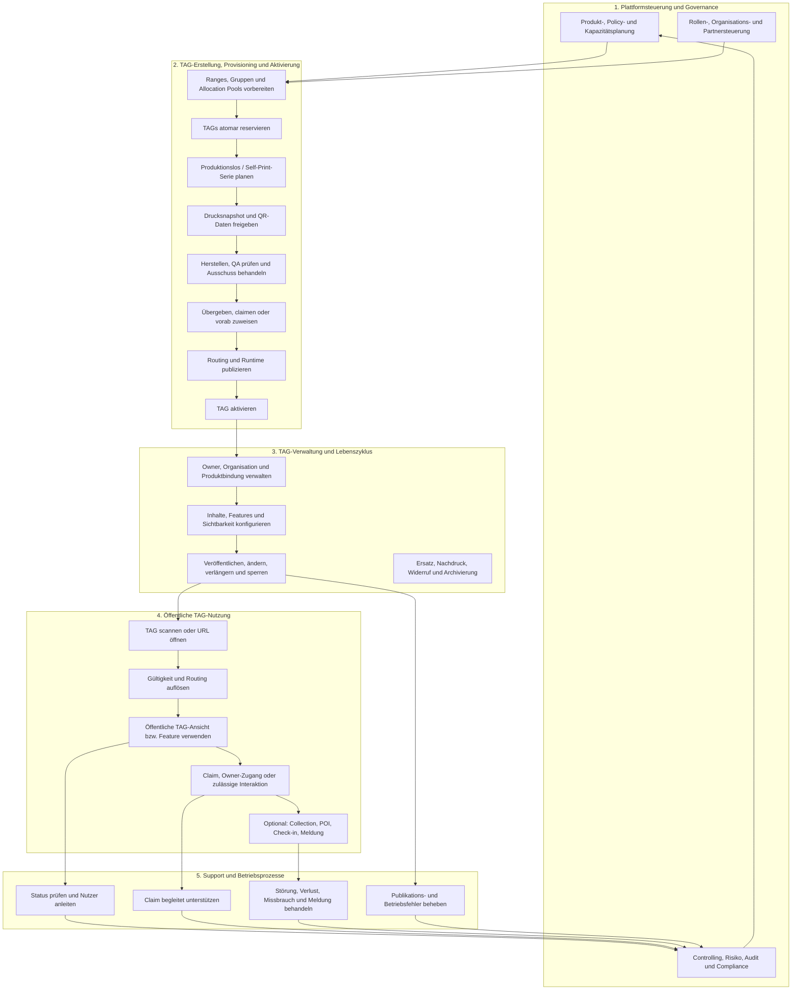

# Funktionale Architektur der TAG-Plattform

**Status:** Zielarchitektur  
**Stand:** 2026-10-06  
**Ebene:** fachliche Prozess- und Leistungsarchitektur  
**Schwerpunkt:** TAG-Erstellung, Verwaltung, Provisioning und Nutzung

## Zweck dieses Architekturstrangs

Dieser Bereich beschreibt, **welche fachlichen Leistungen** die myQR24 TAG-Plattform erbringt, **welche Rollen** beteiligt sind und **wie die End-to-End-Prozesse** vom verfügbaren TAG-Kapazitätsraum bis zu Nutzung, Support, Auswertung und Steuerung zusammenhängen.

Die Dokumentation bleibt bewusst fachlich. Sie beschreibt keine Tabellen, APIs oder Cloudflare-Key-Strukturen im Detail. Diese sind in der [Datenarchitektur](../30-Data-Architecture/README.md), der [Control-Plane-Architektur](../PWA-PHP-Applications/TAG_CONTROL_PLANE_AND_BASIS_VAULT.md) und den Implementierungssträngen konkretisiert.

## Lesereihenfolge

1. **[Prozessarchitektur der TAG-Plattform](10-TAG-PLATFORM-PROCESS-ARCHITECTURE.md)**  
   Prozesslandkarte, Rollen, Kernwertströme, Status- und Kontrollpunkte.
2. [Domänenregeln](../../DOMAIN_RULES.md)  
   Kanonische TAG-ID-, Range- und Routingregeln.
3. [TAG Control Plane und Basis Vault](../PWA-PHP-Applications/TAG_CONTROL_PLANE_AND_BASIS_VAULT.md)  
   Autoritative Verwaltungsquelle und Trennung zur öffentlichen Data Plane.
4. [Datenarchitektur](../30-Data-Architecture/README.md)  
   Fachobjekte, Datenverantwortung und physische Speicherabbildung.
5. [TAG-Typen und POI-Features](../../20-Special-Specifications/TAG_TYPES_AND_POI_FEATURES.md)  
   Produkt- und Nutzungskontexte.

## Funktionale Prozesslandkarte

## Fachliche Leistungsbereiche

| Leistungsbereich | Fachlicher Zweck | Hauptnutzer / Rollen | Wichtigste Ergebnisse |
| --- | --- | --- | --- |
| Plattformgovernance | Produktregeln, Kapazitäten, Rollen und Risiken zentral steuern | Plattformadministration, Produktmanagement, Compliance | Policies, Rollen, Kapazitäts- und Steuerungsentscheidungen |
| TAG-Registry und Provisioning | eindeutige TAGs aus zulässigen Räumen reservieren und ausgabefähig machen | TAG-Management, Produktion, Partner | reservierte, prüfbare und zuordenbare TAGs |
| Herstellung und Fulfillment | physische bzw. Self-Print-Ausgabe kontrollieren | Produktion, QA, Fulfillment, Partner | geprüfte und übergebene TAG-Einheiten |
| Claiming und Ownership | dauerhafte, nachvollziehbare Besitz- oder Betreiberbindung herstellen | Owner, Organisationen, Support | Besitzanker, Owner-/Organisationskontext |
| Content, Feature und Publishing | zulässiges TAG-Verhalten und sichtbare Inhalte vorbereiten und veröffentlichen | Owner, Content-Editoren, TAG-Management | bestätigte Routing- und Runtime-Projektionen |
| Öffentliche Nutzung | Scan sicher in eine erlaubte öffentliche Interaktion überführen | Scanner, Besucher, Finder, Nutzer | öffentliche TAG-Ansicht oder zulässiges Featureergebnis |
| Support und Incident Management | Nutzungs-, Claim-, Qualitäts-, Missbrauchs- und Publikationsprobleme bearbeiten | Support, Reviewer, Plattformadministration | nachvollziehbar gelöste oder eskalierte Fälle |
| Controlling und Management | Leistung, Qualität, Kapazität, Sicherheit und Produktwirkung bewerten | Management, Produkt, Betrieb, Compliance | Kennzahlen, Maßnahmen, Forecasts und Governance-Entscheidungen |

## Nicht verhandelbare fachliche Leitplanken

1. **Die Control Plane ist die fachliche Quelle.** Alle Reservierungs-, Besitz-, Produkt-, Status-, Claim-, Freigabe- und Publish-Entscheidungen werden dort getroffen.
2. **Ein TAG wird vor der Ausgabe eindeutig reserviert.** Physische Herstellung, Selbstprint und öffentliche Aktivierung erzeugen keine neue TAG-ID.
3. **Herstellung und Aktivierung sind getrennt.** Nur qualitätsgeprüfte und fachlich freigegebene TAGs erhalten eine öffentliche Wirkung.
4. **Claiming begründet erst mit Besitzanker dauerhafte Verwaltung.** Ein Claim-Credential oder lokaler Browserzustand ist kein dauerhafter Eigentumsnachweis.
5. **Routing und öffentliche Runtime sind abgeleitete Veröffentlichungen.** Sie sind keine zweite fachliche Wahrheit und enthalten keine privaten Daten oder Secrets.
6. **Öffentliche Nutzung ist datensparsam und neutral bei Fehlern.** Unbekannte, gesperrte, nicht veröffentlichte und abgelaufene Zustände dürfen keine internen Details offenlegen.
7. **Support handelt über kontrollierte Fachprozesse.** Support kann Sicherheits- und Lebenszyklusregeln weder umgehen noch Credentials dauerhaft einsehen.
8. **Controlling nutzt redigierte, zweckgebundene Daten.** Kennzahlen dienen der Steuerung, nicht der unkontrollierten personenbezogenen Verhaltensüberwachung.

## Abgrenzung zu technischen Komponenten

| Fachliche Verantwortung | Primäre technische Realisierung | Keine fachliche Autorität |
| --- | --- | --- |
| Registry, Policies, Produkt, Ownership, Claim, Lifecycle, Audit, Publishing-Aufträge | TAG Control Plane (PHP + MySQL) | Edge Router, TAG-App, TCC |
| administrative Bedienung und fachliche Freigaben | TAG Control Center | eigene Datenbank oder Cloudflare-Schreibzugriff aus dem Browser |
| öffentliche Scan-Auflösung | Cloudflare Edge Router + minimale KV-Projektion | Besitz, Claim, Vault, Sessions, Produktpolicy |
| öffentliche TAG-Interaktion | TAG-App + Public/Protected Runtime API | Routing-, Berechtigungs- oder Publikationsentscheidung im Client |
| Projektionsauslieferung | serverseitiger Publisher, KV und optional R2 | öffentliche Clients und QR-Codes |
