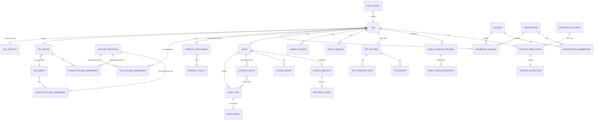

# Fachliches Datenmodell der myQR24-Domäne

**Status:** Zielarchitektur
**Stand:** 2026-10-06
**Ebene:** fachlich-logisch; technologieunabhängig
**Lesereihenfolge:** [Übersicht](README.md) → dieses Dokument → [Komponentensicht](20-COMPONENT-DATA-ARCHITECTURE.md) → [physische Abbildung](30-PHYSICAL-DATA-ARCHITECTURE.md)

## 1. Modellierungsziel und zentrale Trennung

Das Modell beschreibt fachliche Datenobjekte und ihre Beziehungen unabhängig davon, ob sie später in MySQL, Cloudflare KV, R2, einem Worker oder im Browser liegen.

Es unterscheidet drei Datenräume:

```text
A. Autoritative Control Plane
   vollständige fachliche Objekte, private Daten, Berechtigungen,
   Policies, Workflows, Audit und Publikationsaufträge

B. Öffentliche Data Plane
   aus A abgeleitete, minimale Routing- und Runtime-Projektionen;
   nur aktiv veröffentlichte öffentliche Daten

C. Lokaler Client-Kontext
   unverbindliche UI- und Gerätezustände; niemals fachlich autoritativ
```

Ein Objekt kann in mehreren Datenräumen vorkommen, jedoch nur **eine** fachlich autoritative Quelle besitzen. Eine Runtime- oder Routing-Projektion ist keine zweite Wahrheit, sondern ein versioniertes Veröffentlichungsergebnis.

## 2. Domänenlandkarte



Die Darstellung abstrahiert optionale Features wie Lost & Found, Chat, Guestbook und Check-in als eigenständige, später hinzukommende Teilaggregate. Sie hängen stets am TAG und dürfen die TAG-ID-, Routing- und Berechtigungsinvarianten nicht umgehen.

## 3. Domänenaggregate und Datenobjekte

### 3.1 Identität, Ausgabe und Routing-Kontext

| Objekt                       | Fachliche Aufgabe                                                  | Primärschlüssel / stabile Identität                                                   | Wesentliche Attribute                                                                                | Autorität                      |
| ---------------------------- | ------------------------------------------------------------------ | ---------------------------------------------------------------------------------------- | ---------------------------------------------------------------------------------------------------- | ------------------------------- |
| **TAG**                | verwaltetes physisches oder selbstgedrucktes TAG als Kernaggregate | interne`tagId`-Referenz; fachlich eindeutig durch öffentliche ID und kanonischen Wert | Lifecycle-Status, Ausgabedatum, Range-/Gruppenkontext, Aktivierungs- und Ablaufzeit                  | TCP                             |
| **TAG Identity**       | kryptografisch und öffentlich relevante TAG-Identität            | `tagId` plus `(length, decodedValue)`                                                | kanonische Base36-`tagId`, `length`, vollständiger `decodedValue`, ggf. 8-stelliger Basisslot | TCP; Edge prüft nur abgeleitet |
| **TAG Range**          | reservierter, lückenfreier numerischer TAG-Bereich                | stabile`rangeId`                                                                       | `start`, `end`, `length`, `active`, `groupId`                                              | TCP                             |
| **TAG Group**          | logische Standardgruppierung mehrerer Ranges                       | `groupId`                                                                              | Bezeichnung, Standard-Feature-Zuweisung, Status                                                      | TCP                             |
| **Feature Definition** | wiederverwendbare, schema-validierte Routing-/App-Funktion         | `featureId`                                                                            | Typ, aktiv, sichere URL-/App-Vorlage, typspezifische Attribute                                       | TCP                             |
| **Feature Assignment** | Prioritätsabhängige Zuordnung von Features                       | Scope + referenzierte`featureId`                                                       | Scope`tag`, `range`, `group`; sortierte Feature-Liste; Modus zukünftig explizit               | TCP                             |
| **Routing Projection** | minimaler Edge-Lookup ohne private Daten                           | KV-Key und Publikationsrevision                                                          | Range-Index, Gruppenregel, Range-Regel, direkte TAG-Regel, Feature-Dokument                          | abgeleitet aus TCP              |

#### Identitätsinvarianten

1. `tagId` ist eine kanonische, kleingeschriebene Base36-ID mit exakt 6 oder 8 Stellen.
2. `(length, decodedValue)` und `tagId` sind jeweils global eindeutig.
3. `decodedValue` ist immer der vollständige Feistel-decodierte kanonische Integer; bei 8 Stellen inklusive HMAC-Nibble.
4. Eine TAG-Range ist global sortiert, nicht überlappend und für 8 Stellen an 16er-Slotgrenzen ausgerichtet.
5. Ein TAG gehört durch seinen vollständigen kanonischen Wert höchstens zu einer aktiven Range und damit genau einem Gruppen-Kontext.
6. Edge-Regelpriorität lautet: direkte TAG-Zuweisung vor Range-Zuweisung vor Gruppen-Zuweisung.
7. Secrets, Feistel-Schlüssel und HMAC-Schlüssel sind keine Domänendaten und werden niemals an TAG-, Range-, Feature- oder Projektionsobjekte angehängt.

### 3.2 Produkt, Lifecycle, Besitz und Mandant

| Objekt                            | Fachliche Aufgabe                                                  | Wesentliche Beziehungen                                         | Wesentliche Attribute                                                                                     | Autorität |
| --------------------------------- | ------------------------------------------------------------------ | --------------------------------------------------------------- | --------------------------------------------------------------------------------------------------------- | ---------- |
| **Product Policy**          | zentral konfigurierbare Regeln eines Produkt-Tiers                 | wird von vielen Produktzuordnungen verwendet                    | Tier, Laufzeiten, Quoten, erlaubte Module, Claim-/Owner-Policy                                            | TCP        |
| **Product Assignment**      | konkrete kommerzielle/fachliche Zuordnung eines Tiers zu einem TAG | 1:1 zum TAG; referenziert Product Policy                        | Beginn, Ende, Status, Kontingent-Overrides, Verlängerungsstatus                                          | TCP        |
| **Account**                 | identifizierbare natürliche Person oder Serviceidentität         | kann Owner, Organisationsmitglied, Admin, Empfänger sein       | Kontostatus, Verifikation, Authentisierungsstärke; keine öffentlichen Felder                            | TCP        |
| **Organization**            | Betreiber-, Partner- oder Kundenkontext                            | hat Mitgliedschaften, TAG-Besitz-/Betriebsbeziehungen           | Status, Organisationsprofil, Vertrags-/Mandantenkontext                                                   | TCP        |
| **Organization Membership** | Rolle eines Accounts innerhalb einer Organisation                  | Account ↔ Organisation                                         | Rolle, Gültigkeit, Widerruf, Auditkontext                                                                | TCP        |
| **Ownership Anchor**        | dauerhafte fachliche Besitz-/Verwaltungsberechtigung eines TAGs    | TAG ↔ Account oder Organisation; optional Owner-Passphrase     | Typ`account`, `organization`, `owner-passphrase`; Status, eingerichtet am                           | TCP        |
| **Claim Credential**        | einmaliger oder beschränkter Aktivierungsnachweis                 | gehört zum Ausgabe-/Poolkontext und führt zu Ownership Anchor | nur Hash, Policy, Ablauf, Fehlversuche, Sperre, Verbrauch                                                 | TCP        |
| **Owner Credential**        | getrennte TAG-Owner-Passphrase                                     | 0..1 pro TAG zusätzlich/alternativ zum Accountanker            | Hash, Version, Lockout, Format-/Policy-Referenz                                                           | TCP        |
| **Lifecycle State**         | fachlicher Veröffentlichungs- und Nutzungsstatus                  | ist Eigenschaft des TAG und ggf. POI                            | `draft`, `pending-review`, `ready-to-publish`, `active`, `suspended`, `expired`, `archived` | TCP        |

Ein Claim ist kein dauerhafter Besitznachweis. Ein erfolgreicher Claim muss in einem `claim-pending-setup`-ähnlichen Übergang in mindestens einen Ownership Anchor überführt werden. Gedrucktes Claim-Secret, Owner-Passphrase, Gast-PIN und Besucher-PIN sind stets getrennte Credential-Domänen mit separaten Hashes, Limits und Audits.

### 3.3 Vault, Inhalte, Medien und Sichtbarkeit

| Objekt                         | Fachliche Aufgabe                                 | Kardinalität / Beziehungen      | Fachlich relevante Attribute                                                           | Autorität                             |
| ------------------------------ | ------------------------------------------------- | -------------------------------- | -------------------------------------------------------------------------------------- | -------------------------------------- |
| **Vault**                | Content-Aggregat eines TAGs                       | maximal ein Vault pro TAG        | Präsentationsprofil, öffentliche Beschreibung, Action-Mode, Veröffentlichungsstatus | TCP                                    |
| **Vault Item**           | einzeln verwaltbarer Inhalt                       | n:1 zu Vault                     | `kind` Asset/Notiz, Kategorie, Titel, Beschreibung, Sichtbarkeit, Sortierung, Status | TCP                                    |
| **Media Asset**          | Binärinhalt hinter einem Asset-Item              | 0..1 zu Asset-Item               | serverseitiger Objektbezug, MIME-Type, Größe, Digest, Varianten, Quarantänestatus   | TCP-Metadaten; Object Store für Bytes |
| **Content Block**        | serverseitig validierter Darstellungsbaustein     | n:1 zu Vault; n:m zu Vault Items | Blocktyp, Reihenfolge, Sichtbarkeit, strukturierte Attribute, Item-Referenzen          | TCP                                    |
| **Public Content Block** | bereinigter, sichtbarer Teil eines Content Blocks | Teil einer Runtime-Revision      | typisierte Darstellung, ausschließlich veröffentlichte sichtbare Attribute           | abgeleitet                             |
| **Visibility**           | Sichtbarkeit eines Items/Blocks                   | Wert je Objekt                   | `public`, `shared`, `private`, `ownerOnly`                                     | TCP                                    |
| **Vault Presentation**   | Präsentationsprofil, keine Berechtigung          | Wert je Vault                    | `standard`, `gallery`, `public-page`, `museum-exhibit`, `summit-guide`       | TCP                                    |

Inhalte werden nicht als frei ausführbares HTML modelliert. Ein Content Block referenziert zulässige Items über stabile IDs und enthält nur schema-validierte, typisierte Attribute. Für eine Galerie sind `coverAssetId`, geordnete `assetIds`, Layout und Beschriftungsregel fachliche Attribute; für Audio unter anderem `assetId`, optionales Transkript und Player-Sichtbarkeit.

### 3.4 Zugriff, Sessions und Freigaben

| Objekt                             | Zweck                                                | Beziehungen                                               | Erlaubte Daten                                                                        | Autorität    |
| ---------------------------------- | ---------------------------------------------------- | --------------------------------------------------------- | ------------------------------------------------------------------------------------- | ------------- |
| **Owner Session**            | kurzlebiger Verwaltungszugang zu einem konkreten TAG | n:1 zu TAG, optional zu Account-/Owner-Credential-Kontext | ausschließlich gehashter Sessionwert, Ablauf, Widerruf, letzte Nutzung, CSRF-Bindung | TCP           |
| **Guest Session**            | eingeschränkter Zugang für Gastbeiträge           | n:1 zu TAG                                                | gehashter Sessionwert, Ablauf, Widerruf                                               | TCP           |
| **Access Grant**             | globale zeitlich begrenzte Sichtbarkeitserweiterung  | n:1 zu Vault/TAG                                          | Scope`shared`/`private`, Beginn, Ablauf, Widerruf, Erzeuger                       | TCP           |
| **Access Request**           | browsergebundene Anfrage nach zusätzlichem Zugriff  | n:1 zu TAG/Vault                                          | nur Hashes von Browser-/Vergleichstoken, Status, Fristen, Rate-Limit-Kontext          | TCP           |
| **Recipient Grant**          | empfängergebundene, widerrufbare Freigabe           | n:1 zu Access Request; n:1 zu TAG                         | gehashter Empfängertoken, Scope, Nutzungslimit/-zähler, Ablauf, Widerruf            | TCP           |
| **Local Collection Entry**   | bewusster lokaler Merker des Nutzers                 | Client ↔`tagId`                                        | kanonische`tagId`, lokaler Zeitpunkt/Name; keine Berechtigung                       | TAG-App lokal |
| **Account Collection Entry** | persönliche, kontogebundene Sammlung                | Account ↔ TAG                                            | Account-ID, TAG-Referenz, Hinzugefügt-am, optionale eigene Notiz                     | TCP           |

Die Sichtbarkeit wird bei jedem privaten oder geschützten Zugriff serverseitig bestimmt. Ein Account- oder Collection-Eintrag erhöht die Sichtbarkeit nicht. Einzelverbräuche eines Recipient Grants müssen atomar gezählt werden; KV ist hierfür kein zulässiger Speicher.

### 3.5 POI, Community und optionale Feature-Domänen

| Objekt                             | Aufgabe                                                              | Beziehungen                                            | Autorität                |
| ---------------------------------- | -------------------------------------------------------------------- | ------------------------------------------------------ | ------------------------- |
| **POI Settings**             | Ergänzung eines TAGs zur autorisierten POI-/Community-Produktklasse | 0..1 zu TAG; referenziert Betreiber, Produkt und Vault | TCP                       |
| **POI Operator Role**        | rollenbasierter Betriebszugriff                                      | Account ↔ POI/Organisation                            | TCP                       |
| **Placement Evidence**       | private Betreiber-/Anbringungsnachweise                              | n:1 zu POI                                             | TCP                       |
| **POI Report**               | öffentliche Meldung mit Bearbeitungszustand                         | n:1 zu POI/TAG                                         | TCP                       |
| **Guestbook Entry**          | moderierter Besucherbeitrag                                          | n:1 zu TAG; optional zu Check-in/Guest Session         | TCP, spätere Erweiterung |
| **Chat Thread / Message**    | private Finder-/Owner-Kommunikation                                  | n:1 zu TAG, Teilnehmerbeziehungen                      | TCP, spätere Erweiterung |
| **Lost-Found Case**          | Verlust- und Fundstatus                                              | n:1 zu TAG; optional Chat-Referenz                     | TCP, spätere Erweiterung |
| **Check-in Event**           | servergeprüfter Besuch                                              | n:1 zu TAG, n:1 zu Account                             | TCP, spätere Erweiterung |
| **Collection Definition**    | fachliche Sammelregel, nicht lokale Liste                            | referenziert viele TAG-/POI-Kontexte                   | TCP, spätere Erweiterung |
| **Campaign / Reward Credit** | Kampagnenregel und atomarer Credit                                   | Campaign ↔ Check-in/Account                           | TCP, spätere Erweiterung |

POI-Status, GEO-Rohdaten, Moderation, Kampagnen und Betreiber-/Nachweisdaten sind nie Routing- oder öffentliche Runtime-Daten. Öffentliche POI-Ansichten entstehen nur als bereinigte Vault-/Runtime-Projektion.

### 3.6 Governance, Veröffentlichung und Nachvollziehbarkeit

| Objekt                            | Fachliche Aufgabe                                                            | Beziehungen                                         | Autorität                                        |
| --------------------------------- | ---------------------------------------------------------------------------- | --------------------------------------------------- | ------------------------------------------------- |
| **Public Runtime Revision** | unveränderliche veröffentlichte öffentliche Ansicht eines TAGs            | n:1 zu TAG; referenziert sichtbare Blöcke/Medien   | TCP als Quelle, Data Plane als abgeleitete Ablage |
| **Runtime Pointer**         | verweist auf aktuelle zulässige Runtime-Revision                            | 1 pro öffentlich aktivem TAG                       | abgeleitet                                        |
| **Routing Publication**     | fachlicher Publish-/Unpublish-Vorgang für Edge-Regeln                       | n:1 zu TAG oder Konfigurationsscope                 | TCP                                               |
| **Publication Outbox Job**  | zuverlässig wiederholbarer technischer Publikationsauftrag                  | n:1 zu Mutation/Publikation                         | TCP                                               |
| **Audit Event**             | unveränderbarer Nachweis einer sicherheits- oder fachlich relevanten Aktion | polymorph zu TAG, Account, POI, Inhalt, Publication | TCP                                               |
| **Retention Policy**        | Lösch-, Archivierungs- und Aufbewahrungsregeln                              | referenziert Produkt, Datenklasse, Objektklasse     | TCP                                               |

Der fachliche Status „veröffentlicht“ ist erst erreicht, wenn die MySQL-Transaktion, Audit-Event, Outbox-Auftrag und die bestätigte Veröffentlichung in der Zielumgebung konsistent nachweisbar sind. Bei Fehlern bleibt die fachliche Quelle unverändert bzw. der Auftrag retrybar; die Data Plane wird nicht als stillschweigend erfolgreich angenommen.

## 4. Schlüsselsystem und Referenzregeln

### 4.1 Schlüsselarten

| Schlüsselart                           | Beispiele                                                       | Sichtbarkeit / Regel                                                            |
| --------------------------------------- | --------------------------------------------------------------- | ------------------------------------------------------------------------------- |
| Öffentlicher Domänenschlüssel        | `tagId`, öffentliche Content-/Block-ID soweit geliefert      | stabil, kanonisch, darf in URLs vorkommen                                       |
| Interner Fachschlüssel                 | UUID/ULID für Item, Audit, Request, Publication                | nie aus URL-Parametern ableiten; nur kontrolliert nach außen geben             |
| Kryptografischer/technischer Lookup-Key | vollständiger dezimaler`decodedValue`, KV-Key, R2-Objekt-Key | nur serverseitig erzeugen; keine privaten IDs im öffentlichen Pfad             |
| Referenzschlüssel                      | `rangeId`, `groupId`, `featureId`                         | projektionstauglich, sofern nicht personenbezogen                               |
| Geheimnis / Credential                  | PIN, Claim-Code, Session-Rohwert, API-Token                     | niemals persistiert oder übertragen als Klartext; nur Hash/Secret Store        |
| Öffentlicher Projektionsschlüssel     | `public-tag-config/v1/{prefix}/{tagId}/{revision}.json`       | aus`tagId` und veröffentlichter Revision abgeleitet; enthält keine Owner-ID |

### 4.2 Referenzielle Integrität

1. Ein Vault, Produktassignment, POI Setting oder Owner Anchor darf nur für einen existierenden TAG angelegt werden.
2. Ein Feature Assignment darf nur auf eine gültige Feature Definition verweisen.
3. Ein Content Block darf nur auf aktive oder kontrolliert historisierte Vault Items desselben Vaults referenzieren.
4. Ein veröffentlichter Public Content Block darf nur auf veröffentlichte, für seine Visibility zulässige Items und Medienvarianten verweisen.
5. Ein Recipient Grant darf nur aus einer noch entscheidungsfähigen Access Request entstehen.
6. Eine direkte Routing-Regel darf keinen Wert außerhalb einer aktiven, gültigen Range aktivieren.
7. Der öffentliche Runtime-Pointer darf ausschließlich auf eine vollständig validierte, bestätigte Revision verweisen.

## 5. Fachliche Status- und Zeitmodelle

| Objekt                  | Zustände / Zeitregeln                                                                                                                                    |
| ----------------------- | --------------------------------------------------------------------------------------------------------------------------------------------------------- |
| TAG                     | `draft → pending-review → ready-to-publish → active`; `active → suspended/expired/archived`; nur `active` ist regulär öffentlich publizierbar |
| Vault Item              | `uploading → active`; alternativ `quarantined`, `deleted`; `uploading` und `quarantined` nie öffentlich                                       |
| Public Runtime Revision | `prepared → published → superseded`; keine inhaltliche Mutation nach `published`                                                                    |
| Publication Job         | `pending → processing → succeeded` oder `retryable-failed` / `terminal-failed`                                                                    |
| Access Grant            | aktiv nur im Intervall`[startsAt, expiresAt)` und ohne Widerruf                                                                                         |
| Access Request          | `open → approved/rejected/deleted/withdrawn/expired`                                                                                                   |
| Recipient Grant         | aktiv bis Ablauf/Widerruf und ggf. bis atomarem Nutzungslimit                                                                                             |
| POI                     | `pending-verification → active`; außerdem `review`, `suspended`, `expired`                                                                      |
| Owner/Guest Session     | aktiv bis Ablauf und solange nicht widerrufen; serverseitig an Scope und TAG gebunden                                                                     |

## 6. Datenklassifikation und Publikationsregel

| Klasse                | Beispiele                                                                                                         | Zulässige Datenräume                                      | Nicht zulässig                                                           |
| --------------------- | ----------------------------------------------------------------------------------------------------------------- | ----------------------------------------------------------- | ------------------------------------------------------------------------- |
| **Öffentlich** | `tagId`, veröffentlichter Titel, sichere Content-Blöcke, öffentliche Medienvariante, erlaubtes Redirect-Ziel | Runtime-Projektion, öffentliche API, R2 public/versioniert | Entwürfe, private Sichtbarkeiten                                         |
| **Intern**      | Range-/Gruppen-/Featurekonfiguration, Produktstatus, technische Job-IDs                                           | TCP, bereinigte Routing-Projektion wenn nötig              | Client-Storage ohne Zweck, öffentliche Runtime sofern nicht erforderlich |
| **Vertraulich** | Owner-/Organisationsdaten, private Items, Rechnungsmetadaten, POI-Nachweise, Supportdetails                       | TCP, privater Object Store, kontrollierte Admin-Contracts   | KV, öffentliche API, öffentliches R2, Browser-Persistenz                |
| **Geheim**      | Passwort-/PIN-/Credential-/Token-Hash, Session-Rohwert, Cloudflare API-Token, Kryptografie-Secret                 | TCP-Hashspeicher bzw. Secret Store                          | Logs, Audit-Metadaten, KV, R2, Runtime, Browser                           |

Ein Audit-Ereignis darf eine Korrelation, Akteurtyp, Objekt, Aktion und Ergebnis speichern, nie jedoch Klartext-PIN, Token, Credential, unredigierte private Inhaltsdaten oder Secrets.

## 7. Abhängigkeiten der Komponenten

| Datenobjektgruppe                                      | Erzeuger / autoritative Komponente       | Lesende Komponenten                                                        | Öffentliche Projektion?                  |
| ------------------------------------------------------ | ---------------------------------------- | -------------------------------------------------------------------------- | ----------------------------------------- |
| TAG, ID, Range, Group, Feature                         | TCP                                      | TCC, Publisher, Edge Router                                                | nur minimales Routingmodell               |
| Produkt, Ownership, Account, Organisation, Credentials | TCP                                      | TCC, Owner-API                                                             | nein                                      |
| Vault, Items, Blocks, Medienmetadaten                  | TCP                                      | TCC, TAG-App über öffentliche API                                        | nur bereinigte veröffentlichte Runtime   |
| Freigaben, Sessions, Zugriffsanfragen                  | TCP                                      | TAG-App über serverseitig autorisierte API, TCC nur Support gemäß Rolle | nein                                      |
| POI, Nachweise, Rollen, Meldungen                      | TCP                                      | TCC, Owner-/Moderator-UI                                                   | nur freigegebene öffentliche Darstellung |
| Runtime Revision / Media Reference                     | TCP erzeugt, Cloudflare hält abgeleitet | TAG-App Runtime                                                            | ja, strikt bereinigt                      |
| Local Collection                                       | TAG-App                                  | nur derselbe Browser                                                       | nein                                      |
| Account Collection                                     | TCP                                      | TAG-App, TCC nur bei berechtigtem Support                                  | nein                                      |
| Audit / Outbox                                         | TCP                                      | TCC, Publisher                                                             | nein                                      |

## 8. Architekturentscheidungen mit Datenwirkung

1. **TCC ist keine eigene Fachdomäne.** Es besitzt höchstens transiente UI-Zustände; fachliche Daten werden über TCP-APIs gelesen und verändert.
2. **TAG-App ist Runtime-Client, nicht Besitzer der Content-Wahrheit.** Sie rendert PublicTagView und sendet Commands; sie hält nur lokale Präferenzen, offlinefähige unverbindliche Entwürfe und explizite lokale Collections.
3. **Edge Router ist kein TAG-Register.** Er liest die minimale KV-Projektion und verarbeitet keine Vault-, Owner-, Session-, POI- oder Check-in-Daten.
4. **R2 ist kein Berechtigungssystem.** Objektzugriff wird durch TCP-/Runtime-API vor Ausgabe einer kurzlebigen URL oder eines Streams entschieden.
5. **Runtime-Revision und Routing-Projektion sind getrennt.** Routing bestimmt, wohin ein gültiger Scan geht; Runtime bestimmt, welche veröffentlichten Inhalte der Ziel-Client anzeigen darf.
6. **Eine Berechtigung wird nicht projiziert.** Aktive Freigaben, PIN-/Owner-/Gastzustände und Empfängertokens bleiben serverseitig, weil sie zeitkritisch, widerrufbar und sensibel sind.

## 9. Offene fachliche Entscheidungen vor physischer Umsetzung

| Thema                       | Benötigte Entscheidung                                          | Datenarchitektonische Auswirkung                    |
| --------------------------- | ---------------------------------------------------------------- | --------------------------------------------------- |
| primäre Public Runtime API | PHP-Read-API als Übergang oder Cloudflare Worker/API als Ziel   | Ort der Runtime-Projektionslese- und Cachelogik     |
| Accountmodell               | eigenes IAM, Passkeys, externer Identity Provider                | Account-/Session-/Recovery-Schema                   |
| Owner-Passphrase            | verpflichtend oder nur Fallback neben Account                    | Anzahl und Lebenszyklus von Ownership Anchors       |
| Medienverarbeitung          | Scan/Quarantäne/Varianten synchron oder asynchron               | Asset-Status, Job- und Eventmodell                  |
| Retention                   | Fristen für Entwürfe, gelöschte Medien, Audit, POI-Nachweise  | Löschjobs, Archivierung, Rechts-/Datenschutzmodell |
| Check-in/Rewards            | Datenbanktransaktion, Durable Object oder zusätzlicher Ledger   | atomare Event-/Credit-Modelle und Anti-Missbrauch   |
| Mandantentrennung           | logical tenant isolation oder getrennte Datenbanken für Partner | Indizes, Partitionierung, Zugriffspolicies, Backups |

Diese Entscheidungen verändern keine der oben definierten Fachgrenzen: TCP bleibt autoritativ; öffentliche Projektionen bleiben minimal, versioniert und frei von Geheimnissen.
