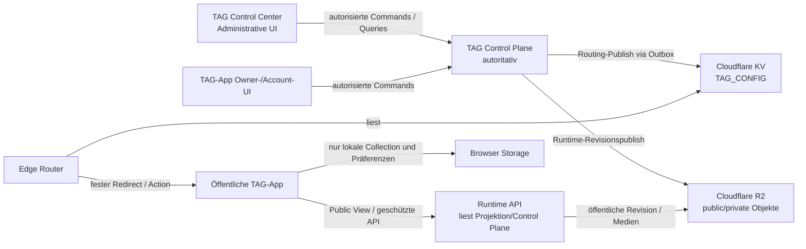

# Datenarchitektur je Plattformkomponente

**Status:** Zielarchitektur  
**Stand:** 2026-10-06  
**Ebene:** logisch; Komponentensicht  
**Grundlage:** [fachliches Datenmodell](10-DOMAIN-DATA-MODEL.md)

## 1. Überblick der Datenverantwortung



| Komponente | Datenrolle | Autoritative Objekte | Abgeleitete / temporäre Objekte |
| --- | --- | --- | --- |
| Edge Router | Scan-Validator und Routing-Resolver | keine | KV-Routing-Projektion während Request |
| TAG-App | Public-/Owner-/Collection-Client | nur lokale, löschbare Clientpräferenzen und lokale Collection | PublicTagView, Session-Cookies, kurzlebige View-Zustände |
| TCP | Fachliche Quelle und Publisher | sämtliche fachlichen Kernobjekte, Policies, Inhalte, Sessions, Audit, Outbox | generierte Routing-/Runtime-Projektionen |
| TCC | Administrativer TCP-Client | keine fachlichen Objekte | UI-Filter, Form-Entwürfe, serverseitige Session-Cookies |

## 2. Edge Router: minimale Routing-Daten

### 2.1 Verantwortung und Datenfluss

Der Edge Router erhält eine öffentliche Scan-URL, validiert Host, Pfad und TAG-ID kryptografisch und löst dann ausschließlich die publizierte Routing-Konfiguration auf.

```text
GET https://p.qr4.uk/t/{tagId}
  → URL-/ID-Normalisierung
  → Feistel-/HMAC-Prüfung
  → TAG_CONFIG lesen
  → aktive Range finden
  → Regelpriorität: TAG > Range > Group
  → Feature-Dokument lesen
  → sicherer Redirect oder JSON-Aktionsdokument
```

Die Komponente führt weder eine TAG-Verwaltungsdatenbank noch eine Content-, Owner-, Session- oder POI-Datenhaltung.

### 2.2 Logische KV-Objekte und Beziehungen

| KV-Objekt | Key | Beziehung / Inhalt | Zulässige Attribute |
| --- | --- | --- | --- |
| Range Index | `tag-range-index` | globale Liste aller aktiven/inaktiven TAG-Ranges | Version, `rangeId`, dezimale `start`/`end`, `length`, `groupId`, `active` |
| Range Rule | `range-rule:{rangeId}` | Feature-Zuweisung einer Range | `featureIds` |
| Group Rule | `group:{groupId}` | Standard-Feature-Zuweisung der Gruppe | `id`, `featureIds` |
| Direct TAG Rule | `tag:{decodedValue}` | spezifische Feature-Zuweisung nach erfolgreicher Range-Bestätigung | `featureIds` |
| Feature Definition | `feature:{featureId}` | wiederverwendbare Funktionsdefinition | Typ, `enabled`, sichere App-/URL-Templates, streng typspezifische öffentliche Konfiguration |

Die Beziehungskette lautet:

```text
vollständiger decodedValue
  → aktive Range im tag-range-index
  → rangeId und groupId
  → tag:{decodedValue} ODER range-rule:{rangeId} ODER group:{groupId}
  → feature:{featureId}
  → Redirect oder Action
```

Die direkte TAG-Regel hat nur dann Wirkung, wenn der vollständige `decodedValue` nach der kryptografischen Validierung in einer aktiven Range liegt. Sie kann keine außerhalb reservierter Ranges liegenden Werte aktivieren.

### 2.3 Feature-Datenvertrag

Ein Feature ist eine öffentliche technische Funktionsdefinition, kein Content-Speicher. Es referenziert nur fest konfigurierte, serverseitig validierte Ziele.

| Featuretyp | Minimal zulässige Attribute | Nicht zulässig im Edge-Feature |
| --- | --- | --- |
| `redirect` | `id`, `type`, `enabled`, `url` oder `urlTemplate`, `status`, optional kontrollierte `signing` | Request-URLs, freie Query-Parameter, Secrets, Ownerdaten |
| `tag-vault` | `id`, `type`, `enabled`, `appUrlTemplate`, Präsentationshinweis, öffentliche Action-Policy | Vault-Inhalte, private Sichtbarkeit, PIN-/Session-/Grantdaten |
| `tag-chat` | App-Ziel, Aktivierungsmodus, öffentlicher Chatstatus | Threads, Nachrichten, Teilnehmer, Tokens |
| `lost-found` | App-Ziel, Referenz auf Chat-Feature | Finder-/Owner-Kontakt- oder Fallinformationen |
| `tag-guestbook` | App-Ziel | Beiträge, Moderation, Autoreninformationen |
| `tag-checkin` | App-Ziel, abstrakte Verifikations-/Collection-Defaults | Geo-Koordinaten, Scan-Historie, Credits, Kampagnenfortschritt |
| `image` / `json` / `feature-set` | strikt schema-validierte nicht geheime öffentliche Konfiguration | Binärdaten, frei ausführbares JSON, private Appzustände |

Für einen Basis-Vault kann die Definition beispielsweise festlegen, dass ein gültiger Scan auf `https://app.myqr24.com/tag/{tagId}` führt. Die tatsächliche View- und Content-Auflösung erfolgt erst in der TAG-App-/Runtime-API-Schicht.

### 2.4 Edge Router: Datenklassen und Verbote

| Zulässig | Nicht zulässig |
| --- | --- |
| kanonische TAG-ID, vollständiger `decodedValue` nur im Request-Kontext, Range-/Group-/Feature-IDs, sichere Ziel-Templates, aktive Flags | Account-/Owner-ID, Organisation, Claim- oder Owner-Credential, Hash, PIN, Session, Audit, Produktkontingent, POI-Nachweis, Vault-Content, R2-private Key, Geo-Rohdaten |
| Cloudflare Worker Secrets ausschließlich als Laufzeitsecrets | Secrets in KV, Feature-Dokumenten, Responses oder Logs |
| technische Fehler als einheitliches `404` | Detailfehler, die Entwürfe, Sperrgründe oder Existenz offenbaren |

### 2.5 Konsistenzmodell

Cloudflare KV ist ein replizierter Read Store und bietet keine transaktionale Mehrschlüssel-Änderung für fachliche Entscheidungen. Daher:

1. TCP validiert und persistiert die komplette Konfiguration.
2. TCP erzeugt einen dedizierten Publish-Auftrag.
3. Der Publisher schreibt KV-Objekte in sicherer, idempotenter Reihenfolge.
4. Der veröffentlichte Zustand wird erst nach bestätigten API-Aufrufen in TCP markiert.
5. Bei temporärer KV-Inkonsistenz verhält sich der Worker fail-closed; es gibt keine Fallback-Entscheidung aus Clientdaten.
6. Einmalfreigaben, Zähler, Locks und Besitzentscheidungen liegen niemals in KV.

## 3. TAG-App: Runtime-, Feature- und Clientdaten

### 3.1 Rolle der TAG-App

Die TAG-App ist eine öffentliche PWA und spätere Owner-/Account-Oberfläche. Sie besitzt keine Routing- oder Berechtigungsautorität. Sie:

- rendert eine neutrale Startseite sowie `/tag/{tagId}`;
- fordert einen typisierten öffentlichen `PublicTagView` an;
- zeigt nur vom Server erlaubte Blöcke, Medienreferenzen und Aktionen;
- führt Owner-, Claim-, PIN-, Collection- oder Upload-Commands nur über serverseitige APIs aus;
- hält lokale Daten ausschließlich als Komfortfunktion ohne fachliche Wirkung.

### 3.2 PublicTagView als Runtime-Datenvertrag

Die TAG-App konsumiert einen versionierten, bereinigten Datenvertrag. Er enthält keine allgemeinen Verwaltungsobjekte.

```ts
type PublicTagView = {
  contractVersion: 1;
  tag: {
    tagId: string;
    displayName?: string;
    presentation: "standard" | "gallery" | "public-page" | "museum-exhibit" | "summit-guide";
  };
  runtime: {
    revision: string;
    accessMode: "public" | "pin-required" | "closed" | "redirect";
    publishedAt?: string;
  };
  blocks: PublicContentBlock[];
  media: PublicMediaReference[];
  actions: PublicAction[];
};
```

| Teilobjekt | Inhalt | Herkunft | Wichtige Regeln |
| --- | --- | --- | --- |
| `tag` | nur öffentliche Bezeichnung und darstellungsrelevante Attribute | Public Runtime Revision | `tagId` ist kanonisch; keine interne TAG-/Owner-ID |
| `runtime` | öffentliche Runtime-Revision und neutraler Zugriffsmodus | Public Runtime Pointer/Revision | `closed` liefert keine Sperrursache |
| `blocks` | typisierte, sichtbare Hero-, Text-, Galerie-, Audio-, Dokument-, Callout- oder Linkblöcke | bereinigte Content Blocks | nie Roh-HTML, Skripte oder nicht sichtbare Item-IDs |
| `media` | nur freigegebene Varianten, Alt-Texte, sichere URLs/Handles | Public Media References | Originalkeys und private Varianten fehlen |
| `actions` | nur aktuell zulässige Aktionen | Runtime-/Policy-Mapper | keine Autorisierung allein anhand dieser UI-Hinweise |

Der Server darf `pin-required` als neutralen Einstieg modellieren. Die PIN-Prüfung und nachfolgende geschützte Darstellung bleiben serverseitig. Eine `closed`-Antwort ist nicht unterscheidbar von nicht veröffentlichter, gesperrter oder unbekannter Fachlage.

### 3.3 Feature-Definitionen im Client

Die TAG-App kennt einen **Client-Renderer** für versionierte, serverseitig validierte Feature- und Content-Formen. Sie darf keine frei interpretierbare Konfiguration ausführen.

| Client-Feature / Block | Renderingdaten | Serverpflicht |
| --- | --- | --- |
| Hero | Titel, Bildreferenz, Alt-Text, Sichtbarkeit bereits gefiltert | Asset-/Visibility-Prüfung |
| Rich Text | strukturierter/sanitierter Text | Sanitizing und Schema-Validierung |
| Gallery | geordnete öffentliche Assetreferenzen, Cover, Layout | jedes Asset/Block-Referenz prüfen |
| Audio | Player-Quelle, Titel, Transkript | autorisierte URL und keine Autoplay-Pflicht |
| Document | sichtbarer Titel, Download-Aktion | Download erneut serverseitig prüfen |
| Link / Google Place | Label und validierte externe URL | Scheme-/Allowlist-/URL-Validierung |
| Redirect Action | vom Edge oder Runtime-Service bestätigtes Ziel | Template-/Signaturvalidierung |
| Check-in / Guestbook / Chat Einstieg | nur Aktivierungs-/Anzeigehinweis | Account, Policy, Session, Moderation und Geo-Prüfung serverseitig |

Eine Feature-Definition darf nie Script, iFrame-HTML, Handler, SQL, R2-Key, Token oder beliebige Endpoint-URL enthalten.

### 3.4 TAG-App: lokale Datenobjekte

| Lokales Objekt | Zweck | Zulässige Felder | Speicher-/Cache-Regel |
| --- | --- | --- | --- |
| Local Collection Entry | Nutzer markiert eine bekannte TAG-ID bewusst | `tagId`, lokaler Anzeigename/Notiz, hinzugefügt/geändert am | IndexedDB oder Local Storage; löschbar, nicht geteilt, kein Besitznachweis |
| Permission Preference | z. B. vorheriger bewusster Kamera-Start oder UI-Hinweis | lokale Präferenz, kein Systemrecht | lokal; Browser-Systemstatus bleibt maßgeblich |
| Scanner Draft | manuell eingegebene/erkannte URL bis Navigation | Kandidatenstring, Validierungsergebnis | nur Arbeitsspeicher; keine Scan-Historie ohne Einwilligung |
| Offline Draft | unverbindlicher Entwurf für unterstützte Owner-Formulare | minimierter, verschlüsselungsfrei nicht sensibler Entwurf | nur wenn explizit aktiviert; kein Claim, Publish, Credential oder private Medien |
| UI State | Dialog, Filter, Lade-/Fehlerstatus | nicht fachlich | Arbeitsspeicher |
| Service-Worker Cache | App-Shell und ausschließlich sichere öffentliche, versionierte Assets | Build-/Runtime-Asset | nie private View, personalisierte API, PIN-/Claim-Response oder signierte URL |

Local Storage und IndexedDB enthalten niemals Owner-/Gast-/Empfänger-Sessionwerte, PINs, Claim-Secrets, private View-Daten, signierte Downloads oder fachlich verbindliche Publish-/Besitzzustände.

### 3.5 Account Collection und lokale Übernahme

```text
lokale Collection (Browser)
  -- bewusste, idempotente Nutzeraktion nach Account-Anmeldung -->
TCP: Account Collection Entry
```

| Regel | Datenwirkung |
| --- | --- |
| keine automatische Synchronisation | Browserdaten werden nicht stillschweigend an TCP übertragen |
| idempotentes Hinzufügen | eindeutige Kombination `(accountId, tagId)` verhindert Duplikate |
| keine Rechtewirkung | Eintrag verändert weder `Visibility` noch Ownership Anchor |
| personenbeziehbar | persönliche API-Antworten erhalten `Cache-Control: no-store` |
| Löschung | lokal und kontogebunden jeweils getrennt möglich; keine Auswirkung auf das TAG |

### 3.6 TAG-App: Datensicherheit und Cachegrenzen

| Antwort / Objekt | Caching |
| --- | --- |
| App-Shell, Manifest, statische Bundles | versioniert cachebar |
| öffentliche unveränderliche Runtime-Revision/Medienvariante | kontrolliert cachebar, nur wenn `public` und versioniert |
| aktuelle PublicTagView mit Widerrufs-/Statussensitivität | kurze TTL oder serverseitig invalidierbar |
| `shared`/`private`-sichtbare View | `Cache-Control: no-store` |
| Owner-/Account-/Collection-/Claim-/PIN-Antwort | `Cache-Control: no-store` |
| kurzlebige Download-URL | nicht persistieren; TTL höchstens Restlaufzeit der Berechtigung |

## 4. TAG Control Plane (TCP): autoritative Datenarchitektur

### 4.1 Datenverantwortung

TCP ist die fachliche Quelle für:

- TAG-Identitäten, Reservierungen, Ranges, Gruppen und Features;
- Produktpolicy, Lifecycle, Ausgabe-/Pool- und Claim-Workflows;
- Accounts, Organisationen, Rollen und dauerhafte Ownership Anchors;
- Vaults, Items, Blocks, Medienmetadaten, Visibility und Quoten;
- Owner-/Gast-/Empfänger-/Account-Sessions, Freigaben, Zugriffsanfragen;
- POI-Status, Betreiberrollen, Nachweise, Meldungen und Moderation;
- Audit, Outbox, Publish-Historie, Runtime-Revisionen und Retention.

TCP stellt dafür getrennte Contracts bereit:

| Contractklasse | Leser / Nutzer | Beispiel |
| --- | --- | --- |
| Admin Query/Command | TCC, Plattformadmin | Range anlegen, Feature validieren, Status ändern, publishen |
| Owner Query/Command | TAG-App, Account-/Owner-Session | Content bearbeiten, Upload beginnen, Freigabe ändern |
| Public Read | TAG-App ohne Anmeldung | `PublicTagView`, neutrale Verfügbarkeit |
| Protected Runtime Read | TAG-App nach serverseitiger Zugangskontrolle | geschützte Sichtbarkeit, Download-Entscheidung |
| Publisher Contract | TCP-intern / Publisher | outbox-basierter KV-/R2-Publish, Ergebnisrückmeldung |
| Support Contract | TCC, streng rollenbasiert | anonymisierte Claim-/Statushilfe, Sperre/Retry mit Audit |

Die API akzeptiert keine clientseitige Entscheidung über Tier, Status, Ownership, Visibility, Revision, R2-Key oder Cloudflare-Ziel.

### 4.2 Logische Teilbereiche und Kernbeziehungen

| TCP-Bereich | Autoritative Objekte | Importiert / referenziert | Liefert an andere Komponenten |
| --- | --- | --- | --- |
| TAG Registry | TAG, Identity, Range, Group, Feature Assignment | Feature Definition, Produkt | Routing-Projektion, TAG-Status |
| Product & Fulfillment | Product Policy/Assignment, Pool, Bestellung (später), Claim Credential | Account, Organisation, TAG | zulässige Produkt-/Lifecycle-Entscheidungen |
| IAM & Ownership | Account, Organization, Membership, Ownership Anchor, Owner Credential | TAG, Produktpolicy | serverseitige Sessions und Scope-Entscheidungen |
| Vault CMS | Vault, Item, Asset-Metadaten, Content Block, Visibility | TAG, Ownership, Produktquote | Public Runtime Revision, Owner-View |
| Access Service | Owner/Guest Sessions, Grants, Requests, Recipient Grants | Vault, Account, Owner Credential | gefilterte Views, Downloadentscheidung |
| POI Governance | POI Settings, Roles, Evidence, Report | TAG, Vault, Organization, Product | POI-Status und freigegebene Inhalte |
| Publishing & Audit | Runtime Revision, Routing Publication, Outbox, Audit | alle Mutationen | KV-/R2-Projektionen, TCC-Status |
| spätere Feature-Domänen | Lost & Found, Chat, Guestbook, Check-in, Campaign | TAG, Account, POI, Policy | feature-spezifische APIs ohne Edge-Private-Daten |

### 4.3 Grenzen zwischen fachlichem und technischem Status

| Fachobjekt | Fachlicher Zustand | Technischer Begleitzustand | Regel |
| --- | --- | --- | --- |
| TAG | `active` | Routing-/Runtime-Publish bestätigt | aktiv öffentlich nur nach bestätigter Projektion |
| Vault Item | `active` | Asset hochgeladen, geprüft, Varianten bereit | keine öffentliche Referenz vor Abschluss |
| Public Runtime Revision | `published` | R2-Objekt und Pointer bereit | Pointerwechsel erst nach erfolgreichem Objekt-Publish |
| Routing Publication | „veröffentlicht“ | KV-Schlüssel bestätigt | Status nicht vor Cloudflare-Bestätigung setzen |
| Recipient Grant | aktiv / verbraucht | atomarer Nutzungszähler | Zähler und Nutzung in einer Transaktion |
| POI | `active` | Nachweise/Review erfüllt | Module einzeln serverseitig deaktivierbar |

### 4.4 TCP-Daten, die externe Komponenten nutzen

| TCP-Objekt | Edge Router | TAG-App | TCC |
| --- | --- | --- | --- |
| TAG Identity / Range / Group | nur als minimale KV-Projektion | `tagId` im Pfad, keine Decoderlogik | vollständig nach Berechtigung |
| Feature Definition / Assignment | bereinigte KV-Feature-Dokumente | Renderer-/Runtime-Hinweise, keine Steuerungsautorität | vollständige Edit-/Diff-Ansicht |
| Vault / Content / Media | nie | gefilterter Public-/Owner-Contract | Verwaltung nach Rolle |
| Produkt / Ownership / Credentials | nie | nur abgeleitete Capabilities | Verwaltung/Support nach Rolle |
| Session / Grant / Request | nie | nur Cookie und aktuell erlaubtes Ergebnis | Support-/Auditansicht nach Rolle |
| Audit / Outbox / Publication | nie | nie | Status, Korrelation und redigierte Details |

## 5. TAG Control Center (TCC): administrative Datenperspektive

### 5.1 Keine parallele Datenquelle

TCC ist eine administrative Anwendung und besitzt kein separates fachliches TAG-, Content- oder Berechtigungsmodell. Alle persistenten Fachänderungen erfolgen als TCP-Command, inklusive Servervalidierung, RBAC, Audit und ggf. Outbox.

```text
TCC-Formular
  → TCP Command API
  → MySQL-Transaktion + Policy + Audit + Outbox
  → bestätigte Result-DTO
  → TCC-Ansicht
```

Eine TCC-UI darf ihre eigenen Validierungen für gute Bedienbarkeit besitzen; ihre Ergebnisse sind nie entscheidend. Manipulierte Requests werden vollständig in TCP abgewehrt.

### 5.2 TCC-Lesesichten und Datenobjekte

| TCC-Ansicht | konsumierte TCP-Objekte | Datensparsame Darstellung |
| --- | --- | --- |
| TAG-Register | TAG, Identity, Lifecycle, Product Assignment, Public Status | keine Claim- oder Owner-Secrets |
| Range-/Gruppenverwaltung | Range, Group, Feature Assignment, Projection Diff | keine Cloudflare-Tokens |
| Featurekatalog | Feature Definition, Schema-/Validation Result | keine beliebigen Scripts/Secrets |
| Pool-/Claim-Support | Pool-/Ausgabestatus, erlaubte Strategie, anonymisierte Statusinformation | keine Credential-Hashes, Klartextcodes, Fehlversuchszähler |
| Runtime-Publishing | Runtime Revision, Diff, Publish-/Retry-Status, Audit-Korrelation | keine privaten Items oder R2-Interna |
| Vault-Verwaltung | Vault, Content Block, Item, Assetstatus | nur für zuständige Rolle; private Inhalte nicht in allgemeinen Listen |
| POI-Review | POI Settings, redigierte Evidence-Metadaten, Reports, Rollen | Nachweisdokumente nur bei expliziter Compliance-Berechtigung |
| Audit / Support | Audit Event, Korrelation, Ergebnis, Zeitstempel | keine Secrets, Tokens, PINs, unredigierte Payloads |

### 5.3 TCC-eigene Daten

| Objekt | Persistenzempfehlung | Einschränkung |
| --- | --- | --- |
| Authentisierte Admin-Session | TCP-/IAM-Session-Cookie; serverseitige Sessionablage | `HttpOnly`, `Secure`, `SameSite`, CSRF; nicht Local Storage |
| UI-Filter, Spalten, letzte nicht sensible Ansicht | optional Browserpräferenz oder serverseitige Profilpräferenz | keine Secrets, privaten Inhalte oder berechtigungsrelevante Caches |
| Formularentwurf | Arbeitsspeicher oder explizit serverseitiger Entwurf | keine Persistenz von Credentials oder Nachweisdateien im Browser |
| Uploadvorbereitung | kurzlebige TCP-Upload-Referenz | kein freier Object-Key, keine Cloudflare-Credentials |
| Runtime-/Projection-Diff | serverseitig berechnetes, redigiertes DTO | nach Ansicht verwerfen; keine private Payload lokal cachen |

### 5.4 Spezifische TCC-Beziehungen zum TCP

| TCC-Aktion | TCP-Objekte | Erforderliche Serverwirkung |
| --- | --- | --- |
| TAG reservieren | TAG, Identity, Range, Pool, Audit | einzigartige Reservierung in Transaktion |
| Status aktivieren/sperren | TAG, Product Assignment, Audit, Publication Outbox | Policy prüfen, Runtime/Routing neutralisieren oder publizieren |
| Feature konfigurieren | Feature Definition, Assignment, Validation | Schema-/Zielvalidierung vor Speicherung |
| Runtime veröffentlichen | Runtime Revision, Pointer, Outbox, Audit | nur bereinigte aktive Revision publizieren |
| Owner-/Support-Claim | Claim Credential, Ownership Anchor, Audit | Credential nur am TCP prüfen, neutral antworten |
| POI prüfen | POI Settings, Evidence, Roles, Reports | Status-/Module serverseitig steuern |
| Publish wiederholen | Outbox Job, Publication, Audit | idempotent, korreliert, keine Browser-KV-Operation |

## 6. Komponentenübergreifende Datenflüsse

### 6.1 TAG-Ausgabe bis Scan

```text
TCC → TCP: TAG anlegen/reservieren
TCP: Identity, Range-Beziehung, Produkt, Feature Assignment, Audit
TCP Publisher → KV: minimale Routing-Projektion
Edge Router ← KV: validiert Scan und löst Feature
Edge Router → TAG-App: feste Route / Action
TAG-App → Runtime API: PublicTagView anfordern
```

### 6.2 Content-Änderung bis öffentliche Anzeige

```text
TAG-App Owner oder TCC
  → TCP: Vault-/Block-/Asset-Command
  → TCP: Policy, Visibility, Assetprüfung, Audit
  → TCP: neue Public Runtime Revision vorbereiten
  → TCP Outbox/Publisher: R2-Revision + Pointer publizieren
  → TAG-App: liest veröffentlichte Runtime-Revision
```

### 6.3 Sperrung, Ablauf und Widerruf

```text
TCP Lifecycle-/Policy-Entscheidung
  → Audit + Outbox
  → Routing entfernen oder neutrale Regel setzen
  → Runtime Pointer entfernen/auf neutrale Revision setzen
  → Public API liefert neutrale Nichtverfügbarkeit
  → keinerlei Sperr-, Owner- oder Claimgrund nach außen
```

### 6.4 Geschützter Content und Freigaben

```text
TAG-App → Runtime API: View/Download-Request
Runtime API → TCP Access Service:
  Session, Grant, Ablauf, Widerruf, Visibility prüfen
TCP → Runtime API: ausschließlich erlaubte Daten / kurzlebige URL
TAG-App: nicht dauerhaft cachen
```

## 7. Prüfregeln für Schnittstellen

| Regel | Betroffene Komponenten |
| --- | --- |
| Cloudflare-Schreibzugriff nur aus serverseitigem Publisher | TCP, TCC, TAG-App |
| TCC und TAG-App führen keine clientseitige Ownership-/Policy-Entscheidung durch | TCC, TAG-App |
| Edge Router verarbeitet nur ID/Routing; keine privaten Feature-Daten | Edge Router |
| PublicTagView enthält weder Entwurfs- noch Owner-/Credential-/Auditdaten | TAG-App, TCP |
| R2-Schlüssel werden nur serverseitig abgeleitet; keine frei wählbaren Clientpfade | TCP, TAG-App |
| persönliche und geschützte Antworten sind `no-store` | TCP, TAG-App |
| Publishing und Unpublishing sind auditierbar, idempotent und retrybar | TCP, TCC |
| Runtime- und Routing-Projektionen können unabhängig versioniert werden | TCP, Edge Router, TAG-App |
