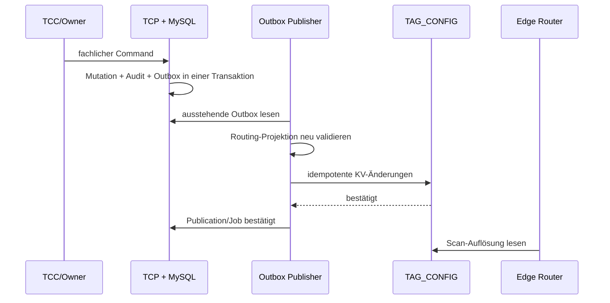
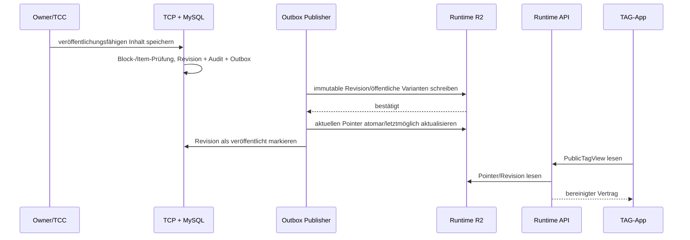

# Physische Datenarchitektur und Speicherabbildung

**Status:** Zielarchitektur; die beschriebenen TCP-/Runtime-Speicher sind überwiegend geplant  
**Stand:** 2026-10-06  
**Grundlage:** [fachliches Datenmodell](10-DOMAIN-DATA-MODEL.md) und [Komponentensicht](20-COMPONENT-DATA-ARCHITECTURE.md)

## 1. Technologie- und Autoritätsmatrix

| Plattform / Speicher | Zweck | Autoritativ? | Datenklassen | Bemerkung |
| --- | --- | --- | --- | --- |
| Dogado PHP + MySQL (TCP) | fachliche Verwaltungsdaten, Policies, IAM, Content-Metadaten, Audit, Outbox | **ja** | intern, vertraulich, Hashes | Ziel der Control Plane |
| Server Secret Store / Umgebungsvariablen | Cloudflare API-Token, kryptografische Secrets, DB-Zugang | ja, für Secrets | geheim | keine Speicherung in MySQL-Fachdaten, Git oder Browser |
| Cloudflare KV `TAG_CONFIG` | Scan-/Routing-Read-Model | nein, Projektion | minimal öffentlich/intern | existierende Edge-Router-Bindung |
| Cloudflare Worker | Request-lokale Verarbeitung, keine dauerhafte Fachdatenhaltung | nein | flüchtig | Secrets nur als Worker-Runtime-Bindings |
| Cloudflare R2 privat | Originalmedien, private Varianten, Nachweisdokumente | nein, Binärablage | vertraulich | Zugriff nur über serverautorisierten API-Entscheid |
| Cloudflare R2 public/versioniert | veröffentlichte Runtime-JSON-Revisionen und zulässige öffentliche Medienvarianten | nein, Projektion | öffentlich | optionales Zielmodell nach Basis-PHP-Read-API |
| Public Runtime API | liest veröffentlichte Revision bzw. TCP-Read-Model und erzwingt View-/Downloadpolicy | nein | öffentlich/geschützt | Übergang PHP-Read-API, Ziel Cloudflare-API möglich |
| TAG-App Browser | App Shell, lokale Collection, nicht sensible Präferenzen | nur für lokale Präferenzen | lokal | keine Berechtigungsquelle |
| TCC Browser | UI-Zustand und nicht sensible Präferenzen | nein | lokal | Authentisierung ausschließlich via sichere Server-Session |

> **Wichtige Übergangsregel:** Die erste Basis-Vault kann öffentliche Daten aus einer PHP-Read-API über MySQL liefern. Die nachfolgend beschriebene Runtime-R2-Projektion ist das Zielmodell für eine Cloudflare-native Auslieferung. Beide Varianten verwenden dieselbe TCP-Autorität und denselben `PublicTagView`-Vertrag.

## 2. TCP: MySQL als autoritative relationale Datenbank

### 2.1 Konventionen

| Thema | Festlegung |
| --- | --- |
| Primärschlüssel | UUIDv7 oder ULID als `CHAR(26)`/`BINARY(16)` nach Technologieentscheidung; öffentliche `tag_id` bleibt fachlicher Unique Key |
| Zeit | UTC, z. B. `DATETIME(6)`; alle Fristen/Audits in UTC |
| JSON | `JSON` nur für schema-versionierte, validierte Strukturen; referenzielle Kernbeziehungen bleiben relational |
| Soft Delete | `deleted_at` für Inhalte; fachliche Löschfristen per Retention-Job |
| Mandant | bei mandantenfähigen Objekten explizite `organization_id`-/Owner-Beziehung; keine implizite Isolation allein über UI |
| Optimistische Sperre | `version` / `updated_at` für editierbare Aggregate, insbesondere Vault/Content/POI |
| Audit | append-only; fachliche Payloads redigiert, Secrets ausgeschlossen |
| Zeichensatz | `utf8mb4`, konsistente Case-/Collation-Entscheidung; IDs ausschließlich kanonisch speichern |
| Datenbank-Constraints | IDs, Statuswerte, Fremdschlüssel und Unique Keys serverseitig erzwingen; UI-Validierung ist ergänzend |

### 2.2 TAG-Registry und Routingkonfiguration

| Zielrelation | Fachobjekt | Schlüssel / Constraints | Wesentliche Spalten / Hinweise |
| --- | --- | --- | --- |
| `tags` | TAG + Identity | `PRIMARY KEY(id)`; `UNIQUE(tag_id)`; `UNIQUE(length, decoded_value)` | `tag_id`, `decoded_value` als dezimaler String/geeigneter großer Integer, `length`, `range_id`, Lifecycle, `created_at`, `activated_at`, `expires_at` |
| `tag_ranges` | TAG Range | `PRIMARY KEY(id)`; `UNIQUE(range_code)` | `range_code`, `start_value`, `end_value`, `length`, `group_id`, `active`; globale Nichtüberlappung zusätzlich transaktional prüfen |
| `tag_groups` | TAG Group | `PRIMARY KEY(id)`; `UNIQUE(group_code)` | stabile `group_code`, Bezeichnung, Status |
| `feature_definitions` | Feature Definition | `PRIMARY KEY(id)`; `UNIQUE(feature_code)` | `feature_code`, `type`, `enabled`, `schema_version`, `definition_json`, `validation_status` |
| `tag_feature_assignments` | direkte Zuweisung | `UNIQUE(tag_id, position)` | `tag_id`, `feature_id`, `position`, optional später `mode` |
| `range_feature_assignments` | Range-Zuweisung | `UNIQUE(range_id, position)` | `range_id`, `feature_id`, `position` |
| `group_feature_assignments` | Gruppen-Zuweisung | `UNIQUE(group_id, position)` | `group_id`, `feature_id`, `position` |
| `routing_publications` | Publish-Fachobjekt | `PRIMARY KEY(id)` | Scope, Zielumgebung, gewünschte/realisierte Version, Status, Korrelation, angefordert/abgeschlossen |
| `publication_outbox` | zuverlässiger Publish-Job | idempotenter `deduplication_key` | Eventtyp, Payload-Referenz/Hash, Ziel, Status, Versuche, nächster Versuch, Korrelation |
| `publication_attempts` | technische Nachweise | n:1 zu Outbox | Ergebniscode, redigierte Fehlerklasse, Zeitpunkt, externe Request-Korrelation |

**`decoded_value`-Speicherung:** Weil der 8-stellige Raum über die bequeme Reichweite mancher SQL-Integer- und PHP-Plattformpfade hinausgehen kann und die Domänenregel ohnehin eine verlustfreie Behandlung verlangt, wird der kanonische Wert als streng validierter dezimaler String gespeichert. Jeder Vergabe-/Vergleichspfad verwendet BigInt-/arbitrary-precision-fähige Applikationslogik. Datenbank-Constraints sichern mindestens die eindeutige Zeichenrepräsentation je Länge.

**Range-Integrität:** MySQL besitzt keinen nativen allgemeinen Exclusion Constraint. Nichtüberlappung und 8-stellige 16er-Slot-Grenzen werden daher in einem serialisierten Verwaltungscommand geprüft; zusätzlich schützt ein Range-Index/Lock gegen parallele Änderungen. Der Publisher validiert die gesamte Range-Menge vor jeder KV-Projektion nochmals fail-closed.

### 2.3 Produkt, Pools, Claim und Ownership

| Zielrelation | Fachobjekt | Schlüssel / Constraints | Wesentliche Spalten / Hinweise |
| --- | --- | --- | --- |
| `product_policies` | Product Policy | `UNIQUE(tier, version)` | Tier, erlaubte Module, Laufzeit-/Quota-/Claim-Policy JSON, Gültigkeit |
| `tag_product_assignments` | Product Assignment | `UNIQUE(tag_id)` | `tag_id`, Policy-Version, Beginn/Ende, Status, Overrides |
| `allocation_pools` | Ausgabe-/Kundenpool | `PRIMARY KEY(id)` | Range-/Produkt-/Organisationsbezug, Kapazität, Ausgabe-/Claimstrategie |
| `accounts` | Account | `PRIMARY KEY(id)`; eindeutige normalisierte Anmeldekennung | Verifikation, Status, Auth-Stärke; personenbezogen und privat |
| `organizations` | Organization | `PRIMARY KEY(id)` | Status, Name/Profil, Vertragskontext |
| `organization_memberships` | Membership | `UNIQUE(organization_id, account_id, role, revoked_at-logik)` | Rollen, gültig/revoked, erteilt von |
| `tag_ownership_anchors` | Ownership Anchor | mindestens ein aktiver Anker je geclaimtem TAG per Transaktionsregel | `tag_id`, Typ, `account_id`/`organization_id` nullable, Status, eingerichtet am |
| `claim_credentials` | Claim Credential | nur Hash, niemals Klartext | Pool-/TAG-Bezug, Argon2id-Hash, Ablauf, Fehlversuche, Lockout, verbraucht am |
| `tag_owner_credentials` | Owner Credential | `UNIQUE(tag_id, credential_version)` | Argon2id-Hash, Status, Lockout, ersetzt am; getrennt von Claim-/Gastcode |
| `account_collections` | Account Collection Entry | `UNIQUE(account_id, tag_id)` | optional eigene Notiz, `created_at`, `deleted_at` |
| `account_sessions` | Account-/Admin-Session | `UNIQUE(token_hash)` | Scope, Ablauf, Widerruf, Re-Auth, CSRF-/Device-Kontext minimiert |

Credential-Werte, PINs und Session-Rohwerte verlassen nie den flüchtigen Request-/Cookie-Kontext. Persistiert werden ausschließlich langsame Credential-Hashes bzw. Token-Hashes.

### 2.4 Vault, Content Blöcke und Medienmetadaten

| Zielrelation | Fachobjekt | Schlüssel / Constraints | Wesentliche Spalten / Hinweise |
| --- | --- | --- | --- |
| `tag_vaults` | Vault | `UNIQUE(tag_id)` | TAG-Bezug, Präsentation, public action mode, öffentliche Beschreibung, Bearbeitungsversion |
| `tag_vault_items` | Vault Item | `PRIMARY KEY(id)` | `vault_id`, `kind`, Kategorie, Titel, Beschreibung, Visibility, Sortierung, Status, Soft Delete |
| `media_assets` | Media Asset | `UNIQUE(vault_item_id)` für Asset-Items | private Objektkennung, MIME, Byte-Größe, SHA-256, Variantenstatus, Quarantäne-/Scanstatus |
| `content_blocks` | Content Block | `UNIQUE(vault_id, position)` | Blocktyp, Visibility, `block_json`, Position, Status, Schema-Version |
| `content_block_item_refs` | Block-Item-Relation | `UNIQUE(block_id, item_id, role)` | `role` wie `cover`, `gallery-item`, `audio-source`, definierte Reihenfolge |
| `upload_operations` | kontrollierter Upload | `UNIQUE(upload_token_hash)` | TAG/Vault/Item-Bezug, servergenerierter Object-Key, erwartete Größe/MIME, Ablauf, Status |
| `asset_variants` | abgeleitete Medienvariante | `UNIQUE(media_asset_id, variant_kind, revision)` | private/öffentliche Objektkennung, Dimensionen, MIME, Status |
| `vault_publication_revisions` | Public Runtime Revision | `UNIQUE(tag_id, revision)` | Revision, serialisierter validierter Runtime-Payload/Hash, Prepared/Published/Superseded, Zeitpunkt |
| `public_media_references` | Public Media Reference | n:1 zu Runtime Revision | nur veröffentlichter R2-Key/URL-Handle, Alt-Text, Cacheklasse |

`block_json` ist kein frei formulierbares HTML. Es wird je `block_type` gegen ein versioniertes Schema validiert. Referenzen auf Items sind zusätzlich in `content_block_item_refs` relational abgelegt, damit ein Löschen, eine Sichtbarkeitsänderung oder Quarantäne einer Referenz kontrolliert geprüft werden kann.

### 2.5 Zugriff, Freigaben und Asset-Auslieferung

| Zielrelation | Fachobjekt | Schlüssel / Constraints | Wesentliche Spalten / Hinweise |
| --- | --- | --- | --- |
| `tag_owner_sessions` | Owner Session | `UNIQUE(token_hash)` | TAG-Scope, Credential-/Accountkontext, Ablauf, Widerruf, letzte Nutzung |
| `tag_guest_sessions` | Guest Session | `UNIQUE(token_hash)` | TAG-Scope, Ablauf, Widerruf |
| `tag_access_grants` | globale Freigabe | Geschäftsregel: höchstens eine aktive Freigabe pro TAG | Scope, Beginn, Ablauf, Widerruf, Erzeuger |
| `tag_access_requests` | Access Request | `UNIQUE(browser_token_hash)` ggf. kombiniert mit aktivem TAG | Vergleichscode nur als Hash, Status, Fristen, Auflösung |
| `tag_recipient_grants` | Recipient Grant | `UNIQUE(recipient_token_hash)` | Scope, Ablauf, Widerruf, `max_uses`, `used_count` |
| `asset_access_events` | pseudonymisierter Downloadnachweis | n:1 zu Item/Grant | minimaler Zeitpunkt, Entscheidungsresultat, Korrelation; Retention begrenzen |
| `rate_limit_counters` | optional persistierte Schutzregel | policy-/scope-bezogener Schlüssel | keine IP als Identität; kurze Retention, datenschutzkonform |
| `csrf_nonces` / Session-Feld | CSRF-Bindung | an Session | rotierbarer Hash/Nonce, Ablauf |

Der Verbrauch einer Einmalfreigabe erfolgt atomar, beispielsweise:

```sql
UPDATE tag_recipient_grants
SET used_count = used_count + 1
WHERE id = :grant_id
  AND revoked_at IS NULL
  AND (expires_at IS NULL OR expires_at > UTC_TIMESTAMP(6))
  AND (max_uses IS NULL OR used_count < max_uses);
```

Nur wenn genau eine Zeile betroffen ist, darf die API den Download/Content liefern. Für Mehrschritt-Entscheidungen wird dies in einer Datenbanktransaktion mit dem jeweiligen Audit-Ereignis ausgeführt.

### 2.6 POI und spätere Featuremodule

| Zielrelation | Fachobjekt | Hinweise |
| --- | --- | --- |
| `poi_tag_settings` | POI Settings | 1:1 zu TAG; Status, Art, Betreiber, Laufzeit, aktivierte Module |
| `poi_operator_roles` | POI Operator Role | TAG-/Organisation-/Account-bezogene Rolle, Widerruf |
| `poi_placement_evidence` | Placement Evidence | privates Objekt-/Metadatenverzeichnis; Zugriff besonders beschränken |
| `poi_tag_reports` | POI Report | Kategorie, optionaler Kontakt, Status, Triage, Retention |
| `guestbook_entries` | Guestbook Entry | spätere Erweiterung: Moderatorstatus, Autor-/Sessionreferenz, keine öffentliche Rohkoordinate |
| `lost_found_cases` | Lost & Found Case | spätere Erweiterung; Public-/Owner-Status getrennt |
| `chat_threads`, `chat_messages` | Chat | spätere Erweiterung; Teilnehmer-/Threadzugriff serverseitig |
| `checkin_events` | Check-in Event | spätere Erweiterung; signierte Ereignisdaten, Geo-Rohdaten minimieren/retention |
| `collection_definitions`, `collection_entries` | fachliche Collection | getrennt von Local/Account Collection |
| `campaigns`, `campaign_credits` | Campaign / Credit | atomare Credits, Anti-Missbrauch, Audit |

## 3. Cloudflare Edge Router: KV `TAG_CONFIG`

### 3.1 Namespace und Schlüsselraum

Der Worker verwendet einen einzigen logisch abgegrenzten Namespace `TAG_CONFIG`; Staging und Produktion erhalten getrennte Namespaces und Tokens.

| KV-Key | JSON-Dokument | Fachliche Herkunft | Enthält nicht |
| --- | --- | --- | --- |
| `tag-range-index` | globale sortierte Range-Liste | `tag_ranges` + `tag_groups` | TAGs, Owner, Inhalte, Secrets |
| `group:{groupId}` | Gruppen-Feature-Zuweisung | `tag_groups` + Assignments | Organisations-/Pooldaten |
| `range-rule:{rangeId}` | Range-Feature-Zuweisung | `tag_ranges` + Assignments | TAG-Inhalte, Credential |
| `tag:{decodedValue}` | direkte spezifische Feature-Zuweisung | `tags` + Assignments | `tagId`-Ownerbindung, Lifecycle-Details |
| `feature:{featureId}` | schema-validierte Featuredefinition | `feature_definitions` | Scripts, private Featurepayloads, Tokens |

Die Keyteile werden ausschließlich durch TCP generiert und gegen das dokumentierte ID-Schema geprüft. Der Browser und die TAG-App schreiben niemals in diesen Namespace.

### 3.2 KV-Schemata

#### Range Index

```json
{
  "version": 2,
  "ranges": [
    {
      "id": "campaign-summer-6-001",
      "start": "60466176",
      "end": "60467175",
      "groupId": "campaign-summer",
      "length": 6,
      "active": true
    }
  ]
}
```

| Feld | Physische Vorgabe |
| --- | --- |
| `version` | positive Schema-/Projektionsversion |
| `start`, `end` | kanonische, nichtnegative Dezimalstrings; niemals JSON Number |
| `length` | `6` oder `8` |
| Reihenfolge | global streng aufsteigend nach `start`; keine Überlappung |
| 8-stellige Grenzen | `start % 16 = 0`, `end % 16 = 15` |
| Leselogik | Worker parst zu `BigInt` und verwirft ungültigen gesamten Index fail-closed |

#### Regel- und Feature-Dokumente

```json
{ "featureIds": ["vault-standard"] }
```

```json
{
  "id": "vault-standard",
  "type": "tag-vault",
  "enabled": true,
  "appUrlTemplate": "https://app.myqr24.com/tag/{tagId}",
  "presentation": "public-page",
  "accessMode": "public-only",
  "display": {
    "publicActionMode": "hidden",
    "showPublicContent": true
  }
}
```

Sämtliche Feature-Dokumente sind klein, validiert und nicht geheim. Große Contentblöcke, Galerien, Medienlisten, POI-Koordinaten oder Berechtigungszustände gehören nicht in KV.

### 3.3 Schreib- und Konsistenzprozess

```text
MySQL-Transaktion
  1. Fachmutation speichern
  2. Audit Event erzeugen
  3. Outbox Job mit idempotentem Schlüssel erzeugen
Commit
  ↓
serverseitiger Publisher
  4. vollständige Projektion validieren
  5. KV-Dokumente schreiben / obsolete Regeln entfernen
  6. Erfolg oder retrybaren Fehler dokumentieren
  7. Routing Publication als bestätigt markieren
```

Empfohlene Reihenfolge bei Aktivierung: Feature-Dokumente → Gruppen-/Range-Regeln → Range-Index → direkte TAG-Regeln. Bei Entzug: direkte TAG-Regeln entfernen/neutralisieren → abhängige Regeln prüfen → Range-Status/Index aktualisieren. Die konkrete Reihenfolge wird pro Projektionsänderung so gewählt, dass ein unvollständiger Zustand zu keiner unerlaubten Aktivierung führt.

## 4. Public Runtime und Cloudflare R2

### 4.1 Trennung öffentlicher und privater Buckets

| Bucket / logischer Bereich | Inhalt | Zugriffsmodell |
| --- | --- | --- |
| `myqr24-runtime-public-{env}` | veröffentlichte Runtime-Revisionen, öffentliche Medienvarianten | Worker/API oder kontrolliert öffentlich; nur versionierte Objekte |
| `myqr24-vault-private-{env}` | Originale, private Varianten, Quarantäne, POI-Nachweise | niemals direkt öffentlich; nur serverseitige Ausgabe / signierte Kurzzeit-URL |
| optional `myqr24-media-processing-{env}` | temporäre Upload-/Transformationsobjekte | Worker/Job-only, Retention kurz |

Ein Bucketname ist ein Infrastrukturdetail. Entscheidend ist die logische Trennung von unveränderlich veröffentlichten und privaten/vertraulichen Daten, inklusive getrennten Berechtigungen und Umgebungen.

### 4.2 Öffentliche Runtime-Key-Struktur

```text
public-tag-config/v1/{tagId[0:2]}/{tagId}/{revision}.json
public-tag-config/v1/{tagId[0:2]}/{tagId}/current.json
public-media/v1/{tagId[0:2]}/{tagId}/{revision}/{assetPublicId}/{variant}.webp
```

| Segment | Regel |
| --- | --- |
| `tagId[0:2]` | nur technisch zur Verteilung; aus kanonischer `tagId` |
| `tagId` | öffentliche, kanonische Base36-ID; keine interne DB-/Owner-ID |
| `revision` | vom TCP erzeugte unveränderliche Publikationsrevision, z. B. ULID oder fortlaufende Version |
| `assetPublicId` | entkoppelte veröffentlichte Asset-ID; nicht der private Originalobjektkey |
| `variant` | allowlist, etwa `thumbnail`, `mobile`, `gallery`, `audio-stream` |
| `current.json` | kleiner Pointer/Manifest, nur nach erfolgreicher Revision aktualisieren |

Das Runtime-Payload wird in TCP aus veröffentlichter Sichtbarkeit und validierten Contentblöcken materialisiert. Ein möglicher physischer Inhalt:

```json
{
  "contractVersion": 1,
  "tag": {
    "tagId": "ab12cd",
    "displayName": "Mein Test-TAG",
    "presentation": "public-page"
  },
  "runtime": {
    "revision": "01J...",
    "accessMode": "public",
    "publishedAt": "2026-10-06T12:00:00Z"
  },
  "blocks": [
    {
      "id": "block-hero-01",
      "type": "hero",
      "title": "Mein Test-TAG",
      "image": {
        "id": "media-cover-01",
        "alt": "Öffentliches Titelbild",
        "src": "/api/v1/public-media/media-cover-01"
      }
    }
  ],
  "media": [],
  "actions": []
}
```

Die Runtime-Datei enthält keine Owner-/Account-ID, Claim-/PIN-/Session-/Grant-Daten, private Contentreferenzen, Auditdaten, Produkt-/Poolinformation, internen Objektkey oder frei wählbare Herkunfts-URLs.

### 4.3 Pointer- und Cachemodell

| Objekt | Mutabilität | Cache |
| --- | --- | --- |
| `{revision}.json` und öffentliche Varianten | immutable | lange TTL mit `immutable`, weil revisioniert |
| `current.json` / Runtime Pointer | überschreibbar | kurze TTL / gezielte Cache-Invalidierung |
| PublicTagView mit zeitkritischem Lifecycle | abhängig vom Pointer | kurze TTL; bei `closed` neutral |
| geschützte View/Downloads | dynamisch | `Cache-Control: no-store` |
| private Originale | nicht direkt ausgeliefert | keine öffentliche CDN-Cacheability |

Eine Runtime-Revision macht nur öffentliche, stabile Inhalte cachebar. Dynamische Freigaben, PIN-geschützter Inhalt und Empfängerrechte werden nie in eine solche Revision eingebettet, sondern bei jedem Zugriff über eine kontrollierte API entschieden.

### 4.4 Private Objektkeys und Uploads

Serverseitig erzeugte private Schlüssel verwenden keine Originaldateinamen und keine Account-/Owner-IDs. Beispiel:

```text
private/v1/tags/{tagId[0:2]}/{tagId}/assets/{assetId}/original/{randomObjectId}
private/v1/poi-evidence/{evidenceId}/{randomObjectId}
quarantine/v1/{uploadId}/{randomObjectId}
```

Der Client erhält höchstens eine auf genau einen vorbereiteten Key begrenzte, kurzlebige Uploadmöglichkeit. Er kann keinen R2-Key frei wählen. Nach Upload wird der Metadatenstatus erst nach Größen-, MIME-, optional Malware- und Variantprüfung von `uploading` nach `active` gesetzt.

## 5. TAG-App: Browser-Speicher und Laufzeitdaten

### 5.1 Erlaubte Speicherorte

| Browsermechanismus | Zulässige Daten | Nicht zulässig |
| --- | --- | --- |
| Arbeitsspeicher | UI-Status, Ladezustand, temporäre Scanner-/Formwerte | dauerhafte Credentials, private Responsecache |
| IndexedDB | Local Collection, explizit gewählte nicht sensible Offline-Entwürfe | Sessions, PINs, Claim-Secrets, private Medien/Views, signierte URLs |
| Local Storage | kleine Präferenzen, falls erforderlich | Authentisierung, Besitzstatus, Permissions als Wahrheit |
| Cookie | nur vom Server ausgestellte `HttpOnly`-Session | per JavaScript lesbare Bearer-/Owner-Tokens |
| Cache Storage / Service Worker | App Shell, versionierte öffentliche statische Assets | private/personalized API-Responses, geschützte Runtime, Downloads |
| Browser Permission Store | Kamera-/Standortstatus | fachliche Einwilligung oder Berechtigung in eigener Datenform |

### 5.2 Lokale Collection-Schema

```json
{
  "schemaVersion": 1,
  "entries": [
    {
      "tagId": "ab12cd",
      "label": "optional lokal",
      "addedAt": "2026-10-06T12:00:00Z",
      "updatedAt": "2026-10-06T12:00:00Z"
    }
  ]
}
```

- Vor dem Speichern wird `tagId` auf kanonisches Base36 normalisiert.
- Die Schema-Collection ist nach `tagId` dedupliziert.
- Ein Eintrag ist keine Bestätigung, dass das TAG aktiv, öffentlich, besessen oder weiterhin erreichbar ist.
- Bei explizitem Import entsteht in TCP ein `account_collections`-Datensatz; der lokale Eintrag bleibt bis zur bewussten lokalen Löschung bestehen.
- Es existiert kein stilles Analytics- oder Scan-History-Log als Teil der Collection.

## 6. TCC: Persistenz und technische Grenzen

TCC speichert keine eigene fachliche Datenbank. Die technische Persistenz beschränkt sich auf:

| Datenklasse | Speicherort | Regel |
| --- | --- | --- |
| Admin-Session | TCP/IAM serverseitig + `HttpOnly` Cookie | sichere Flags, CSRF, Re-Authentisierung bei sensitiven Commands |
| UI-Präferenz | Browser oder serverseitiges Accountprofil | nur nicht sensible Anzeigeeinstellungen |
| Formularentwurf | standardmäßig Arbeitsspeicher | optional TCP-Entwurf, wenn fachlich gewünscht; keine Credential-/Secretwerte |
| Dateiupload | TCP `upload_operations` + private R2-Vorbereitung | kurzlebig; kein browserseitiger Cloudflare-Token |
| Diff/Vorschau | serverseitig berechnetes DTO | redigiert, nicht als dauerhafter lokaler Cache |

Die TCC-API darf keine generische Datenbankabfrage oder Cloudflare-Admin-Proxy-Schnittstelle sein. Jeder Command besitzt einen fachlichen Typ, Scope, Rollenprüfung, Auditkontext und validiertes Schema.

## 7. Physische Publikationspfade

### 7.1 Routing-Publishing: TCP → KV → Edge Router



### 7.2 Runtime-Publishing: TCP → R2 → Runtime API → TAG-App



Fehlt die Revision, ist sie ungültig oder wurde sie entzogen, liefert die Runtime API eine neutrale Nichtverfügbarkeit statt einer fachlich detaillierten Fehlermeldung.

### 7.3 Private Medien: TAG-App → API → R2

```text
TAG-App fordert einen sichtbaren Download an
  → API lädt Session-/Grant-/Visibility-Status aus TCP
  → atomare Policy-/Nutzungslimitprüfung
  → API streamt Objekt oder erzeugt kurzlebige URL
  → Audit-/Zugriffsevent nach datensparsamer Policy
```

Der R2-Key ist nie frei vom Client steuerbar. Eine signierte URL ist keine Berechtigungsdatenbank und wird weder persistent noch im Service-Worker gecacht.

## 8. Backup, Retention, Löschung und Wiederherstellung

| Speicher | Backup-/Recovery-Grundsatz | Retention-/Löschgrundsatz |
| --- | --- | --- |
| MySQL | verschlüsselte, getestete Backups; Wiederherstellung regelmäßig üben | Produkt-, Datenschutz- und gesetzliche Regeln je Objektklasse; Löschung nachvollziehbar |
| Private R2 | Versionierung/Lifecycle nach Schutzbedarf; Wiederherstellung nur berechtigten Rollen | Quarantäne/temporäre Uploads kurz; gelöschte Inhalte nach Grace Period entfernen |
| Public Runtime R2 | Revisionen kurzzeitig für Rollback, danach Lifecycle-Löschung | superseded Revisionen nur solange für Rollback/Cache-Sicherheit nötig |
| KV | TCP bleibt Quelle; KV jederzeit aus TCP erneut materialisierbar | obsolete Regel-/Feature-Keys kontrolliert entfernen |
| Browser | Nutzer kontrolliert lokale Löschung | keine fachliche Recovery aus Browserdaten erwarten |
| Audit | append-only, redigiert, zugriffsbeschränkt | gesetzlich/produktseitig definierte Frist; keine Secrets speichern |

Ein Restore der Control Plane löst keine automatische unkontrollierte Data-Plane-Veröffentlichung aus. Nach einem Restore werden Routing- und Runtime-Projektionen gegen die wiederhergestellte autoritative Datenlage validiert und kontrolliert neu publiziert.

## 9. Umgebungs- und Mandantentrennung

| Dimension | Vorgabe |
| --- | --- |
| Staging / Produktion | getrennte MySQL-Datenbanken bzw. klar getrennte Schemas, Cloudflare KV-Namespaces, R2-Buckets, Tokens und Domains |
| Secrets | pro Umgebung getrennt, rotierbar, niemals repliziert in Fixtures |
| Testdaten | ausschließlich synthetisch; keine Produktions-PINs, Nutzer, Medien oder Nachweise |
| Partner / Organisation | zunächst logische Isolation über FK, Scopes und serverseitige Policy; physische Separierung bei Risiko-/Vertragsbedarf evaluieren |
| Öffentliche Schlüssel | `tagId` darf umgebungsübergreifend nicht versehentlich denselben öffentlichen Inhalt auflösen; Umgebung ist durch Domain/API/Namespace getrennt |

## 10. Physische Prüf- und Migrationsgates

Vor Implementierung oder Schemaänderung sind mindestens zu prüfen:

1. Unique Constraints für `tag_id` und `(length, decoded_value)`.
2. Range-Überlappungs- und 8-Stellen-Slotprüfung im transaktionalen Command und vor KV-Publish.
3. Fremdschlüssel/Scopes für Vault-, Block-, Item-, Asset- und Sessionbeziehungen.
4. Schema-Validierung für Feature- und Content-JSON, einschließlich einer Denylist für HTML, Script, iFrame und freie Objektkeys.
5. Leak-Tests: keine privaten Daten, Hashes, Tokens oder R2-private Keys in KV, Runtime-R2, PublicTagView, TCC-Standardlisten, Logs oder Fixtures.
6. Atomare Tests für Claim-Verbrauch, TAG-Vergabe, Einmalfreigaben und Campaign-Credits.
7. Outbox-/Retry-/Idempotenztests für KV- und R2-Publishing.
8. Cache-/Widerrufstests für `closed`, Ablauf, Sperrung, Visibility-Änderung und Freigabewiderruf.
9. Restore-/Rebuild-Test: KV und Runtime-Projektionen aus TCP reproduzierbar erzeugen.
10. Umgebungsprüfung: keine Staging-Secrets oder -Daten im Produktionspfad und umgekehrt.

## 11. Implementierungsstatus

| Baustein | Architekturstatus | Repository-/Betriebsstatus |
| --- | --- | --- |
| Edge Router KV-Read-Modell | detailliert und in Worker-Grundform vorhanden | bestehender `apps/edge-router`-Strang |
| TAG-App PublicTagView-Mock und Basis-PWA | erste Staging-Basis vorhanden | bestehender `apps/tag-app`-Strang |
| TCP MySQL-Schema, APIs, Publisher, Outbox | detailliert geplant | noch nicht implementiert |
| TCC | detailliert geplant als TCP-Client | noch nicht implementiert |
| Runtime-R2-Revisionen und private Medienablage | Zielmodell spezifiziert | noch nicht implementiert |
| erweiterte Vault-/POI-/Check-in-/Guestbook-/Chat-Daten | logisch modelliert | schrittweise spätere Umsetzung |

Diese physische Architektur ist absichtlich so gestaltet, dass die erste PHP-MySQL-Read-API ohne Datenmodellbruch starten kann und die spätere Cloudflare-Runtime-Auslieferung ausschließlich eine kontrollierte, wiederaufbaubare Projektion ergänzt.
