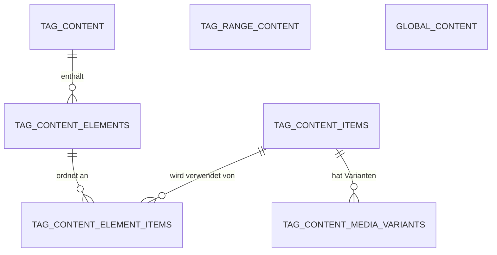

# TAG-App-Datenmodell: operative Contentprojektion

**Status:** operative D1-Struktur mit lokal ausführbaren Migrationen `0001`–`0004`
**Stand:** 2026-11-20
**Ebene:** logisch und physisch für die TAG Application API
**Grundlage:** [fachliches Gesamtmodell](10-DOMAIN-DATA-MODEL.md), [Komponentensicht](20-COMPONENT-DATA-ARCHITECTURE.md), [TAG App Access v1](../35-Contracts/tag-app-access-v1.md)

## 1. Zweck und Datenhoheit

Dieses Dokument beschreibt die operative D1-Datenbank der TAG Application API. Sie enthält ausschließlich den aktuellen, veröffentlichten Laufzeitstand. Redaktionelle Revisionen, Entwürfe, Rollback-Historie und Audit bleiben in der TAG Control Plane (TCP) und werden im TAG Control Center (TCC) dargestellt.

| Datenbereich | Autorität | TAG-App-D1 | R2 | Browser |
| --- | --- | --- | --- | --- |
| TAG-Identität, Lifecycle, Owner, redaktioneller Vault | TCP/MySQL | minimale Laufzeitprojektion | nein | nein |
| aktuelle TAG-/Element-Beschreibung | TCP erzeugt und publiziert | TAG-Pointer plus Elementstruktur/Sichtbarkeit | ein versioniertes TAG-JSON mit `view` + `elements[]` | nur erlaubte API-Antwort |
| Content-Items und Varianten | TCP/Application API | Item-Identität, Metadaten, Mitgliedschaft, Variantenindex | Item-/Medienbytes | keine Keys, keine persistente private Kopie |
| Scanner-Access, PIN-Throttle, Sessions | TAG Application API | autoritativ für den Laufzeitbereich | nein | nur `HttpOnly`-Cookie |
| Chat, Guestbook, Check-ins | spätere API-Module | nicht Bestandteil der TAG-Content-Migrationen | spätere private Anhänge | kein persistenter privater Cache |

`global` ist keine Sichtbarkeit. Ein globales Item wird nur ausgeliefert, wenn es einem Element des angefragten TAGs zugeordnet ist und Session-, Element- und Item-Sichtbarkeit dies erlauben.

## 2. Operatives Modell



| Tabelle | Aufgabe |
| --- | --- |
| `tag_content` | genau eine Zeile pro TAG mit numerischem PK; Pointer auf die aktuelle TAG-JSON |
| `tag_content_elements` | aktuelle Elementstruktur eines TAGs: `tag_numeric_id`, `content_element_id`, `content_element_type`, `display_order`, `visibility`; keine Datei-/Hash-/Größenfelder |
| `tag_content_items` | Item-Identität, Typ, Scope, Owner, Anzeigefelder, Dateiname und Status |
| `tag_content_element_items` | relationale Mitgliedschaft, Reihenfolge, Sichtbarkeit und Dateinamen-Eindeutigkeit |
| `tag_content_media_variants` | Variantenmetadaten für Signierung und Downloads |
| `tag_range_content` | aktuelle Beschreibung für eine TAG-Range |
| `global_content` | aktuelle globale Beschreibung, z. B. ein Redirect-Ziel |

Es gibt **keine** `tag_content_revisions`-Tabelle. Eine Revision ist nur ein Informationsfeld in `tag_content` und der effektive Bootstrap-Pointer in `tag_routing.content_revision`. Beide werden im selben Publish-Batch aktualisiert.

## 3. Schlüssel und Identifier

### 3.1 TAG

- `tag_numeric_id INTEGER PRIMARY KEY` ist die stabile TAG-Identität.
- `tag_base36_id TEXT NOT NULL UNIQUE` dient ausschließlich Suche, Anzeige und API-Lookup.
- Der Constraint prüft Länge 6/8/10 und den jeweiligen kanonischen Zahlenraum. Die exakte Base36-/Numerik-Zuordnung validiert TCP mit dem Codec.
- Die Base36-ID ist **nicht** Bestandteil eines R2-Pfads. Eine Codec-/Secret-Rotation darf den Storage-Key nicht verändern.
- Alle kanonischen TAG-Werte sind kleiner als `36^10` und damit kleiner als `2^53`. Die D1-`INTEGER`-Werte sind im JavaScript-Kontext verlustfrei.

### 3.2 Content-Item

Content-IDs werden serverseitig aus Zeitstempel und Zufall gebildet:

```text
32 Bit Unix-Sekunden (bis 2106)
20 Bit kryptographischer Zufall (1.048.576 Werte pro Sekunde)
content_id = (seconds << 20) | random
```

Der Maximalwert ist `2^52 - 1`. D1 speichert `INTEGER`; JSON und URL-Parameter verwenden den kanonischen Dezimalstring. Die ID ist sortierbar, aber **kein Secret** und keine Berechtigung.

Bei einem Unique-Konflikt wird die Zufallskomponente neu erzeugt und der Insert wiederholt. Das ist bei parallelen Uploads die Ausnahme, nicht der Normalfall.

Ein einzelner 52-Bit-Wert hält den Primary Key und die API-ID einfach. Zwei Spalten (`created_at_ms`, `random_part`) wären nur nötig, wenn millisekundengenaue Sortierung oder mehr als eine Million IDs pro Sekunde fachlich erforderlich sind. Dann müsste die API zusätzlich eine gepackte oder zusammengesetzte ID definieren. Für Uploads reicht die Sekundenauflösung mit 20 Zufallsbits und Unique-Retry.

### 3.3 Content-ID im API-Vertrag

`POST /api/get-image-url` akzeptiert `contentId` als Dezimalstring ohne Präfix und ohne führende Null. `cnt_…` aus dem früheren lokalen Slice ist nicht mehr gültig. Auch Content-IDs innerhalb der von TCP publizierten TAG-View müssen diese numerische Form verwenden; der Publisher ersetzt alte `cnt_…`-Referenzen vor dem Schreiben der R2-Datei.

## 4. Items, Mitgliedschaft und parallele Uploads

### 4.1 Item-Zustände

| Status | Bedeutung |
| --- | --- |
| `pending` | Upload reserviert, Bytes oder Varianten noch unvollständig |
| `ready` | vollständig und einem Element zuordenbar |
| `quarantined` | sicherheits- oder prüfungsbedingt gesperrt, nicht ausliefern |
| `revoked` | fachlich widerrufen, bleibt für Audit sichtbar |

Nur `ready`-Items dürfen einem Element zugeordnet werden. Ein Item kann vor dem ersten Publish existieren; deshalb gibt es keinen Fremdschlüssel von Items auf `tag_content`.

### 4.2 Paralleler Upload

1. Upload reserviert eine Item-Zeile mit neuer 52-Bit-ID und `status = pending`.
2. Die Bytes werden unter dem item-spezifischen R2-Prefix geschrieben.
3. Variantenmetadaten werden gespeichert und das Item auf `ready` gesetzt.
4. Die Zuordnung zu einem Element erfolgt separat. Der Unique-Constraint auf `(tag_numeric_id, content_element_id, filename_key)` verhindert doppelte Dateinamen.
5. Ein abgebrochener Upload bleibt `pending` und wird durch einen Cleanup-Lauf entfernt.

Jeder Upload schreibt nur seine eigene Item-Zeile, seine eigenen R2-Objekte und seine eigene Zuordnung. Es gibt keine gemeinsame Element-JSON, die parallele Uploads überschreiben könnten.

Die Content-Antwort der Application API liest `view` und Element-Payloads aus demselben TAG-JSON (`elements[]`), gleicht die Liste mit D1-Strukturzeilen ab und ergänzt sichtbare Item-Mitgliedschaften aus D1. Elementdateien werden nicht mehr gelesen. Item-Anzeigefelder `contentId`, Typ, Titel, Alt-Text, Dateiname, Reihenfolge und Scope kommen aus D1; `contentId` wird als Dezimalstring ausgeliefert.

### 4.3 Dateinamen

`original_filename` bleibt Anzeige-/Downloadname. `filename_key` wird serverseitig normalisiert und ist pro Element eindeutig. Die Zuordnung kopiert den Key; ein Trigger verhindert abweichende Werte. Ein globales Item kann in mehreren Elementen und TAGs verwendet werden, sofern der jeweilige Dateiname im Element nicht kollidiert. Ein TAG-lokales Item ist pro TAG genau einem Element zugeordnet; für eine zweite Verwendung wird ein eigenes Item oder ein globales Item benötigt. TAG-spezifische Dateinamen- oder Titel-Overrides sind nicht Teil dieses Modells; globale Items behalten ihre kanonischen Anzeigefelder.

### 4.4 Sichtbarkeit

`visibility` ist an Element und Zuordnung gesetzt. Die effektive Sichtbarkeit ist die restriktivere Kombination:

- `public` ist mit Public-, PIN- und Login-Session sichtbar;
- `shared` nur mit PIN-/Login-Session;
- `private` und `ownerOnly` werden von der TAG-App-Contentroute nicht ausgeliefert.

Die Sichtbarkeit ersetzt keine TAG-Zugriffsprüfung. `tag_routing.protection_mode`, Access-Version und Session bleiben vorgelagert.

## 5. R2-Pfade

Alle Keys werden serverseitig aus D1-Werten und Konstanten abgeleitet. Der Browser liefert niemals Bucket, Scope, Pfad oder Objekt-Key.

```text
content/v1/tags/{tagNumericId}/tag-rev{revision}.json
content/v1/tags/{tagNumericId}/items/{contentId}/item.json
content/v1/tags/{tagNumericId}/items/{contentId}/variants/{variant}
content/v1/global/items/{contentId}/item.json
content/v1/global/items/{contentId}/variants/{variant}
content/v1/tag-ranges/{rangeId}/descriptions/{contentId}/content-rev{revision}.json
content/v1/global/descriptions/{contentId}/content-rev{revision}.json
```

Beispiele:

```text
content/v1/tags/623187229/tag-rev8.json
content/v1/tags/623187229/items/1850000000000000/item.json
content/v1/tags/623187229/items/1850000000000000/variants/large
content/v1/global/items/1850000000000001/item.json
content/v1/tag-ranges/campaign-summer-6-001/descriptions/redirect-default/content-rev7.json
content/v1/global/descriptions/redirect-default/content-rev3.json
```

Regeln:

- Die numerische TAG-ID stabilisiert den Pfad; Base36 ist nur Such-/Anzeigeinformation.
- `tag-rev{n}.json` ist das einzige Präsentationsartefakt des TAGs; es enthält `view` und `elements[]`. Elementdateien sind Altbestand und werden nicht mehr geschrieben oder gelesen.
- `item.json` und Varianten sind pro Content-ID unveränderlich. Ein Ersatz erzeugt eine neue Content-ID.
- `tagNumericId` und `contentId` sind kanonisch dezimal; `contentElementId` beginnt mit `cel_`; Varianten und Dateinamen werden allowlistbasiert validiert.
- `..`, `/`, `\`, Steuerzeichen und reservierte Segmente sind ausgeschlossen.

## 6. Publish, Ersetzen und Rollback

1. TCP validiert die neue Revision und erzeugt ein TAG-JSON mit `view` und `elements[]`.
2. Das eine R2-Präsentationsdokument wird unter dem neuen Revisionsnamen geschrieben.
3. Ein D1-Batch aktualisiert `tag_content`, ersetzt die Elementzeilen und item-Zuordnungen und setzt `tag_routing.content_revision`.
4. Erst nach erfolgreichem Commit werden nicht mehr referenzierte Präsentationsdateien gelöscht.
5. Ein Fehler vor dem Commit lässt den alten D1-Pointer aktiv. Neue R2-Dateien sind Waisen und werden bereinigt.
6. Rollback veröffentlicht die alte Revision erneut; D1 zeigt danach wieder auf deren Dateien.

D1 sieht durch den Batch entweder den alten oder den neuen Elementbestand, nie eine halb ersetzte Liste. Bereits ausgegebene kurzlebige Medien-URLs können durch einen Widerruf nicht zurückgeholt werden; neue Signaturen werden verhindert.

## 7. Range- und Global-Inhalte

Range- und Global-Beschreibungen sind keine Items, sondern eigenständige Content-Objekte:

- `tag_range_content.range_id` ist der stabile Range-Schlüssel;
- `global_content.content_id` ist ein logischer Beschreibungsschlüssel wie `redirect-default`;
- beide speichern Revision, Schema-Version, Pointer, Hash, Größe und Zeitpunkte;
- die Auflösungsreihenfolge ist TAG → Range → Global;
- eine Rangeprüfung benötigt die Range-Zuordnung des TAGs. Sie sollte vor dem ersten Deployment in `tag_routing.range_id` oder einer separaten Identitätsprojektion ergänzt werden.

Redirect-Beschreibungen enthalten ausschließlich validierte Ziele:

- nur `https:`,
- keine Credentials in der URL,
- keine `javascript:`-/`data:`-Ziele,
- optional Allowlist pro Produkt/Umgebung,
- Ausführung serverseitig als `302`, nicht durch Browser-JavaScript.

## 8. Sicherheitsgrenzen

- Operative Runtime-Beschreibungen sind **JSON**. Frei ausführbares HTML/JavaScript wird nicht in der TAG-App-Domain ausgeliefert.
- HTML/JS-Artefakte dürfen nur als `text/plain`/Attachment oder auf einer separaten, cookie-losen Sandbox-Origin mit strenger CSP bereitgestellt werden.
- Kein `dangerouslySetInnerHTML`, kein `eval`, kein `<script>` aus Content.
- R2-Keys, Presigned URLs, Bucket-Namen, Session-Tokens, PINs und Hashes erscheinen nie in einer öffentlichen API-Antwort.
- Die Content-ID ist kein Secret. Jeder Medienabruf prüft Session, TAG, Element, Item-Status und Sichtbarkeit erneut.
- Der Media Signer erhält ausschließlich den vom Application API abgeleiteten Objekt-Key, nicht frei wählbare Client-Parameter.

## 9. Abgrenzung und offene Betriebsgates

Noch nicht implementiert sind:

- TCP-Publisher und Outbox-Anbindung für `0002`,
- Owner-/Gastverwaltung und Upload-Endpunkte,
- Variantenpipeline und Quarantäne,
- ZIP-/Download-Autorisierung,
- Cleanup für `pending`-/verwaiste Items und alte Präsentationsdateien,
- Range-Fallback in der Application API,
- reale D1-/R2-Ressourcen und Secrets.

Chat, Lost & Found, Guestbook und Check-ins erhalten eigene Tabellen mit eigener Sessionbindung, Moderation, Retention und Datenschutzlogik. Sie werden nicht in `tag_content_items` versteckt.

## 10. Physische Referenzen

| Artefakt | Zweck |
| --- | --- |
| `apps/tag-app/database/0001_tag_access.sql` | Routing, Access-Sessions, PIN-Credentials und Throttle |
| `apps/tag-app/database/0002_tag_content.sql` | operative Contentprojektion, Items, Varianten, Range-/Global-Beschreibungen |
| `apps/tag-app/database/0003_tag_content_element_structure.sql` | entfernt Element-Datei-Spalten; `_v3` sind temporäre Namen, das finale Schema verwendet die kanonischen Tabellennamen |
| `apps/tag-app/database/0004_tag_app_development_reset.sql` | destruktiver Reset von D1-Access-/Contentdaten für disposable Dev-/Staging-Umgebungen; nicht produktiv anwenden |
| `apps/tag-app/workers/content-id.ts` | 52-Bit-Content-ID erzeugen, parsen, formatieren |
| `apps/tag-app/workers/content-paths.ts` | serverseitige R2-Key-Ableitung und Segmentvalidierung |
| `apps/tag-app/test/database-schema.test.mjs` | SQLite-/D1-Schema, Trigger, Unique- und Scope-Regeln |
| `apps/tag-app/test/content-id.test.ts` | ID-Packing, Grenzen und JSON-Roundtrip |
| `apps/tag-app/test/content-paths.test.ts` | Pfadableitung und Traversal-Schutz |
| `apps/tag-app/test/app-api.test.ts` | Session-, Content-, Sichtbarkeits- und Signer-Grenzen |
| `apps/tag-app/wrangler.app-api.toml` | D1-Binding und `migrations_dir = "database"` |

Migration `0004` löscht Daten, nicht das Schema; R2-Objekte werden nicht berührt. Nur auf explizit entbehrlichen Umgebungen ausführen. Staging ist auf `myqr24-stg-db` und `myqr24-stg-blob` gebunden; `0001`–`0004` wurden remote angewendet und per D1-Migrationsliste, Schema-Query, `PRAGMA foreign_key_check` und Zeilenzählung geprüft. R2-Objekte blieben unangetastet. Das Ausführen lokaler Migrationstests ist kein Nachweis eines Cloudflare-D1-Deployments.


