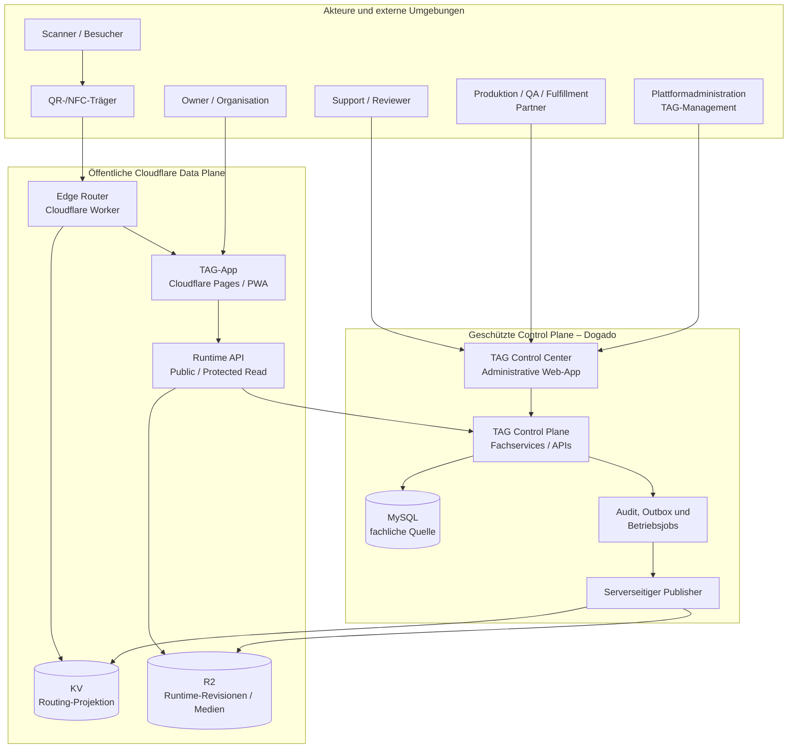
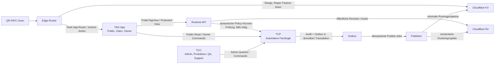
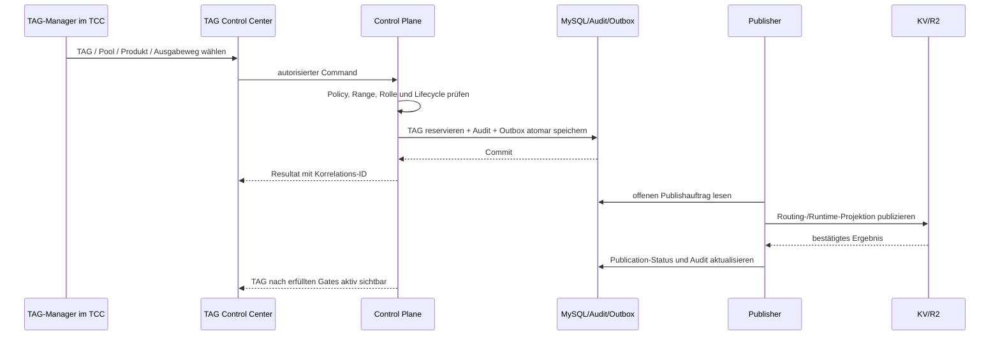
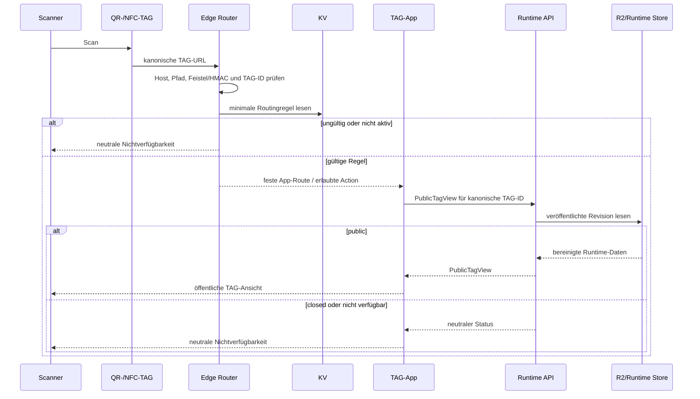
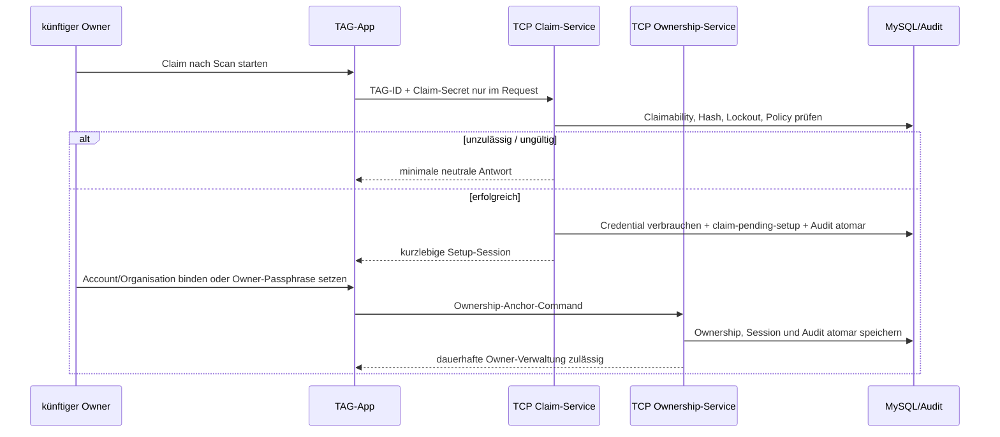

# Komponenten- und App-Überblick der TAG-Plattform

**Status:** Zielarchitektur  
**Stand:** 2026-10-06  
**Ebene:** fachliche und technische Komponentenarchitektur  
**Grundlage:** [App- und Komponentenarchitektur – Übersicht](README.md)

## 1. Architekturziel

Die TAG-Plattform verbindet zwei bewusst unterschiedliche Betriebswelten:

- eine **geschützte Verwaltungs- und Fachwelt** für die Erzeugung, Verwaltung, Freigabe, Auswertung und den Support von TAGs;
- eine **öffentliche, global auslieferbare Scan- und Nutzungswelt** für QR-/NFC-Scans und die TAG-App.

Diese Welten haben unterschiedliche Anforderungen und dürfen deshalb keine gemeinsame unkontrollierte Daten- oder Berechtigungsgrenze bilden.

```text
Control Plane
  = entscheiden, verwalten, prüfen, auditieren, veröffentlichen
  = PHP + MySQL bei Dogado

Public Data Plane
  = gültige TAG-URL auflösen, freigegebene Daten ausliefern
  = Cloudflare Worker, KV, Pages/PWA, R2 und Runtime API
```

Die Architektur optimiert für vier Ziele:

1. **Eindeutigkeit und Nachvollziehbarkeit:** Ein TAG entsteht, ändert seinen Status und wird veröffentlicht ausschließlich über autorisierte, auditierte Control-Plane-Prozesse.
2. **Sichere öffentliche Nutzung:** Scanner erhalten schnell eine erlaubte öffentliche Wirkung, ohne dass private Fachdaten, Secrets oder Verwaltungslogik an die Kante gelangen.
3. **Austauschbare Projektion:** KV, R2 und Runtime-Darstellungen sind abgeleitete Veröffentlichungen; sie können aus der autoritativen Control Plane kontrolliert neu aufgebaut werden.
4. **Getrennte Benutzererlebnisse:** TCC unterstützt komplexe Backoffice-Arbeit. Die TAG-App optimiert öffentliche Scan- und Owner-Interaktionen. Beide vertrauen derselben serverseitigen Fachlogik.

## 2. Kontext und Systemgrenzen



### 2.1 Vertrauenszonen

| Zone | Komponenten | Vertrauensniveau | Fachliche Regel |
| --- | --- | --- | --- |
| Öffentlicher Client | QR-/NFC-Scanner, Browser, TAG-App-PWA | nicht vertrauenswürdig | Clientdaten sind immer Eingaben und nie eine Autoritätsquelle |
| Öffentliche Data Plane | Edge Router, KV, öffentliche Runtime API, öffentliche R2-Objekte | öffentlich erreichbar, technisch kontrolliert | enthält nur abgeleitete und freigegebene Daten |
| Geschützte Anwendungszone | TCC, TCP, Publisher, MySQL, Audit-/Outbox-Jobs | administrativ geschützt | trifft alle Fach-, Rechte-, Claim- und Publish-Entscheidungen |
| Externe Betriebszone | Druckerei, QA, Fulfillment, Partner, Endgeräte | teilvertrauenswürdig, pro Prozess begrenzt | erhält nur zweckgebundene Druck-/Übergabeinformationen |
| Secret- und IAM-Zone | Serversecrets, Cloudflare-Tokens, Session-/Credential-Hashes | streng geschützt | niemals in Browser, KV, R2-öffentliche Objekte oder Audit-Klartext |

## 3. Komponentenkatalog

### 3.1 Anwendungen und fachliche Hauptverantwortung

| Komponente | Typ | Fachliche Verantwortung | Autorität | Persistenz |
| --- | --- | --- | --- | --- |
| **TAG Control Center (TCC)** | administrative Web-App | bedienbare Verwaltungs-, Produktions-, QA-, Support- und Review-Arbeitsplätze | keine eigene Fachautorität | nur minimale UI-Präferenzen / Arbeitsspeicher |
| **TAG Control Plane (TCP)** | PHP-Anwendung, Services und APIs | TAG-Registry, Pool, Produkt, Lifecycle, Claim, Ownership, Content, Policy, Audit, Outbox | alleinige fachliche Autorität | MySQL als Quelle |
| **TAG-App** | öffentliche PWA mit Owner-/Account-UI | Scan-Ziel darstellen, Claim/Owner/Collection als Client-UX bedienen | keine Routing-, Besitz- oder Policy-Autorität | nur lokale Komfortdaten ohne Rechtewirkung |
| **Edge Router** | Cloudflare Worker | TAG-ID validieren, minimale Routingregel auflösen, sichere Aktion ausführen | technische Scan-Autorität innerhalb der publizierten Projektion | keine Fachpersistenz |
| **Runtime API** | Public-/Protected-Read-Service | bereinigte PublicTagView bzw. geschützte View liefern | entscheidet nur über serverseitig erlaubte Runtime-Antworten | keine unabhängige Fachquelle |
| **Publisher** | serverseitiger TCP-Betriebsprozess | bestätigte Routing-/Runtime-Projektionen idempotent ausliefern | keine fachliche Regelautonomie | verarbeitet Outbox-Aufträge |
| **KV-Projektion** | Cloudflare KV Namespace | Minimaldaten für Scan-Routing | keine Fachautorität | replizierter Read Store |
| **Runtime-Store** | Cloudflare R2, optional Pointer in KV | versionierte öffentliche Runtime-Revisionen und Medien | keine Fachautorität | abgeleitete Objekte |
| **MySQL, Audit, Outbox** | TCP-Datenhaltung | fachliche Objekte, Policies, Publish-Aufträge, Audit | autoritativ über TCP-Services | private, relationale Persistenz |
| **Produktions-/QA-Umgebung** | Partner-/Betriebsprozess | QR-/NFC-Ausgabe, Lesbarkeitsprüfung, Übergabe | nur Rückmeldung im erlaubten Prozess | kein TAG-Registry-Owner |

### 3.2 Technische Zuordnung

| Fachkomponente | Vorgesehene technische Umsetzung | Deployment-/Betriebseinheit | Verbindungsrichtung |
| --- | --- | --- | --- |
| TCC | Browser-App, desktop-first, mobil für reduzierte Supportaufgaben | separate Admin-Origin bzw. geschützter Bereich | Browser → TCP über HTTPS |
| TCP | PHP-Module / serverseitige APIs / Hintergrundjobs | Dogado Webhosting mit MySQL | TLS-APIs, DB-intern, ausgehend zu Cloudflare |
| MySQL | relationale Datenbank | Dogado | ausschließlich TCP-Zugriff |
| Publisher | TCP-Worker, Cron-/Queue-Consumer oder gleichwertiger serverseitiger Prozess | Dogado bzw. geschützte Betriebsumgebung | TCP → Cloudflare API |
| Edge Router | Worker in `apps/edge-router` | Cloudflare Worker | liest KV, leitet um / antwortet |
| TAG-App | PWA in `apps/tag-app` | Cloudflare Pages | Browser → Runtime API / TCP-Commands |
| Runtime API | Worker/API-Gateway oder klar abgegrenzter API-Service | Cloudflare und/oder TCP-Read-Service | liest R2/Pointer, ruft TCP nur kontrolliert |
| KV | `TAG_CONFIG` je Umgebung | Cloudflare | ausschließlich Publisher schreibt |
| R2 | versionierte Runtime-/Medien-Buckets je Umgebung | Cloudflare | ausschließlich Publisher/Runtime-Service kontrolliert |
| Tag Lab | lokales Testwerkzeug in `tools/tag-lab` | Entwicklung | kein Bestandteil produktiver Datenflüsse |

## 4. Fachliche Beziehungen zwischen den Anwendungen



| Beziehung | Zweck | Fachliche Bedeutung |
| --- | --- | --- |
| TCC → TCP | administrative Commands und Queries | TCC ist nur Bedienoberfläche; TCP prüft jedes Recht und jede Invariante |
| TAG-App → TCP | Claim-, Owner-, Account-, Collection- und ggf. Content-Commands | Browser löst keine Ownership-, Policy- oder Publishentscheidung aus |
| TCP → MySQL | transaktionale Fachpersistenz | einzige Quelle für TAG- und Verwaltungszustände |
| TCP → Outbox → Publisher | asynchrone, verlässliche Projektion | Fachmutation, Audit und Publish-Auftrag entstehen konsistent |
| Publisher → KV | minimale Routingdaten | Edge kann Scans auflösen, ohne private Informationen zu kennen |
| Publisher → R2 | public Runtime-Revisionen und Medien | TAG-App rendert freigegebene Inhalte ohne Entwurfsdaten |
| Edge Router → KV | technische Scanauflösung | strikt read-only, fail-closed bei unvollständiger Projektion |
| Edge Router → TAG-App | fester Redirect bzw. Action-Vertrag | Scan führt in kontrollierte öffentliche UX |
| TAG-App → Runtime API | öffentliche bzw. geschützte View lesen | Server gibt nur zulässige Sichtbarkeit und Aktionen frei |
| Runtime API → TCP/R2 | Projektion bzw. dynamische Prüfung | weder App noch Runtime-Store sind eine zweite Fachquelle |

## 5. Verantwortungs- und Entscheidungsgrenzen

### 5.1 Wo wird entschieden?

| Entscheidung | Entscheidet ausschließlich | Konsumierende Komponenten |
| --- | --- | --- |
| TAG reservieren und eindeutige ID vergeben | TCP | TCC, Produktionsprozess |
| Range, Gruppe, Pool und Feature validieren | TCP | TCC, Publisher |
| Produkt-, Laufzeit- und POI-Policy anwenden | TCP | TCC, TAG-App, Runtime API nur als Ergebnis |
| Claim-Credential prüfen und verbrauchen | TCP Claim-Service | TAG-App, TCC-Support |
| Ownership Anchor einrichten oder ändern | TCP IAM-/Ownership-Service | TAG-App, TCC |
| TAG aktivieren, sperren, ablaufen lassen, archivieren | TCP Lifecycle-Service | Publisher, TCC, Runtime API |
| Routing-/Runtime-Projektion ableiten | TCP-Projektionslogik | Publisher |
| KV/R2 tatsächlich beschreiben | Publisher | Cloudflare Data Plane |
| TAG-ID und Scanroute validieren | Edge Router anhand veröffentlichter Regeln | Scanner, TAG-App |
| öffentlichen View rendern | TAG-App anhand des Runtime-Vertrags | Scanner / Besucher |
| öffentliche oder geschützte View filtern | Runtime API / TCP Access Service | TAG-App |
| UI-Ablauf, Formvalidierung und Darstellung | TCC bzw. TAG-App | jeweilige Nutzergruppe |

### 5.2 Verbotene Abkürzungen

| Nicht zulässig | Grund |
| --- | --- |
| TCC oder TAG-App schreiben direkt in MySQL | Umgehung von Policy, Transaktion, Audit und Scope-Prüfung |
| Browser schreibt direkt nach KV, R2 oder Cloudflare API | Cloudflare-Tokens wären exponiert; kein fachlicher Gate |
| Edge Router fragt Owner-, Claim-, Produkt- oder Vaultdaten ab | Scanpfad bleibt minimal, datensparsam und hochverfügbar |
| KV/R2 entscheidet Claim, Ownership, Sperre oder Quoten | Projektionen sind repliziert und nicht transaktional autoritativ |
| Clientparameter bestimmen R2-Key, Publishrevision, Owner oder Produkt | Pfad-/Berechtigungseskalation und private Datenlecks |
| lokale Collection oder URL-Kenntnis begründet Verwaltungsrechte | Komfortdaten sind kein Besitz- oder Rollenbeleg |
| Support ersetzt die Claim- oder Sperrlogik durch manuelle DB-Änderung | Sicherheits- und Auditgrenzen würden verletzt |

## 6. Schnittstellenkatalog

Die Schnittstellen sind nach Zielgruppe, Vertrauensklasse und Datenvertrag getrennt. Konkrete URL-Pfade, DTOs und Authentisierungsdetails werden in der API-/Implementierungsdokumentation versioniert.

### 6.1 Administrative Schnittstellen

| ID | Konsument → Anbieter | Zweck | Sicherheitsmodell | Datenklasse |
| --- | --- | --- | --- | --- |
| A-01 | TCC → TCP Admin API | TAG-, Range-, Pool-, Feature- und Produktverwaltung | Admin-Session, CSRF, serverseitiges RBAC und Scope | privat / administrativ |
| A-02 | TCC → TCP Production API | Charge, Drucksnapshot, QA, Ausschuss, Übergabe | Rolle + organisations-/auftragsbezogener Scope | vertraulich |
| A-03 | TCC → TCP Support API | Statushilfe, begleiteter Claim, zulässige Folgeaktionen | Supportrolle, minimaler Datensatz, Re-Auth bei sensiblen Aktionen | vertraulich / redigiert |
| A-04 | TCC → TCP Review API | POI-Nachweise, Meldungen, Moderation, Freigaben | Reviewer-/Compliance-Rolle, enger Scope | besonders geschützt |
| A-05 | TCC → TCP Audit/Operations API | Audit, Outbox- und Publishstatus, Retry | berechtigte Rolle, redigierte Antworten | intern / redigiert |

**Regel:** TCC kann UI-seitige Vorvalidierung durchführen, aber TCP verwirft jeden nicht autorisierten, ungültigen oder nicht zulässigen Command unabhängig von der Oberfläche.

### 6.2 TAG-App- und Runtime-Schnittstellen

| ID | Konsument → Anbieter | Zweck | Sicherheitsmodell | Datenklasse |
| --- | --- | --- | --- | --- |
| P-01 | Browser → Edge Router | Scan-URL bzw. kanonischer TAG-Pfad auflösen | Host-/Pfad-/ID-Prüfung im Worker | öffentlich, minimal |
| P-02 | TAG-App → Runtime API | `PublicTagView` für `/tag/{tagId}` laden | kanonische ID, Rate Limits, CORS, neutraler Fehlervertrag | öffentlich, veröffentlicht |
| P-03 | TAG-App → TCP Claim API | offenen TAG claimen und Setup beginnen | Credential nur im Request, Rate Limit, Lockout, Account-/Setup-Kontext | geheim im Transit, keine Persistenz |
| P-04 | TAG-App → TCP Owner API | Owner-Session, Konfiguration, Inhalte, Publish-Vorschlag | Account- oder Owner-Session, CSRF, TAG-Scope, Policy | privat |
| P-05 | TAG-App → TCP Account API | Collections und Accountbezug | Account-Session; `no-store` | personenbezogen |
| P-06 | TAG-App → Protected Runtime API | PIN-/Grant-/Owner-abhängige View oder Download | serverseitige Session-/Grant-Prüfung; `no-store` | geschützt |
| P-07 | TAG-App → Kamera-/NFC-API des Geräts | lokale Scanunterstützung | explizite Browserberechtigung | nur Clientkontext |

### 6.3 Interne Publishing- und Storage-Schnittstellen

| ID | Konsument → Anbieter | Zweck | Sicherheitsmodell | Datenklasse |
| --- | --- | --- | --- | --- |
| I-01 | TCP → MySQL | fachliche Mutation, Query, Audit, Outbox | DB-Zugang ausschließlich serverseitig | autoritativ / privat |
| I-02 | TCP → Publisher | bestätigten Outbox-Job ausführen | interner Jobvertrag, Idempotenz- und Korrelations-ID | intern |
| I-03 | Publisher → Cloudflare KV API | Routingprojekte anlegen, ändern, neutralisieren | minimaler Token je Umgebung/Namespace | öffentlich ableitbar, minimal |
| I-04 | Publisher → Cloudflare R2 API | Runtime-Revisionen und Medienobjekte publizieren | minimaler Bucket-/Prefix-Scope | öffentlich freigegeben oder geschützt |
| I-05 | Edge Router → KV | Range, Regel und Feature lesen | Worker-Binding, nur Read im Request | öffentlich ableitbar |
| I-06 | Runtime API → R2 | veröffentlichte Revision bzw. freigegebene Medien lesen | serverseitige Key-Ableitung | veröffentlichte/geschützte Runtime |
| I-07 | Runtime API → TCP | aktuelle dynamische Access-/Policyentscheidung | service-to-service-authentisiert | intern / geschützt |

### 6.4 Externe operative Schnittstellen

| ID | Konsument → Anbieter | Zweck | Sicherheitsmodell | Datenklasse |
| --- | --- | --- | --- | --- |
| E-01 | TCP/TCC → Druck-/Self-Print-Export | freigegebene QR-/Druckdaten ausgeben | erneute Freigabe, Ablauf, Audit, vertraulicher Export | vertraulich |
| E-02 | Produktion/QA → TCP | Druck-, Scan-, QA- und Ausschussrückmeldung | Partner-/Rollen-/Auftragsscope | intern / auftragsbezogen |
| E-03 | Fulfillment → TCP | Übergabe- und Empfängerstatus melden | Auftragsscope und Audit | privat |
| E-04 | Nutzer → TAG-App / TCC | Supportanfrage, Meldung oder POI-Report | Rate limit, datensparsame Kontaktoption, Moderation | fallbezogen |

## 7. Kern-Datenverträge an App-Grenzen

### 7.1 Scan-Routing-Vertrag: Edge Router und KV

Der Edge Router liest ausschließlich eine **minimale Routing-Projektion**. Sie erlaubt die technische Auflösung, aber keine fachliche Verwaltung.

```text
tag-range-index
  → range-rule:{rangeId} / group:{groupId} / tag:{decodedValue}
  → feature:{featureId}
  → feste TAG-App-Route oder serverseitig validierte Aktion
```

| Enthalten | Ausgeschlossen |
| --- | --- |
| Range-/Gruppen-/Feature-ID, aktive Flags, sichere App-/URL-Templates, technische Redirect-Konfiguration | Owner, Organisation, Produkt, Claim-/PIN-/Passphrase-Hash, Audit, Bestellung, Poolname, POI-Nachweise, Vault-Content, Secrets |

Ein unbekannter oder unvollständiger Zustand wird **fail-closed** als neutraler Fehler behandelt. Der Worker trifft keinen Fallback anhand von Browserdaten oder einer alternativen Fachquelle.

### 7.2 Öffentlicher Runtime-Vertrag: TAG-App und Runtime API

Die TAG-App erhält einen versionierten, bereinigten `PublicTagView`.

```ts
type PublicTagView = {
  contractVersion: 1;
  tag: {
    tagId: string;
    displayName?: string;
    presentation:
      | "standard"
      | "gallery"
      | "public-page"
      | "museum-exhibit"
      | "summit-guide";
  };
  runtime: {
    revision: string;
    accessMode: "public" | "pin-required" | "closed" | "redirect";
    publishedAt?: string;
  };
  blocks: PublicContentBlock[];
  media: PublicMediaReference[];
  actions: PublicAction[];
};
```

| Enthalten | Ausgeschlossen |
| --- | --- |
| kanonische TAG-ID, erlaubte Darstellung, veröffentlichte Blöcke, freigegebene Medienreferenzen, zulässige Aktionen, neutraler Zugriffsmodus | DB-IDs, Owner/Account, Credentials und Hashes, Sessions, Audit, Pool/Bestellung, Entwürfe, interne Assetkeys, POI-Nachweise |

### 7.3 Owner- und Claim-Verträge: TAG-App bzw. TCC und TCP

| Contract | Eingabe | Ergebnis | Sicherheitsregel |
| --- | --- | --- | --- |
| Claim | kanonische TAG-ID, Claim-Secret, authentisierter/zulässiger Setupkontext | neutraler Status oder kurzlebige Claim-Setup-Berechtigung | Secret weder loggen noch auditieren noch browserseitig speichern |
| Ownership Anchor | Setup-Session, Account-/Organisationsbindung oder Owner-Passphrase | dauerhafte kontrollierte Zuordnung | serverseitig atomar, TAG-gebunden, auditiert |
| Owner Command | Owner-Session, TAG-Scope, CSRF, Commanddaten | validierter Entwurf bzw. Publish-Ausgang | Session und Policy bei jedem schreibenden Command erneut prüfen |
| Support Claim | TAG-ID, Claim-Secret ausschließlich im Request | rollenreduziertes Ergebnis | nutzt exakt denselben Claim-Service; keine Sicherheitsumgehung |

### 7.4 Publisher-Vertrag: TCP und Cloudflare

| Phase | TCP / Publisher | Cloudflare | Fachliche Bedeutung |
| --- | --- | --- | --- |
| Planung | validierte Projektion und Diff erzeugen | keine Änderung | Entwurf bleibt privat |
| Auftrag | Mutation, Audit und Outbox in einer DB-Transaktion | keine Änderung | fachlich nachvollziehbarer Publishwunsch |
| Auslieferung | Job verarbeitet, idempotent, retrybar | KV-/R2-Operation | technische Projektion |
| Bestätigung | Ergebnis/Korrelation speichern | bestätigte Antwort | erst jetzt gilt die Projektion als veröffentlicht |
| Fehler | Fehlklasse und Retryzustand speichern | keine erfolgreiche Wirkung bestätigt | sichtbarer Betriebsfall, keine stille Inkonsistenz |

## 8. End-to-End-Beziehungen nach Nutzungsszenario

### 8.1 Administrativer TAG bis zur Aktivierung



**Architekturregel:** Der TCC-Browser besitzt weder Datenbankzugang noch Cloudflare-Token. Ein TAG wird nicht wegen einer UI-Anzeige aktiv, sondern nur wegen einer erfolgreichen serverseitigen Fach- und Publishkette.

### 8.2 Öffentlicher Scan und öffentliche TAG-Ansicht



**Architekturregel:** Der Scanpfad kennt keine Ownership, Claimdaten, Produktdetails oder Vault-Entwürfe. Ein fehlender, gesperrter, abgelaufener oder nicht veröffentlichter Zustand ist öffentlich neutral.

### 8.3 Claiming und Owner-Einrichtung



**Architekturregel:** Der Client entscheidet weder über Credential-Gültigkeit noch über Owner-Zuordnung. Ein erfolgreicher Credential-Check ohne Besitzanker ist noch keine dauerhafte Ownership.

### 8.4 Sperrung und kontrolliertes Unpublishing

```text
TCC / Lifecycle-Job / Incident
  → TCP prüft Rolle, Grund, Policy und Scope
  → MySQL: Lifecyclewechsel + Audit + Routing-/Runtime-Outbox in einer Transaktion
  → Publisher neutralisiert oder entfernt KV- und Runtime-Projektion
  → bestätigter Erfolg aktualisiert Publication-Status
  → Edge Router und Runtime API liefern neutralen öffentlichen Zustand
```

**Architekturregel:** Sperrung und Widerruf sind keine reine UI- oder Datenbankänderung. Ihre öffentliche Wirkung wird über dieselbe Outbox-/Publisher-Kette kontrolliert und beobachtbar hergestellt.

## 9. Deployment- und Umgebungsmodell

### 9.1 Umgebungen

| Umgebung | Zweck | Mindesttrennung |
| --- | --- | --- |
| Local / Tag Lab | Entwicklung der TAG-ID-, Scan- und Routinglogik | keine produktiven Secrets oder Daten |
| Test | automatisierte Integrations- und Regressionstests | isolierte DB-/KV-/R2-Ressourcen |
| Staging | realitätsnaher E2E-Nachweis inkl. physischer Testscans | eigene Dogado-Konfiguration, eigene Cloudflare-Namespace/Buckets/Tokens/Origins |
| Produktion | reale TAGs und Nutzer | strikt getrennte Tokens, Daten, Domain und Freigaben |

### 9.2 Trennungsregeln

1. Staging-Publisher kann nie in Produktions-KV oder Produktions-R2 schreiben.
2. QR-/Druckdaten enthalten die zur jeweiligen Umgebung passende kanonische Scan-URL.
3. Staging- und Produktionstests verwenden getrennte TAG-Ranges/Pools bzw. klar isolierte Registry-Objekte.
4. Browser-Origins, CORS-Regeln, Cookies und Callback-/Redirect-Hosts sind umgebungsbezogen allowlisted.
5. Testdaten und Demo-TAGs begründen keinen Übergang in produktive Ownership, Publikation oder Billing-Prozesse.

### 9.3 Deploymentverantwortung

| Artefakt | Deploymentziel | Verantwortlich | Prüfschritt |
| --- | --- | --- | --- |
| Edge Router | Cloudflare Worker | Plattformbetrieb | Worker- und KV-Contract-Test |
| TAG-App | Cloudflare Pages | Frontend / Plattformbetrieb | PWA-/PublicTagView-Integrationstest |
| TCP/TCC | Dogado PHP-Webhosting | Backend / Plattformbetrieb | Migration, Auth-/RBAC-/Command-Test |
| MySQL-Migrationen | Dogado MySQL | Backend | transaktionale Migration + Backup |
| KV-/R2-Projektionen | Cloudflare, ausschließlich über Publisher | TCP-Betriebsprozess | Outbox, Diff, Publishbestätigung |
| Drucksnapshot | kontrollierter Exportkanal | TAG-Management / Produktion | Prüfsumme, Ablauf, QA-Nachweis |

## 10. Sicherheits- und Betriebsarchitektur

### 10.1 Identitäten und Berechtigungen

| Kontext | Identität / Berechtigung | Verbindliche Prüfung |
| --- | --- | --- |
| TCC-Administration | Admin-Session, Rolle, Organisations-/Objektscope | TCP bei jedem Command |
| TCC-Support | Supportrolle und enger Case-/TAG-Scope | TCP Support-Service; Re-Auth bei kritischen Aktionen |
| Owner | Account-Session oder TAG-spezifische Owner-Session | TCP Owner-Service; CSRF, Lifecycle und Produktpolicy |
| Scanner | keine angenommene Identität | Edge/Runtime geben ausschließlich öffentliche Minimaldaten |
| PIN-/geschützter Besucher | serverseitig geprüfter kurzlebiger Zugriff | Protected Runtime API; `no-store` |
| Publisher | umgebungs- und zielgebundener Servertoken | Publisher und Cloudflare API |
| Edge/Runtime-Service | Worker-/Service-Binding bzw. Service-Credential | nur vorgesehene interne Verträge |

### 10.2 Schutzrelevante Datenflüsse

| Datenklasse | Zulässiger Fluss | Verbotener Fluss |
| --- | --- | --- |
| Feistel-/HMAC-Secrets | ausschließlich serverseitige Secret-Konfiguration | Browser, Git, MySQL-Fachtabellen, KV, Logs |
| Cloudflare-Publish-Token | Secret Store → Publisher → Cloudflare API | TCC, TAG-App, QR-Code, Drucksnapshot |
| Claim-Secret | unmittelbarer Request → TCP Claim-Service | Log, Auditpayload, Browser-Storage, Export |
| Owner-Passphrase / Besucher-PIN | unmittelbarer Request → spezialisierter TCP-Service | KV, Runtime-Revision, Public API, Audit-Klartext |
| Owner-/Organisation-/POI-Nachweise | TCP und eng berechtigte TCC-Sichten | Edge, KV, öffentliche Runtime, PublicTagView |
| Public Runtime Content | TCP-Publish → R2/Runtime API → TAG-App | direkte Veröffentlichung von Entwürfen |
| Auditdaten | TCP → immutable/geschützte Auditperspektive | öffentliche APIs, unredigierte Browsercaches |

### 10.3 Caching und Fehlerverhalten

| Bereich | Caching | Fehlerregel |
| --- | --- | --- |
| Edge Routing | KV-Read im Request; replizierte Projektion | fehlend/inkonsistent = fail-closed und neutral |
| statische TAG-App | versionierte Bundles/Assets cachebar | sichere Fallback-PWA ohne Fachdetails |
| PublicTagView | kurze TTL oder invalidierbar abhängig von Widerruf | neutral für unbekannt, geschlossen, gesperrt, nicht veröffentlicht |
| öffentliche Runtime-Revisionen | versionierte, freigegebene Objekte cachebar | nur veröffentlichte Revisionen lesbar |
| Owner-/Claim-/PIN-/Account-Antworten | `Cache-Control: no-store` | keine Credentials oder private Diagnose ausgeben |
| TCC-Daten | browserseitig minimal, sensible Daten nicht dauerhaft cachen | datensparsame, korrelierte Fehlermeldungen |

### 10.4 Beobachtbarkeit

| Beobachtungsbereich | Quelle | Ziel |
| --- | --- | --- |
| Fachmutationen | TCP Audit | nachvollziehbare Entscheidungen und Korrelation |
| Publishing | Outbox, Publisher, Cloudflare-Antworten | Retry, Fehlerklassifikation, Nachweis bestätigter Wirkung |
| Edge-Routing | Worker-Metriken und datensparsame technische Logs | Verfügbarkeit, Fehlerquote, keine Scanprofilbildung |
| Runtime API | Request-/Latenz-/Fehlermetriken | Public-View-Qualität, Widerrufsverhalten |
| Produktion/QA | TCP-Produktions- und QA-Ereignisse | Ausschuss, Nachdruck, Übergabegates |
| Support und Sicherheit | Fall-/Sperr-/Lockout-/Review-Statistiken | Trend-, Risiko- und Prozesssteuerung |

## 11. Architekturentscheidungen und Entwicklungslinien

### 11.1 Bereits festgelegte Leitentscheidungen

| Entscheidung | Begründung |
| --- | --- |
| PHP/MySQL für Control Plane | relationale Fachobjekte, Workflows, Rollen, Audit und Backoffice lassen sich dort autoritativ und wirtschaftlich umsetzen |
| Cloudflare für öffentliche Data Plane | globaler Scanpfad, Edge-Validierung und skalierbare öffentliche Auslieferung |
| KV nur als minimaler Routing-Read-Store | keine privaten Daten, keine Secrets, keine transaktionale Fachentscheidung |
| R2 für versionierte Runtime-/Medienobjekte | sichere Trennung zwischen freigegebenem öffentlichen Content und privaten Verwaltungsobjekten |
| Outbox/Publisher statt Direkt-Publish aus UI | fachliche Mutation und technische Auslieferung bleiben konsistent, auditiert und retrybar |
| eine gemeinsame TCP-Fachlogik für TAG-App und TCC | keine abweichende Claim-, Ownership- oder Lifecyclelogik pro Client |
| getrennte Apps für TCC und TAG-App | Backoffice-Komplexität und öffentliche mobile Scan-UX haben unterschiedliche Anforderungen |

### 11.2 Geplante, aber noch auszugestaltende Bausteine

| Baustein | Ziel | Noch festzulegen |
| --- | --- | --- |
| Runtime API Hosting | stabile Public-/Protected-Read-Verträge | Worker-/Service-Schnitt, Cache- und Auth-Topologie |
| R2-Medienpipeline | kontrollierte Uploads, Varianten, Malware-/Formatprüfung | konkrete Scanning-, Transformations- und Retentionlösung |
| Account-IAM | Account-Login, Recovery, MFA-/Passkey-Strategie | Provider/Framework, Recovery- und Datenschutzprozesse |
| Owner-Passphrase-Flow | accountlose, TAG-gebundene Verwaltung | Hashparameter, Reset-/Recoverypolicy |
| Partner-/Druckintegration | sichere industrielle Ausgabe und Rückmeldung | Exportformat, Partneridentität, SLAs, Signatur/Prüfnachweise |
| Reporting | datensparsame Betriebs- und Produktkennzahlen | Datenpipeline, Aggregation, Zugriff und Aufbewahrung |
| erweiterte Fachmodule | Chat, Lost & Found, Guestbook, Check-in, Campaigns | eigene APIs, Abuse-Schutz, Moderation, Datenhaltung und Retention |

## 12. Architektur-Checkliste für neue Komponenten

Eine neue App, ein neues Feature oder ein externer Dienst ist nur dann integrierbar, wenn folgende Fragen beantwortet sind:

1. Welchen fachlichen Prozess unterstützt die Komponente?
2. Ist sie fachlich autoritativ, ein Client oder eine abgeleitete Projektion?
3. Welchen minimalen Datenvertrag konsumiert und liefert sie?
4. Welche Rolle, Session, Token oder Service-Identität darf sie verwenden?
5. Welche Daten sind ausdrücklich ausgeschlossen?
6. Benötigt sie synchrone Entscheidung oder verarbeitet sie Outbox-/Eventdaten?
7. Welche Publish-, Widerrufs-, Retry- und Auditwirkung hat sie?
8. Wie verhält sie sich bei unbekanntem, gesperrtem, abgelaufenem oder teilveröffentlichtem Zustand?
9. Welche Caching-, Datenresidenz-, Retention- und Datenschutzgrenzen gelten?
10. Ist sie zwischen Local, Test, Staging und Produktion vollständig isoliert?

## 13. Referenzen

- [App- und Komponentenarchitektur – Übersicht](README.md)
- [Funktionale Prozessarchitektur](../10-Functional-Architecture/10-TAG-PLATFORM-PROCESS-ARCHITECTURE.md)
- [Fachliches Datenmodell](../30-Data-Architecture/10-DOMAIN-DATA-MODEL.md)
- [Komponentensicht der Datenarchitektur](../30-Data-Architecture/20-COMPONENT-DATA-ARCHITECTURE.md)
- [Physische Datenarchitektur](../30-Data-Architecture/30-PHYSICAL-DATA-ARCHITECTURE.md)
- [TAG Control Plane und Basis Vault](../PWA-PHP-Applications/TAG_CONTROL_PLANE_AND_BASIS_VAULT.md)
- [TAG-App-Architektur](../TAG_APP_ARCHITECTURE.md)
- [Domain-, TAG- und Routing-Regeln](../../DOMAIN_RULES.md)
- [Cloudflare DNS und TLS](../CLOUDFLARE_DNS_AND_TLS_CONFIGURATION.md)
- [TAG Control Plane – User Stories](../../40-Implementation/tag-control-plane/10-USER-STORIES.md)
- [TAG Control Center – User Stories](../../40-Implementation/tag-control-center/10-USER-STORIES.md)
