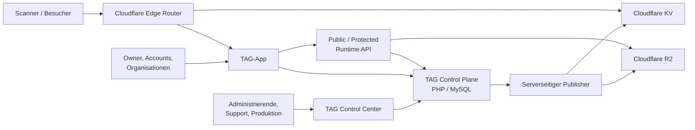

# App- und Komponentenarchitektur der TAG-Plattform

**Status:** Zielarchitektur  
**Stand:** 2026-10-06  
**Ebene:** fachlicher und technischer Systemüberblick

## Zweck

Dieser Architekturstrang beschreibt die Anwendungen, Plattformkomponenten und externen Betriebsdienste der TAG-Plattform. Er beantwortet insbesondere:

- Welche Apps und Komponenten existieren?
- Welche fachliche Rolle übernimmt jede Komponente?
- Wo liegen autoritative Entscheidungen und Daten?
- Wie kommunizieren die Komponenten?
- Welche Schnittstellen sind öffentlich, geschützt oder rein intern?
- Welche Daten und Berechtigungen dürfen eine Komponentengrenze passieren?

Die Darstellung ergänzt, aber ersetzt nicht:

- die [funktionale Prozessarchitektur](../10-Functional-Architecture/README.md);
- die [Datenarchitektur](../30-Data-Architecture/README.md);
- die [Control-Plane-Architektur](../PWA-PHP-Applications/TAG_CONTROL_PLANE_AND_BASIS_VAULT.md);
- die [Domänenregeln](../../DOMAIN_RULES.md).

## Architekturprinzip in einem Satz

> **Die TAG Control Plane auf PHP/MySQL ist die autoritative fachliche Quelle; Cloudflare stellt die minimal abgeleitete, öffentliche Scan- und Runtime-Data-Plane bereit.**

## Dokumente

1. **[Komponenten- und App-Überblick](10-COMPONENTS-AND-APPLICATIONS.md)**  
   Fachliche Rollen, technische Bausteine, Beziehungen, Schnittstellen und Sicherheitsgrenzen.
2. [Funktionale Architektur](../10-Functional-Architecture/10-TAG-PLATFORM-PROCESS-ARCHITECTURE.md)  
   End-to-End-Prozesse für Provisioning, Nutzung, Support und Controlling.
3. [Komponentensicht der Datenarchitektur](../30-Data-Architecture/20-COMPONENT-DATA-ARCHITECTURE.md)  
   Detaillierte Datenverantwortung, Datenverträge und Speicherregeln.
4. [TAG Control Plane und Basis Vault](../PWA-PHP-Applications/TAG_CONTROL_PLANE_AND_BASIS_VAULT.md)  
   Architekturentscheidung PHP/MySQL und Cloudflare.

## App-Landkarte

| App / Komponente | Nutzergruppe | Fachliche Hauptrolle | Technische Heimat |
| --- | --- | --- | --- |
| TAG Control Center (TCC) | Administration, Produktion, QA, Support, Reviewer | administrative Bedienung und fachliche Freigaben | Browser-App, bedient TCP |
| TAG Control Plane (TCP) | TCC, TAG-App, interne Jobs | Autorität für TAGs, Policies, Ownership, Lifecycle, Audit und Publishing | PHP + MySQL bei Dogado |
| TAG-App | Scanner, Besucher, Owner, Accounts | öffentliche TAG-Nutzung, Claim, Owner- und Collection-UX | Cloudflare Pages/PWA |
| Edge Router | Scanner und TAG-App indirekt | kryptografische Scan-Validierung und minimaler Routing-Resolver | Cloudflare Worker |
| Runtime API | TAG-App | PublicTagView und geschützte Runtime-Reads | Edge Worker/API, TCP-/R2-gestützt |
| Publisher | TCP-intern | abgeleitete Routing-/Runtime-Projektionen zuverlässig ausliefern | serverseitiger TCP-Betriebsprozess |
| Cloudflare KV | Edge Router | minimale öffentliche Routing-Projektion | Cloudflare Data Plane |
| Cloudflare R2 | Runtime API | versionierte öffentliche Runtime-Revisionen und Medien; später geschützte Objekte | Cloudflare Data Plane |
| MySQL / Audit / Outbox | TCP | autoritative Fach-, Audit- und Auftragsdaten | Dogado |
| Produktions-/QR-/NFC-Umgebung | Produktion, QA, Partner | kontrollierte physische Umsetzung reservierter TAGs | externe Betriebsumgebung |
