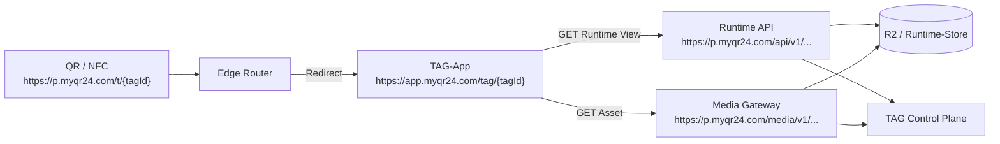

# TAG Edge: Routing- und URL-Vertrag

**Status:** Zielarchitektur; Scan-Routen verbindlich, übrige Pfadfamilien reserviert  
**Stand:** 2026-10-06  
**Geltungsbereich:** Öffentliche Hosts und Pfade für Scan-Auflösung, TAG-App, TAG-Runtime, Medien und zugriffsbezogene TAG-Endpunkte.

## 1. Zweck und verbindliche Leitentscheidung

Die TAG-Plattform verwendet unterschiedliche URL-Rollen für unterschiedliche Aufgaben:

```text
Scan-URL     = physischer QR-/NFC-Einstieg und kryptografische Auflösung
App-URL      = sichtbare HTML-/PWA-Seite für Menschen
API-URL      = maschinenlesbare Runtime-Daten und Commands
Media-URL    = kontrollierte Auslieferung eines zulässigen TAG-Assets
```

Diese Rollen dürfen nicht vermischt werden:

- Die TAG-App wird nie unter `/api/...` ausgeliefert.
- Ein QR-/NFC-Träger verweist auf eine Scan-Route, nicht direkt auf eine API oder einen R2-Key.
- Öffentliche Medien werden nie direkt über einen Bucket- oder frei wählbaren R2-Object-Key ausgeliefert.
- Die Sicherheit einer API ergibt sich aus serverseitiger Authentisierung, Autorisierung, TAG-Status und Visibility — nicht aus den Namen `public` oder `protected` im URL-Pfad.

## 2. Begriffe

| Begriff | Bedeutung |
| --- | --- |
| `tagId` | Öffentliche, kanonische Base36-TAG-ID mit 6 oder 8 Stellen; in URLs kleingeschrieben |
| Scan-Familie | Pfadfamilie, die das Decoder-/Kryptografieprotokoll einer physischen Scan-URL kennzeichnet |
| App-Route | Browserroute, welche die TAG-App als HTML/PWA rendert |
| Runtime-View | Bereinigte Repräsentation eines TAGs, die der aktuelle Zugriff sehen darf |
| Asset | Fachlich verwaltetes Medium, z. B. Bild, Audio oder Dokument; besitzt eine stabile Asset-ID |
| Variante | Für die Auslieferung erzeugte zulässige Asset-Ausprägung, z. B. `cover-1280.webp` |
| Edge Gateway | Worker-Routen auf `s.myqr24.com` bzw. `p.myqr24.com` für Scan, Runtime und Medien |
| Runtime API | serverseitiger Dienst hinter dem Edge Gateway, der Views bzw. Medienzugriffe entscheidet |
| Control Plane (TCP) | PHP/MySQL-Fachautorität für TAGs, Content, Visibility, Sessions, Audit und Publishing |

## 3. Hosts und Umgebungen

### 3.1 Vorgesehene Hosts

| Umgebung | Host | Rolle | Status |
| --- | --- | --- | --- |
| Staging | `s.myqr24.com` | primäres TAG Edge Gateway für die erste Staging-Ausgabe: Scan, Runtime API, Medien | Scan verbindlich; API/Medien reserviert |
| Staging | `app-staging.myqr24.com` | TAG-App / PWA | vorgesehen |
| Production | `p.myqr24.com` | primäres TAG Edge Gateway für die erste Production-Ausgabe: Scan, Runtime API, Medien | Scan verbindlich; API/Medien reserviert |
| Production | `app.myqr24.com` | TAG-App / PWA | vorgesehen |
| Production | `www.myqr24.com` | statische öffentliche Plattforminformation | Worker-Route nur für `/` |
| Staging-Test | `s.qr4.uk` | gleichwertiges Staging Edge Gateway für Scan, Runtime API und Medien | für Tests zulässig; nicht primärer Herstellungsstandard |
| Production-Test | `p.qr4.uk` | gleichwertiges Production Edge Gateway für Scan, Runtime API und Medien | für Tests zulässig; nicht primärer Herstellungsstandard |
| Administration | gesonderter geschützter Admin-Host bzw. Dogado-Bereich | TAG Control Center | nicht Teil dieses öffentlichen Vertrags |

### 3.2 Primäre Herstellung und parallele QR4-Testhosts

Für die erste Umsetzung und Ausgabe physischer TAGs gelten ausschließlich diese Scan-URLs als Herstellungsstandard:

```text
Staging:     https://s.myqr24.com/t/{tagId}
Production:  https://p.myqr24.com/t/{tagId}
```

Die folgenden Hosts sind für Tests und Abnahmen gleichwertig aktivierbar. Sie verwenden dieselben Scan-, Runtime-API- und Medienverträge wie die zugehörige myQR24-Umgebung:

```text
Staging-Test:     https://s.qr4.uk/t/{tagId}
Production-Test:  https://p.qr4.uk/t/{tagId}
```

Die öffentliche `tagId` ist unabhängig vom verwendeten zulässigen Host. Dieselbe Production-TAG-ID kann daher parallel über beide Production-Hosts aufgelöst werden:

```text
https://p.myqr24.com/t/ab12cd
https://p.qr4.uk/t/ab12cd
```

Dies erzeugt keine zweite fachliche TAG-Identität und keine zusätzliche Content-Revision. Bereits hergestellte QR-Codes oder NFC-Payloads bleiben unverändert.

Der Apex `https://qr4.uk/...` wird bis zu einer ausdrücklichen Produkt-, Domain- und Druckentscheidung **nicht** als Scan-, API- oder Medienhost aktiviert. Gleiches gilt für weitere nicht ausdrücklich dokumentierte QR4-Subdomains.

### 3.3 Gleicher Worker-Typ, getrennte Deployments

Die Staging- und Production-Gateways dürfen dieselbe Codebasis verwenden. Sie sind trotzdem vollständig getrennte Deployments:

```text
s.myqr24.com/*
  → myqr24-edge-routing-staging
  → Staging-KV, Staging-R2, Staging-Secrets

p.myqr24.com/*
  → myqr24-edge-routing
  → Production-KV, Production-R2, Production-Secrets
```

Ein Request kann weder durch Pfad noch durch Header, Query-Parameter oder `tagId` von Staging zu Production wechseln. Unterschiedliche Bindings, Tokens, Buckets, Secrets und Worker-Routen stellen die Trennung her.

## 4. Routenlandkarte

### 4.1 Zusammenfassung

| URL-Familie | Beispiel | Verantwortliche Komponente | Zweck | Stufe |
| --- | --- | --- | --- | --- |
| Scan | `https://p.myqr24.com/t/ab12cd` | Edge Router | physischen TAG auflösen | verbindlich |
| Scan v1 | `https://p.myqr24.com/t1/ab12cd` | Edge Router | reservierte Scan-/Decoderfamilie | verbindlich reserviert |
| App | `https://app.myqr24.com/tag/ab12cd` | TAG-App | öffentliche TAG-Seite rendern | App-Grundroute verbindlich |
| App-Feature | `https://app.myqr24.com/tag/ab12cd/claim` | TAG-App | spezifischer Nutzerfluss | reserviert |
| Runtime API | `https://p.myqr24.com/api/v1/tags/ab12cd/view` | Runtime API | aktuell zulässigen TAG-View liefern | reserviert |
| Access API | `https://p.myqr24.com/api/v1/tags/ab12cd/access` | Access/Runtime API | PIN-/Grant-Zugriff prüfen | konzeptionell |
| Asset | `https://p.myqr24.com/media/v1/tags/ab12cd/assets/ast_7f31/cover-1280.webp` | Media Gateway | erlaubte Assetvariante ausliefern | reserviert |
| Owner API | `https://p.myqr24.com/api/v1/owner/tags/ab12cd` | TCP Owner API | Owner-Query bzw. -Command | reserviert |
| Account API | `https://p.myqr24.com/api/v1/account/collection` | TCP Account API | Accountdaten und Collection | reserviert |

### 4.2 Basisdomain-Weiterleitung

Der exakte Root-Pfad `/` jedes zulässigen Scan-Hosts dient als öffentlicher Plattform-Einstieg und wird mit einem temporären Redirect (`302`) auf die Marketing-Startseite geleitet:

```text
https://s.myqr24.com/  → https://www.myqr24.com/
https://s.qr4.uk/      → https://www.myqr24.com/
https://p.myqr24.com/  → https://www.myqr24.com/
https://p.qr4.uk/      → https://www.myqr24.com/
```

Die Weiterleitung gilt ausschließlich für `GET` und `HEAD` auf den Pfad `/`; Query-Parameter werden nicht an das Ziel übertragen. Sie ist kein Fallback für TAG-Auflösungen:

- unbekannte, kryptografisch ungültige, nicht zugewiesene oder gesperrte TAGs unter `/t/{tagId}` bzw. `/t1/{tagId}` bleiben neutral `404`;
- alle weiteren nicht dokumentierten Pfade bleiben `404`;
- Apex `qr4.uk` und nicht erlaubte bzw. umgebungsfremde Hosts bleiben `404`.

Der Production Edge Router verarbeitet diese Weiterleitung selbst. Die vier Scan-Routen bleiben auf `/t/*` und `/t1/*` eingegrenzt; zusätzlich ist ausschließlich `www.myqr24.com/*` an den Production-Worker gebunden. Dort liefert nur `GET` bzw. `HEAD` auf `/` eine statische Informationsseite. Jeder andere `www`-Pfad bleibt `404`.

### 4.3 Route-Grenzen als Diagramm



## 5. Scan-Routen

### 5.1 Verbindliche Pfadfamilien

| Route | Verwendung | Zulässige Methoden | Ergebnis |
| --- | --- | --- | --- |
| `/t/{tagId}` | aktuelle kanonische Scan-Familie | `GET`, `HEAD` | Redirect oder erlaubtes JSON-Aktionsdokument |
| `/t1/{tagId}` | reservierte Scan-Familie für einen künftigen, explizit dokumentierten Decoder-/Secret-Kontext | `GET`, `HEAD` | bis Aktivierung dieselbe Decoderkonfiguration wie `/t/` |

Die vollständigen Validierungs-, Feistel-, HMAC-, Range- und Feature-Regeln stehen verbindlich in [`../../DOMAIN_RULES.md`](../../DOMAIN_RULES.md).

### 5.2 Scan-URL ist nicht gleich App-URL

```text
Scan-URL:
https://p.myqr24.com/t/ab12cd

Ziel-App-URL:
https://app.myqr24.com/tag/ab12cd
```

Ein erfolgreicher Scan kann für ein `tag-vault`-Feature auf die TAG-App weiterleiten. Andere serverseitig valide Features können auf eine andere feste App-Route oder ein erlaubtes Redirect-Ziel führen. Der Worker übernimmt dabei ausschließlich die technische Auflösung und keine Vault-, Owner- oder Visibilityentscheidung.

### 5.3 Keine Längenroute `/8/`

Die Route `/8/{tagId}` wird nicht eingeführt, um achtstellige IDs zu kennzeichnen:

- die ID-Länge ist bereits aus `tagId` eindeutig erkennbar;
- `/t/` akzeptiert gemäß `DOMAIN_RULES.md` sechs- und achtstellige TAG-IDs;
- zusätzliche URL-Formen erschweren QR-/NFC-Kompatibilität, Tests, Analytics und Support.

Eine neue Scanroute wie `/t2/{tagId}` darf ausschließlich eine neue langlebige **Scan-Protokollfamilie** markieren, etwa bei einer neuen kryptografischen Decoder-Version. Sie wird erst nach eigener Spezifikation, Migrationsstrategie und Tests aktiviert.

## 6. TAG-App-Routen

### 6.1 Grundsatz

Die TAG-App ist eine browserseitige HTML-/PWA-Anwendung. Sie erhält eigene, menschenlesbare Deep Links unter `app-staging.myqr24.com` beziehungsweise `app.myqr24.com`.

Sie wird niemals unter `/api/...` ausgeliefert. APIs liefern Daten; App-Routen liefern die PWA-Shell und anschließendes Client-Rendering.

### 6.2 Öffentliche und reservierte App-Pfade

| App-Route | Zweck | Zugriffsmodell | Stufe |
| --- | --- | --- | --- |
| `/` | Startseite, Scan-/Einführungs-UX | öffentlich | aktuell vorhanden |
| `/tag/{tagId}` | öffentliche bzw. neutrale TAG-Ansicht | öffentlich; Runtime entscheidet sichtbaren Inhalt | verbindlich |
| `/tag/{tagId}/claim` | Claim-Einstieg | öffentliches UI, serverseitiger Claim-Check | reserviert |
| `/tag/{tagId}/access` | PIN-/Einladungs-/Grant-Einstieg | öffentliches UI, serverseitige Access-Prüfung | reserviert |
| `/tag/{tagId}/manage` | Owner-Verwaltung eines konkreten TAGs | Owner-/Account-Session erforderlich | reserviert |
| `/tag/{tagId}/guestbook` | Gästebuch-Einstieg | Runtime-/Feature-/Policy-abhängig | reserviert |
| `/tag/{tagId}/check-in` | Check-in-Einstieg | Runtime-/Feature-/Policy-abhängig | reserviert |
| `/account` | Accountbereich | Account-Session erforderlich | reserviert |
| `/collection` | persönliche Collection | Account-Session bzw. lokale Komfortansicht | reserviert |

Die konkrete App-Route eines Features wird durch dessen serverseitig geprüfte Definition festgelegt. Die App darf nicht aus der Kenntnis einer `tagId` selbst ableiten, dass Claim, Gästebuch, Check-in oder Owner-Verwaltung zulässig ist.

### 6.3 Renderingablauf

```text
1. Browser ruft /tag/{tagId} auf.
2. Cloudflare Pages liefert die TAG-App-Shell (SPA-Deep-Link-Fallback).
3. Die TAG-App fordert Runtime-Daten über die Runtime API an.
4. Die Runtime API liefert die für diesen Request erlaubte View oder eine neutrale Nichtverfügbarkeit.
5. Die TAG-App rendert nur den typisierten, serverseitig gefilterten Vertrag.
```

Der aktuelle MVP hat bereits die Route `/tag/{tagId}`. Die im Client verwendeten Fixtures werden später durch den in Abschnitt 7 beschriebenen Runtime-Vertrag ersetzt.

## 7. Runtime-API

### 7.1 API-Prinzip

Die Runtime-API ist **tagzentriert**. Der Pfad benennt das angefragte TAG und die gewünschte Operation. Sichtbarkeit, Schutzbedarf und Rückgabeumfang werden vollständig serverseitig entschieden.

Es werden daher nicht zwei parallele fachliche Bäume `/api/public/...` und `/api/protected/...` als Sicherheitsmodell eingeführt.

Nicht empfohlen:

```text
/api/public/tags/{tagId}
/api/protected/tags/{tagId}
```

Empfohlen:

```text
/api/v1/tags/{tagId}/view
/api/v1/tags/{tagId}/access
/api/v1/tags/{tagId}/assets/{assetId}/download
```

Der gleiche fachliche Endpunkt kann — abhängig von TAG-Status und nachgewiesenem Zugriff — eine öffentliche, geschützte oder neutrale Repräsentation liefern. Der Server legt Antworten für geschützte bzw. personenbezogene Kontexte immer mit `Cache-Control: no-store` aus.

### 7.2 Reservierte Runtime-Endpunkte

| Methode | Route | Zweck | Ohne Session | Mit zulässiger Access-/Owner-Session |
| --- | --- | --- | --- | --- |
| `GET` | `/api/v1/tags/{tagId}/view` | aktuelle zulässige TAG-View abrufen | öffentlicher View oder neutrale Nichtverfügbarkeit | ggf. zusätzlich erlaubte Sichtbarkeit; `no-store` |
| `POST` | `/api/v1/tags/{tagId}/access` | PIN, Einladungs- oder Grant-Zugang prüfen | verarbeitet Zugangseingabe; rate-limited | kann Session/Grant aktualisieren |
| `GET` | `/api/v1/tags/{tagId}/assets/{assetId}/download` | Downloadentscheidung für ein Asset treffen | nur wenn Asset öffentlich downloadbar ist | geschützt möglich nach Prüfung |
| `GET` | `/api/v1/tags/{tagId}/features` | nur falls benötigt: erlaubte Runtime-Aktionen lesen | nur serverseitig gefilterte Actions | ggf. mehr erlaubte Actions |
| `POST` | `/api/v1/tags/{tagId}/report` | Missbrauchs-, POI- oder Inhaltsmeldung abgeben | rate-limited, datensparsam | kontextbezogen |

Die Endpunkte sind reserviert. Vor einer produktiven Implementierung müssen Request-/Response-Schema, Fehlerformat, Rate Limits, CORS, Session-Modell und Auditwirkung separat verbindlich festgelegt werden.

### 7.3 Warum `view` statt nur `/api/v1/tags/{tagId}`

`/view` macht den Zweck eindeutig: Es wird keine vollständige interne TAG-Ressource geliefert, sondern eine bereinigte Darstellung für die Runtime. Das verhindert eine spätere Verwechslung mit Verwaltungs- oder Owner-DTOs.

Die Rückgabe ist ein versionierter `PublicTagView` beziehungsweise ein entsprechender geschützter, serverseitig gefilterter View-Vertrag. Sie enthält nie interne TAG-/Datenbank-IDs, Owner-, Account-, Session-, Credential-, Audit-, Pool- oder Bestelldaten.

### 7.4 Neutrales Fehlerverhalten

Öffentlich darf nicht unterscheidbar sein, ob ein TAG unbekannt, gesperrt, abgelaufen, nicht veröffentlicht oder für den aktuellen Zugriff nicht freigegeben ist.

| Situation | Öffentliche Wirkung |
| --- | --- |
| ungültige `tagId` | neutrale Nichtverfügbarkeit |
| nicht vorhandenes TAG | neutrale Nichtverfügbarkeit |
| nicht veröffentlichter Entwurf | neutrale Nichtverfügbarkeit |
| gesperrtes oder abgelaufenes TAG | neutrale Nichtverfügbarkeit |
| geschütztes TAG ohne Zugang | neutraler Access-Einstieg oder neutrale Nichtverfügbarkeit gemäß Produktpolicy |
| interner Runtime-Fehler | neutrale, korrelierte Fehlerantwort ohne Fachdetail |

## 8. Medienrouten

### 8.1 Öffentlicher logischer Medienpfad

```text
GET /media/v1/tags/{tagId}/assets/{assetId}/{variant}
```

Beispiel:

```text
https://p.myqr24.com/media/v1/tags/ab12cd/assets/ast_7f31/cover-1280.webp
```

| Segment | Bedeutung | Regel |
| --- | --- | --- |
| `/media/v1` | Version der öffentlichen Medienroute | keine Ableitung eines internen Storage-Schemas |
| `{tagId}` | TAG-Kontext | kanonische Base36-ID |
| `{assetId}` | fachlich stabile Asset-ID | serverseitig zu TAG und aktueller zulässiger Revision validieren |
| `{variant}` | erlaubte Auslieferungsvariante | serverseitig allowlisten; kein frei wählbarer Object-Key |

### 8.2 Worker-Auflösung auf R2

Der Media Gateway leitet eine öffentliche URL nie direkt und transparent auf einen Bucket-Key weiter. Er prüft vor einer Antwort mindestens:

1. `tagId`, `assetId` und `variant` entsprechen dem Pfadformat.
2. Das TAG ist im aktuellen Kontext verfügbar.
3. Das Asset ist in der zulässigen Runtime-View für dieses TAG referenziert.
4. Die Variante ist für das Asset und den Request erlaubt.
5. Öffentliches oder geschütztes Zugriffsmodell wurde serverseitig erfüllt.
6. Der interne R2-Key wird ausschließlich serverseitig aus der veröffentlichten Asset-Projektion ermittelt.

```text
Öffentliche URL:
https://p.myqr24.com/media/v1/tags/ab12cd/assets/ast_7f31/cover-1280.webp

möglicher interner R2-Key:
public-media/v1/assets/ast_7f31/sha256-9c0d.../cover-1280.webp
```

Der R2-Key ist kein Browservertrag und darf sich durch Storage-, Hash-, Medienpipeline- oder Migrationentscheidungen ändern.

### 8.3 Visibility ohne getrennten Pfad

Ein `/media/public/...`- und `/media/private/...`-Baum wird nicht verwendet. Sichtbarkeit ist eine Eigenschaft des TAG-/Asset-/Grant-Zustands und keine vom Client vertrauenswürdig erklärbare URL-Eigenschaft.

| Assetzustand | Media-Gateway-Verhalten |
| --- | --- |
| öffentlich und in Runtime-View referenziert | mit kontrollierter Cache-Policy ausliefern |
| öffentlich, aber nicht mehr referenziert | nicht ausliefern |
| privat, ohne erlaubte Session | neutrale Nichtverfügbarkeit |
| privat, mit zulässiger Session/Grant | ausliefern, `Cache-Control: no-store` bzw. streng begrenzte Cache-Policy |
| gesperrtes/archiviertes TAG | nicht ausliefern |
| Asset widerrufen oder in Quarantäne | nicht ausliefern |

### 8.4 Revisionen und stabile Asset-URLs

Eine neue TAG-Revision ändert nicht automatisch sämtliche Medien-URLs:

```text
Runtime revision 41: Text A + asset ast_7f31
Runtime revision 42: Text B + asset ast_7f31
```

Das Asset bleibt fachlich unverändert und dieselbe logische Medien-URL kann bestehen bleiben.

Nur wenn ein Medium ersetzt oder eine neue Assetversion notwendig wird, referenziert die neue Runtime-Revision ein neues Asset oder eine neue zulässige Assetversion:

```text
Runtime revision 41: asset ast_7f31
Runtime revision 42: asset ast_9d12
```

Dadurch bleiben Text-/Layout-Publikationen klein, Medienobjekte immutable und Cache-Invalidierungen auf tatsächlich veränderte Assets beschränkt.

Die konkrete Antwortstrategie für eine bereits bekannte Asset-URL nach Replacement — Weiterleitung auf die neue Variante oder neutrale Nichtverfügbarkeit — ist abhängig von Produkt-, Privacy- und Retentionpolicy und wird im späteren Medienvertrag festgelegt.

## 9. Owner- und Account-APIs

### 9.1 Separate Command-Namensräume

Owner- und Accountoperationen verwenden klar getrennte API-Namensräume. Sie sind keine öffentlichen Runtime-Views und benötigen immer serverseitig geprüfte Sessions.

```text
/api/v1/owner/tags/{tagId}
/api/v1/owner/tags/{tagId}/publish
/api/v1/owner/tags/{tagId}/assets
/api/v1/account/collection
```

| Präfix | Zweck | Mindestschutz |
| --- | --- | --- |
| `/api/v1/owner/...` | TAG-gebundene Owner-Queries und Commands | Owner-/Account-Session, TAG-Scope, CSRF bei Cookie-Session, Lifecycle-/Policy-Prüfung |
| `/api/v1/account/...` | kontobezogene Funktionen, z. B. Collection | Account-Session, Scope, `Cache-Control: no-store` |
| `/api/v1/admin/...` | nicht öffentliches TCC-/Operations-Backend, falls unter diesem Host betrieben | Admin-Session, RBAC, Audit; bevorzugt separater Admin-Host |

Owner- und Accountendpunkte sind keine Abkürzung zur direkten Änderung von R2, KV oder Datenbank. Jeder Command durchläuft TCP-Policy, Transaktion, Audit und gegebenenfalls Outbox-Publishing.

### 9.2 Claim- und Access-Eingaben

Secrets wie Claim-Secret, Owner-Passphrase und Besucher-PIN werden nur in unmittelbaren HTTPS-Requests an den fachlich zuständigen TCP-Service übermittelt. Sie erscheinen niemals:

- in URL-Pfaden oder Query-Parametern;
- in R2-Keys oder KV-Dokumenten;
- in Browser Storage, Exporten oder QR-Code-Payloads;
- in unredigierten Logs oder Auditpayloads.

## 10. HTTP-, Cache- und CORS-Grundregeln

### 10.1 Methoden

| Routenfamilie | Zulässige Methoden |
| --- | --- |
| Plattform-Root `/` auf erlaubtem Scan-Host | `GET`, `HEAD`; `302` nach `https://www.myqr24.com/` |
| Plattforminformation `www.myqr24.com/` | `GET`, `HEAD`; statisches HTML, nur Production |
| Scan `/t`, `/t1` | `GET`, `HEAD` |
| Runtime View | zunächst `GET` |
| Medien | `GET`, `HEAD`; Range-Requests nur nach expliziter Medien-Spezifikation |
| Access/Claim/Owner/Account Commands | jeweils explizit dokumentierte Methoden, üblicherweise `POST`, `PATCH`, `DELETE` |
| unbekannte oder nicht erlaubte Methoden | `405 Method Not Allowed` oder neutraler Fehler entsprechend Sicherheitsmodell |

### 10.2 Caching

| Antwortklasse | Cache-Regel |
| --- | --- |
| statische TAG-App-Shell und versionierte Bundles | cachebar |
| öffentliche, unveränderliche Assetvariante | kontrolliert cachebar; Cache-Invalidierung/Widerruf bleibt möglich |
| aktuelle Runtime-View | kurze TTL oder serverseitig invalidierbar |
| View mit geschütztem, persönlichem oder sessionspezifischem Inhalt | `Cache-Control: no-store` |
| Owner-, Account-, Claim- und Access-Antworten | `Cache-Control: no-store` |
| Plattform-Root-Redirect | `302`; keine Query-Parameter zum Marketing-Ziel übernehmen |
| statische Plattforminformation | öffentlich cachebar; aktuell `max-age=300`, `s-maxage=3600` |
| nicht verfügbar, gesperrt oder Fehler | keine Cache-Antwort, die späteren Statuswechsel verdeckt |

### 10.3 CORS

- Die TAG-App darf nur aus den umgebungszugehörigen App-Origins auf Runtime-/Owner-/Account-APIs zugreifen.
- Staging und Production verwenden getrennte explizite Origin-Allowlisten.
- Credentialed Requests erhalten niemals `Access-Control-Allow-Origin: *`.
- Die konkrete CORS-Matrix wird vor Implementierung je Endpoint festgelegt.
- Medien werden entweder ohne CORS-Credentials als öffentliche Ressourcen geladen oder folgen bei geschützten Abrufen der expliziten Runtime-/Sessionpolicy.

## 11. Pfadreservierung und Evolution

### 11.1 Reservierte Root-Segmente

| Root-Segment | Eigentümer | Andere Verwendung verboten |
| --- | --- | --- |
| `/t` | Edge Scan Router | keine App-/API-/Medienroute |
| `/t1` | Edge Scan Router | keine App-/API-/Medienroute |
| `/api` | versionierte Runtime-/Command-APIs | keine PWA-Shell |
| `/media` | kontrolliertes Media Gateway | keine frei erreichbare Bucket-Spiegelung |
| `/tag` | TAG-App | keine API-/Storage-Bedeutung |

### 11.2 Versionierung

- API- und Medienverträge beginnen mit einer Major-Version: `/api/v1/...`, `/media/v1/...`.
- Scanfamilien verwenden ihre eigene, ausdrücklich dokumentierte Versionierung durch `/t`, `/t1`, später ggf. `/t2`.
- Die App-Route `/tag/{tagId}` bleibt ohne technische Version; Änderungen werden über rückwärtskompatible App-/Runtime-Verträge gesteuert.
- Eine neue Major-Version wird parallel eingeführt. Bestehende QR-/NFC-Träger und App-Deep-Links werden nie stillschweigend umgeschrieben.

### 11.3 Nicht erlaubte Muster

```text
/r2/{freier-object-key}
/media/{freier-bucket}/{freier-object-key}
/api/public/... als alleinige Sicherheitsgrenze
/api/protected/... als alleinige Sicherheitsgrenze
/tag/{tagId}?ownerId=...
/tag/{tagId}?r2Key=...
/t/{tagId}/weiterer/pfad
/8/{tagId} nur zur Kennzeichnung der ID-Länge
```

## 12. Implementierungsreihenfolge

1. Bestehende Scan-Routen `/t/{tagId}` und `/t1/{tagId}` unverändert testen und betreiben.
2. TAG-App auf stabile Custom Domain mit `/tag/{tagId}` überführen.
3. `GET /api/v1/tags/{tagId}/view` mit versioniertem Runtime-View-Vertrag implementieren und den Fixture-Adapter ersetzen.
4. `/media/v1/tags/{tagId}/assets/{assetId}/{variant}` für öffentliche, veröffentlichte Medien implementieren.
5. Erst danach PIN-/Grant-, Owner-, Account- und geschützte Medienzugriffe mit separaten Session-/Access-Spezifikationen einführen.
6. Neue Scanfamilien nur bei tatsächlicher Änderung des Scanprotokolls und nach dokumentierter Migrationsstrategie aktivieren.

## 13. Akzeptanzkriterien

1. Jede physische TAG-URL verwendet ausschließlich `/t/{tagId}` oder die bewusst freigegebene Scan-Familie `/t1/{tagId}`.
2. Eine TAG-App-Seite ist stets eine App-Route unter `/tag/{tagId}`, niemals eine API-Route.
3. Runtime-Daten werden tagzentriert über `/api/v1/tags/{tagId}/...` abgefragt.
4. Sichtbarkeit und Zugriff werden serverseitig entschieden; URL-Namen wie `public` oder `protected` sind keine Berechtigungsgrenze.
5. Medien werden über `/media/v1/...` ausgeliefert und nie über frei konstruierbare R2-Keys.
6. Neue Content-Revisionen ändern ausschließlich tatsächlich veränderte Assetreferenzen, nicht zwangsläufig sämtliche Medien-URLs.
7. Staging und Production haben getrennte Worker-Deployments, Bindings, Secrets, R2-Buckets und Origin-Allowlisten.
8. Öffentliche Antworten legen keine Owner-, Credential-, Session-, Audit-, Pool- oder Entwurfsdaten offen.
9. Geschützte und personenbezogene Antworten verwenden `Cache-Control: no-store`.
10. Jede spätere Pfaderweiterung wird vor Implementierung in diesem Architekturstrang mit Status und Kompatibilitätswirkung dokumentiert.

## 14. Referenzen

- [TAG Edge APIs und URL-Verträge – Übersicht](README.md)
- [Domain-, TAG- und Routing-Regeln](../../DOMAIN_RULES.md)
- [Cloudflare DNS- und TLS-Konfiguration](../../10-Architecture/CLOUDFLARE_DNS_AND_TLS_CONFIGURATION.md)
- [TAG-App-Architektur](../../10-Architecture/TAG_APP_ARCHITECTURE.md)
- [TAG Control Plane und Basis Vault](../../10-Architecture/PWA-PHP-Applications/TAG_CONTROL_PLANE_AND_BASIS_VAULT.md)
- [Komponentensicht der Datenarchitektur](../../10-Architecture/30-Data-Architecture/20-COMPONENT-DATA-ARCHITECTURE.md)
- [Komponenten- und App-Überblick](../../10-Architecture/31-App-Architecture/10-COMPONENTS-AND-APPLICATIONS.md)
